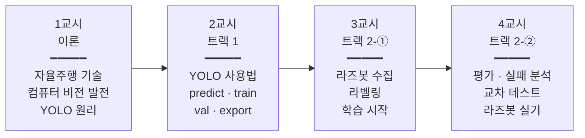
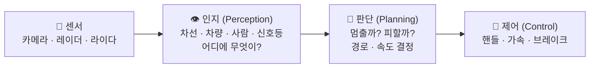
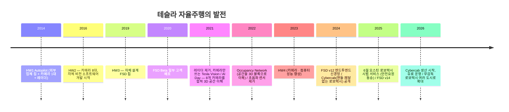
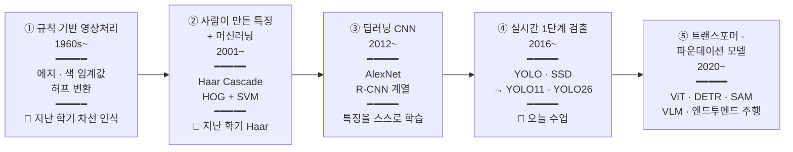
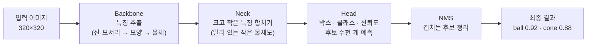
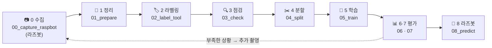
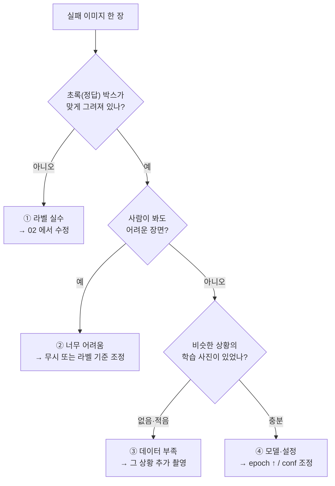
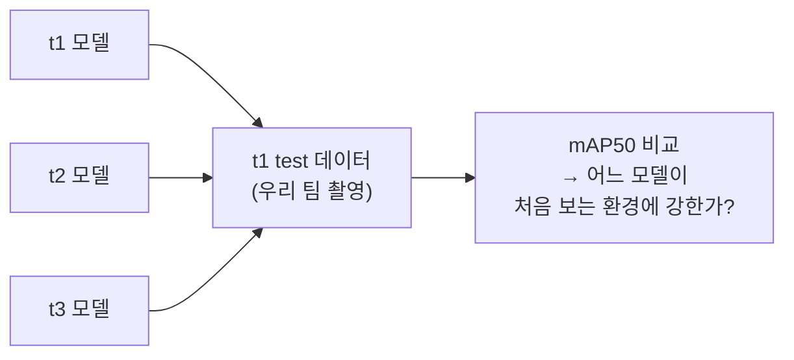

# 컴퓨터 비전과 YOLO11 입문 — 라즈봇으로 나만의 첫 객체 인식 모델 만들기 (4시간)

> **대상**: YOLO·딥러닝을 처음 접하는 대학생 (지난 학기에 OpenCV 차선 인식과 Haar Cascade 를 실습한 학생)
> **장비**: Raspbot V2 (Raspberry Pi + 카메라), 팀별 노트북, **팀마다 똑같은 간단한 소품 세트** (예: 블록 · 미니 라바콘 · 공)
> **형태**: 1교시 이론 → **트랙 1** (YOLO 기본 사용법) → **트랙 2** (라즈봇 수집 → 라벨링 → 학습 → 테스트)
> **오늘의 결과물**: 우리 팀이 라즈봇으로 직접 찍고 라벨링한 데이터로 만든 `best.pt`, 검증 리포트, 팀 교차 테스트 점수표, 라즈봇 실시간 인식 영상
>
> 이 수업은 **모델을 만들고 테스트하는 데서 끝납니다.** 실제 주행에 쓰는 신호등·장애물 학습과 주행 연결은 **다음 수업**에서 같은 방법으로 진행합니다.

---

## 목차

- [0. 수업 한눈에 보기](#0-수업-한눈에-보기)
- [1교시 — 이론: 자율주행과 컴퓨터 비전, 그리고 YOLO](#1교시--이론-자율주행과-컴퓨터-비전-그리고-yolo)
- [2교시 — 트랙 1: YOLO 기본 사용법](#2교시--트랙-1-yolo-기본-사용법)
- [3교시 — 트랙 2-①: 라즈봇으로 수집하고 라벨링하기](#3교시--트랙-2-라즈봇으로-수집하고-라벨링하기)
- [4교시 — 트랙 2-②: 학습 결과 평가와 테스트](#4교시--트랙-2-학습-결과-평가와-테스트)
- [마무리 (10분) — 퀴즈 · 회고 · 다음 수업 예고](#마무리-10분--퀴즈--회고--다음-수업-예고)
- [부록 A. 강사용 사전 준비 체크리스트](#부록-a-강사용-사전-준비-체크리스트)
- [부록 B. 명령어 치트시트](#부록-b-명령어-치트시트)
- [부록 C. 트러블슈팅](#부록-c-트러블슈팅)
- [부록 D. 용어 사전](#부록-d-용어-사전)
- [부록 E. 정답 · 평가 기준](#부록-e-정답--평가-기준)
- [부록 F. 참고 자료](#부록-f-참고-자료)

---

## 0. 수업 한눈에 보기

### 0-1. 학습 목표

**이론**
1. SAE 자율주행 레벨과 **인지 → 판단 → 제어** 구조를 설명하고, 테슬라(카메라 중심)와 웨이모(라이다 포함)의 접근 차이를 비교할 수 있다.
2. 컴퓨터 비전의 **발전 5단계**를 설명하고, 지난 학기에 쓴 Haar Cascade 대신 **YOLO 를 쓰는 이유**를 실험 결과로 말할 수 있다.
3. YOLO 가 한 번의 추론으로 **박스 · 클래스 · 신뢰도**를 내는 원리와 **전이학습**을 설명할 수 있다.

**실습**
4. (트랙 1) Ultralytics YOLO11 의 4가지 기본 동작 **predict · train · val · export** 를 Python 코드로 실행할 수 있다.
5. (트랙 2) 라즈봇 카메라로 데이터를 수집하고, 라벨링 → 학습 → 검증 → 테스트를 거쳐 **자기 팀 모델**을 만들 수 있다.
6. Precision · Recall · mAP 로 모델을 평가하고, **다른 팀 데이터로 교차 테스트**해 일반화 성능을 비교할 수 있다.

### 0-2. 시간표



| 교시 | 시간 | 내용 | 어디서 |
|---|---|---|---|
| **1교시** | 0:00 ~ 0:50 | **이론** — 자율주행 기술(테슬라·로보택시·미래) / 컴퓨터 비전 발전 단계와 Haar → YOLO / YOLO 원리 | 강의 |
| 휴식 | 0:50 ~ 1:00 | | |
| **2교시** | 1:00 ~ 1:50 | **트랙 1** — YOLO 기본 사용법 (사전학습 모델 추론, 결과 다루기, 미니 학습) | PC |
| 휴식 | 1:50 ~ 2:00 | | |
| **3교시** | 2:00 ~ 2:50 | **트랙 2-①** — 라즈봇 수집 → 정리 → 라벨링 → 점검·분할 → **학습 시작** | 라즈봇 → PC |
| 휴식 | 2:50 ~ 3:00 | (학습은 휴식 시간에도 계속 진행) | |
| **4교시** | 3:00 ~ 3:50 | **트랙 2-②** — 결과 읽기 → 검증·테스트 → 팀 교차 테스트 → 라즈봇 실기 | PC → 라즈봇 |
| 마무리 | 3:50 ~ 4:00 | 퀴즈 · 회고 · 다음 수업 예고 | |

### 0-3. 오늘 인식할 대상 — 팀마다 똑같은 소품 세트

| ID | 클래스 | 예시 소품 |
|:---:|---|---|
| 0 | `cube` | 블록 / 큐브 |
| 1 | `cone` | 미니 라바콘 |
| 2 | `ball` | 공 |

- 모든 팀이 **같은 소품 · 같은 클래스 순서**를 씁니다. 그래야 4교시에 **다른 팀의 모델로 우리 데이터를 채점**(교차 테스트)할 수 있습니다.
- 클래스 목록은 [`config.simple.yaml`](../config.simple.yaml) 에 있습니다. 실제로 나눠 줄 소품에 맞게 강사가 **수업 전에** 이름을 정합니다 (수업 중 변경 금지).
- 신호등·표지판·장애물 차량(`config.yaml` 의 5클래스)은 **다음 수업**에서 다룹니다. 오늘 데이터는 `simple/` 폴더에만 저장되어 섞이지 않습니다.

### 0-4. 작업 폴더와 설정 파일 규칙

모든 PC 명령은 **`05_yolo11_pipeline/` 폴더에서** 실행하고, 트랙 2 의 파이프라인 명령에는 **`--config config.simple.yaml`** 을 붙입니다.

```bash
cd ~/Documents/GitHub/Raspbot-v2-self-driving-car/05_yolo11_pipeline
```

```bash
source .venv/bin/activate
```

> Windows 는 `.venv\Scripts\activate`. 설치는 [README 4장](../README.md#4-설치) 참고 — **수업 전에 끝내 두세요** (부록 A).

| 폴더 (`simple/` 아래) | 내용 |
|---|---|
| `raw/` | 라즈봇에서 가져온 원본 사진 |
| `labeled/images`, `labeled/labels` | 라벨링 작업 폴더 |
| `dataset/` | train / val / test 분할 + `data.yaml` |
| `runs/` | 학습·검증·추론 결과 그래프 |
| `reports/` | 점검·검증·테스트 리포트 |
| `models/best.pt` | 최종 모델 |

### 0-5. 팀 역할

| 역할 | 하는 일 |
|---|---|
| 🎮 **운전자** | 라즈봇 SSH 접속, `00_capture_raspbot.py` 실행, 로봇 위치·방향 이동 |
| 🎬 **연출자** | 소품 배치, 거리·각도·조명·배경 바꾸기 |
| 📝 **기록자** | 촬영 계획표 작성, 세션 이름 관리, 교차 테스트 점수 기록 |

2명 팀이면 연출자와 기록자를 한 명이 맡습니다. 라벨링은 **모두가** 나눠서 합니다.

---

## 1교시 — 이론: 자율주행과 컴퓨터 비전, 그리고 YOLO

| 시간 | 내용 |
|---|---|
| 0:00 ~ 0:20 | **Part A** 자율주행 기술은 지금 어디까지 왔나 — 테슬라 · 로보택시 · 앞으로 |
| 0:20 ~ 0:38 | **Part B** 컴퓨터 비전의 발전 단계 — 왜 Haar Cascade 에서 YOLO 로 바꾸나 |
| 0:38 ~ 0:50 | **Part C** YOLO 는 어떻게 한 번에 찾을까 |

> 📅 Part A 의 현황 수치는 **2026년 11월 기준 보도**를 정리한 것입니다. 이 분야는 매달 바뀌므로 수업 직전에 [부록 F](#부록-f-참고-자료) 링크로 최신 숫자를 확인하세요.

### Part A. 자율주행 기술은 지금 어디까지 왔나 (20분)

#### A-1. 자율주행 레벨 (SAE J3016) (3분)

| 레벨 | 이름 | 운전 주체 | 예시 |
|:---:|---|---|---|
| 0 | 자동화 없음 | 사람 | 경고음만 |
| 1 | 운전자 보조 | 사람 (+ 조향 **또는** 속도 보조) | 적응형 크루즈 컨트롤 |
| 2 | 부분 자동화 | 사람이 **항상 감시** (조향 **과** 속도 보조) | 테슬라 FSD (Supervised), 대부분의 고속도로 주행 보조 |
| 3 | 조건부 자동화 | 시스템 (조건 안에서), 요청 시 사람이 개입 | 일부 고급차의 고속도로 정체 구간 자율주행 |
| 4 | 고도 자동화 | 시스템 (정해진 지역·조건 안에서 사람 불필요) | **로보택시** — 웨이모, 테슬라 무감독 로보택시, 서울 심야 자율주행택시(시범) |
| 5 | 완전 자동화 | 시스템 (모든 곳, 모든 조건) | 아직 없음 |

> 💡 **레벨 2 와 4 의 결정적 차이**: 사고가 났을 때 **누가 운전하고 있었는가**(책임 주체). 기술보다 법·보험·규제가 함께 바뀌어야 하는 이유입니다.

#### A-2. 자율주행차의 뇌 구조 — 인지 · 판단 · 제어 (3분)



| 단계 | 실제 자율주행차 | 우리 라즈봇 |
|---|---|---|
| 센서 | 카메라 8~13대, 레이더, 라이다 | 카메라 1대 |
| **인지** | 신경망이 차량·보행자·신호등·차선 검출 | 지난 학기: OpenCV 차선 + Haar → **오늘: YOLO11** |
| 판단 | 경로 계획, 행동 예측 | 상태 머신(FSM): 빨간불이면 정지 … (다음 수업) |
| 제어 | 조향·가감속 제어기 | I2C → 모터 · 서보 |

> **오늘 수업은 "인지" 를 만드는 시간**입니다. 라즈봇은 카메라만으로 주행하는, 아주 작은 테슬라라고 생각하면 됩니다.

#### A-3. 두 진영 — "카메라만" vs "라이다까지" (4분)

| 구분 | 🟥 테슬라 (비전 중심) | 🟦 웨이모 (멀티 센서) |
|---|---|---|
| 센서 | **카메라만** (2021년 레이더, 2022년 초음파 센서 제거) | 카메라 + **라이다** + 레이더 |
| 지도 | 정밀 지도에 크게 의존하지 않음 | **고정밀(HD) 지도** + 운행 지역 사전 매핑 |
| 철학 | "사람도 눈으로 운전한다" → 카메라 + 신경망으로 해결 | 센서를 겹쳐 써서 한 센서가 실패해도 안전하게 |
| 장점 | 센서 가격이 싸고, 판매된 차량 수백만 대에서 **데이터 수집** | 거리 측정이 정확, 야간·악천후에 강함 |
| 단점 | 거리를 영상에서 **추정**해야 함, 악천후·역광에 약할 수 있음 | 차량 1대 비용이 높고, 새 도시마다 지도 작업 필요 |
| 확장 방식 | 소프트웨어 업데이트로 여러 도시 동시 확장 시도 | 도시별로 검증 후 하나씩 확장 |

> 🤔 **토론 (1분)**: 우리 라즈봇은 어느 쪽인가요? → **카메라만** 쓰는 테슬라 방식. 그래서 **카메라 영상을 얼마나 잘 이해하느냐(컴퓨터 비전)** 가 전부입니다.

#### A-4. 테슬라를 기준으로 본 발전 과정 (5분)



**핵심 변화: "규칙을 사람이 짠다" → "신경망이 영상에서 바로 배운다"**

```
 [ FSD v11 까지 ]                               [ FSD v12 이후 — 엔드투엔드 ]
 카메라 → 신경망(인지: 차·차선·신호등 검출)        카메라 영상
        → 사람이 짠 수십만 줄 규칙 코드(판단)          ↓
        → 제어                                    하나의 큰 신경망 (수백만 시간의 주행 영상으로 학습)
                                                       ↓
                                                  핸들 · 가속 · 브레이크
```

- 기존 방식은 "빨간불이면 정지, 노란불이면 …" 같은 규칙을 사람이 계속 추가해야 했습니다.
- 엔드투엔드 방식은 사람 운전 영상을 대량으로 학습해 **판단까지 신경망이 합니다.** 데이터가 많을수록 좋아지므로 **수백만 대 차량에서 영상을 모으는 테슬라의 강점**이 커집니다.
- 하지만 "왜 그렇게 판단했는지" 설명하기 어렵다는 과제가 남습니다.

> 🔗 **우리 수업과의 연결**: 오늘은 **인지(객체 검출)만** 신경망으로 만들고, 판단은 다음 수업에서 사람이 규칙(FSM)으로 짭니다 — 테슬라 FSD v11 까지의 구조와 같습니다.

#### A-5. 로보택시 현황 — 2026년 11월 (3분)

| 서비스 | 지역 | 현황 (보도 기준) |
|---|---|---|
| **테슬라 Robotaxi** | 미국 텍사스(오스틴·댈러스·휴스턴·포트워스·샌안토니오), 플로리다(마이애미·올랜도·탬파) | 2025년 6월 오스틴 시범 → 2026년 11월 8개 도시 무감독 운행 보도. Cybercab 2026년 생산 시작, 9월 오스틴 유료 운행, 11월 일반 주문 시작 (약 3만 달러) |
| **웨이모 (구글 계열)** | 피닉스·샌프란시스코·LA·오스틴 등 미국 10개 도시 | 2026년 3월 **주 50만 건** 유료 운행 (2024년 5월 대비 약 10배), 2026년 말 주 100만 건 목표, 런던·도쿄 진출 예정 |
| **서울 심야 자율주행택시** | 강남 시범운행지구 | 2024년 9월 시작, 2026년 4월 **유료 전환**, 평일 22시~05시, 카카오T 호출 |
| 그 밖에 | 중국(바이두 Apollo Go 등), 미국(Zoox 등) | 여러 도시에서 운행 중. 반면 GM Cruise 는 2023년 사고 이후 로보택시 사업을 접음 |

> ⚠ 차량 수·도시 수는 출처마다 다릅니다. 숫자보다 **추세**(시범 → 유료 → 무감독 → 여러 도시)를 이해하세요.
> 그리고 GM Cruise 사례처럼 **안전 사고 한 번이 사업 전체를 멈출 수 있다**는 점도 함께 기억하세요.

#### A-6. 앞으로 어떻게 발전할까 (2분)

| 방향 | 내용 |
|---|---|
| **엔드투엔드 + VLA** | 영상(Vision)·언어(Language)·행동(Action)을 한 모델이 다룸. "공사 중이니 우회하세요" 같은 표지판 문장까지 이해 |
| **월드 모델 · 시뮬레이션** | 실제로 겪기 어려운 위험 상황을 AI 가 만든 가상 영상으로 학습·검증 |
| **비용 하락** | 전용 차량(Cybercab 등)과 센서 가격 하락 → 택시 요금 경쟁력 |
| **지역 확대** | 미국 → 유럽·일본·한국. 도시마다 규제·도로 문화가 달라 현지 데이터가 필요 |
| **규제 · 책임 · 신뢰** | 사고 책임, 안전 데이터 공개, 원격 관제 기준이 기술만큼 중요 |
| **다른 로봇으로 확장** | 같은 비전 기술이 배송 로봇·트럭·휴머노이드로 확장 |

> 공통점: **모든 방향의 출발점은 "카메라 영상을 정확히 이해하는 것" — 컴퓨터 비전**입니다. 이제 그 발전 과정을 봅니다.

### Part B. 컴퓨터 비전의 발전 단계 — 왜 Haar Cascade 에서 YOLO 로 바꾸나 (18분)

#### B-1. 발전 5단계 (8분)



| 단계 | 핵심 아이디어 | 대표 기술 | 한계 |
|---|---|---|---|
| **① 규칙 기반** | 사람이 **규칙**을 직접 짠다 ("흰색이고 직선이면 차선") | Canny 에지(1986), 허프 변환, HSV 색 임계값 | 조명·그림자가 바뀌면 규칙이 깨짐 |
| **② 사람이 만든 특징 + ML** | 사람이 **특징**(밝기 차이, 기울기 방향)을 정하고, 기계가 **판단 기준**을 학습 | Viola-Jones **Haar Cascade**(2001, 얼굴 검출), HOG+SVM(2005, 보행자) | 특징을 사람이 설계 → 각도·조명·색 변화에 약함 |
| **③ 딥러닝 CNN** | **특징까지 데이터에서 스스로 학습** | AlexNet(2012, ImageNet 대회 오류율을 크게 낮춤), R-CNN·Faster R-CNN(2014~15) | 정확하지만 후보 영역을 따로 찾는 2단계 구조라 느림 |
| **④ 실시간 1단계 검출** | 이미지를 **한 번만 보고** 위치와 종류를 동시에 예측 | **YOLO**(2016), SSD(2016) → YOLO 계보 → **YOLO11**(2024) → YOLO26(2026) | 작은 객체, 많은 데이터 필요 |
| **⑤ 트랜스포머 · 파운데이션** | 거대한 데이터로 미리 학습한 범용 모델, 언어와 결합 | ViT·DETR(2020), CLIP(2021), SAM(2023), 문장으로 찾는 YOLO-World(2024) | 무겁다 → 라즈베리파이에는 아직 부담 |

> 🔑 **한 줄 요약**: 사람이 정하던 것이 **규칙 → 특징 → (아무것도 안 정하고) 데이터** 순서로 기계에게 넘어갔습니다.
> 그래서 지금은 **"어떤 데이터를 보여 주느냐"** 가 개발자의 핵심 일입니다.

#### B-2. 지난 학기 Haar Cascade 복습 (3분)

```
  Haar 특징: 밝은 영역과 어두운 영역의 밝기 차이
 ┌────┬────┐      ┌───┬───┬───┐
 │ ░░ │ ██ │      │░░ │██ │░░ │      특징값 = (흰 영역 밝기 합) − (검은 영역 밝기 합)
 └────┴────┘      └───┴───┴───┘
  → 수천 개 특징을 단계별(Cascade)로 검사: 앞 단계에서 대부분의 배경을 빠르게 버림 → CPU 에서도 빠름
```

지난 학기에 겪은 불편함을 떠올려 봅시다.

- O 표지판용 `cascade.xml`, X 표지판용 … **클래스마다 모델을 따로** 학습해야 했다.
- **흑백**으로만 보기 때문에 **빨간불과 초록불을 구분할 수 없다** → 색 필터 코드를 따로 붙였다.
- 표지판이 조금만 **기울어져도** 못 찾았다.
- `scaleFactor`, `minNeighbors` 같은 값을 손으로 계속 조절해야 했다.

#### B-3. 같은 데이터로 직접 비교한 실험 결과 (5분)

> 실험: [`tools/haar_vs_yolo_experiment.py`](../tools/haar_vs_yolo_experiment.py) — 지난 학기 `04_cascade/park_data_example` 의 **실제 라즈봇 카메라 사진**(O 표지판·X 표지판)과 그때 학습한 `cascade.xml` 을 그대로 사용.
> YOLO11n 은 같은 사진 92장으로 40 epoch 학습, test 40장(O 12개, X 27개)에 일부러 화질을 망가뜨린 버전까지 비교했습니다.

| 테스트 조건 | Haar: O 재현율 | Haar: X 를 O 로 착각 | YOLO11: O·X 재현율 | YOLO11: 클래스 혼동 |
|---|---|---|---|---|
| 원본 | 83% | 7% | **100%** | 0건 |
| 어둡게 | 83% | 7% | **100%** | 0건 |
| **25° 회전** | **0%** 😱 | 7% | **100%** | 0건 |
| 흐리게 | 100% | **22%** | **100%** | 0건 |
| 작게 | 100% | 0% | **100%** | 0건 |
| 1장 처리 시간 (PC CPU) | **약 4.7 ms** ⚡ | | 약 15.5 ms | |

(재현율 = 실제 O 중에서 찾아낸 비율. 수치는 `demo/haar_vs_yolo/results.json`)

> ⚠ 공정하게 보기: test 사진이 40장으로 적고, Haar 는 test 의 O 사진까지 포함해 학습된 **Haar 에 유리한 조건**이었습니다. 그런데도 회전·흐림에서 차이가 컸습니다.
> 반대로 **속도는 Haar 가 약 3배 빠릅니다.** 공짜는 없습니다.

**정리 — 그래서 YOLO 로 바꾼다**

| 항목 | Haar Cascade | YOLO11 |
|---|---|---|
| 클래스 | 모델 1개 = 클래스 1개 | **모델 1개로 여러 클래스** |
| 출력 | 위치만 | **위치 + 클래스 + 신뢰도** |
| 색 | 사용 안 함 (흑백) | **사용** (빨간불·초록불 구분) |
| 각도·조명·흐림 | 약함 | **강함** (데이터·증강으로 보완) |
| 학습 데이터 | 양성·음성 이미지 수천 장 | 클래스당 수십~수백 장 + **전이학습** |
| 속도 (라즈베리파이) | **빠름** | 느린 편 → 작은 모델(`n`), 입력 320, NCNN 변환으로 보완 |

#### 왜 YOLO11 인가? (YOLO 계보)

```
 2016 v1 → 2017 v2 → 2018 v3 → 2020 v4 · v5 → 2022 v6 · v7 → 2023 v8 → 2024 v9 · v10 · YOLO11 → 2025 YOLO12 → 2026 YOLO26 (· YOLO27 발표만, 미공개)
 (워싱턴대 Redmon)                    (여러 연구팀·회사가 이어서 발전, v5·v8·YOLO11·YOLO26 은 Ultralytics)
```

- 오늘은 **YOLO11** 을 씁니다. 이 저장소의 학습 파이프라인과 라즈봇 주행 코드가 YOLO11 로 **검증되어 있기** 때문입니다.
- 2026년 1월 나온 **YOLO26** 은 NMS 없이 끝까지 한 번에 계산하는 구조로 CPU·엣지 기기에서 더 빠르다고 발표되었습니다. 사용법(Ultralytics API)은 **같아서** 모델 파일 이름만 바꾸면 됩니다 (`yolo26n.pt`, Ultralytics 8.4 이상).

  | 가장 작은 모델 (n) | 정확도 COCO mAP50-95 | CPU 추론 시간 (ONNX, Intel Xeon) |
  |---|---|---|
  | YOLO11n | 39.5 | 56.1 ms |
  | **YOLO26n** | **40.9** | **38.9 ms** (Ultralytics 발표: 최대 43% 빠름) |

  - 정확도는 모든 크기(n~x)에서 YOLO26 이 YOLO11 보다 높습니다 (+1.4 ~ +2.8).
  - 단, 큰 모델(m·l·x)은 CPU 에서 YOLO11 이 조금 더 빠르고, GPU(T4 TensorRT)에서는 비슷합니다.
  - 위 시간은 서버 CPU 기준입니다. 라즈베리파이에서는 훨씬 느리므로 **직접 FPS 를 재 보고** 고릅니다.
- **YOLO27** 은 2026년 9월 YOLO Vision 2026 에서 발표되었지만, 아직 가중치·코드가 공개되지 않은 **미리보기** 단계입니다 (2026년 11월 기준). 공개된 모델 중 최신·최고는 YOLO26 입니다.
- 👉 **도구는 계속 바뀌지만, 오늘 배우는 과정(수집 → 라벨링 → 학습 → 평가)은 그대로입니다.**

### Part C. YOLO 는 어떻게 한 번에 찾을까 (12분)

#### C-1. 컴퓨터 비전의 세 가지 질문 (2분)

```
  분류 (Classification)        검출 (Detection)              분할 (Segmentation)
  "이 사진은 무엇?"             "무엇이 어디에?"               "어느 픽셀이 무엇?"
  ┌─────────────┐              ┌─────────────┐               ┌─────────────┐
  │    ⚽       │              │ ┌──┐        │               │  ▓▓         │
  │             │              │ │⚽│ ball .92 │               │  ▓▓         │
  │             │              │ └──┘   ┌───┐│               │        ░░░░ │
  │             │              │        │ ▲ ││               │        ░░░░ │
  └─────────────┘              └────────┴───┴┘               └─────────────┘
  → "공"                       → 박스 2개 + 이름 + 확신도       → 픽셀 단위 색칠
```

오늘 하는 것은 **검출(Detection)**. 객체마다 **바운딩 박스 · 클래스 · 신뢰도(0~1)** 를 출력합니다.

#### C-2. 구조 — Backbone · Neck · Head · NMS (5분)



- **Backbone**: 사진을 "선 → 모서리 → 원 → 공 모양" 순서로 점점 복잡한 특징으로 바꿉니다.
- **Head**: 이미지 곳곳에서 "여기에 무언가 있다면 박스는 이렇고, 무엇일 확률은 이렇다" 를 **한꺼번에** 예측합니다. (Haar 처럼 창을 옮겨 가며 수천 번 검사하지 않음)
- **NMS**: 같은 물체에 겹친 박스 여러 개 중 **가장 확신 높은 하나만** 남깁니다.

```
  NMS 전                         NMS 후
  ┌──────┐                       ┌──────┐
  │┌─────┼┐  ball 0.92           │      │  ball 0.92  ← 하나만 남김
  ││ ⚽  ││  ball 0.85           │  ⚽  │
  │└─────┼┘  ball 0.61           │      │
  └──────┘                       └──────┘
```

#### C-3. 모델 크기와 전이학습 (5분)

| 모델 | 파라미터 | 속도 | 오늘 |
|---|---|---|---|
| `yolo11n` (nano) | 약 260만 | 가장 빠름 | ✅ **라즈베리파이용** |
| `yolo11s` (small) | 약 900만 | 빠름 | 성능이 부족할 때 |
| `yolo11m / l / x` | 2천만~ | 느림 | GPU 서버용 |

> 🧑‍🎓 **전이학습 비유**: 자전거를 탈 줄 아는 사람은 오토바이를 훨씬 빨리 배웁니다.

- `yolo11n.pt` 는 **COCO 데이터셋**(사진 약 12만 장, 사람·자동차·신호등 등 80종)으로 **이미 학습된** 모델입니다.
- 선·모서리·원·색 같은 **일반적인 시각 특징**은 이미 알고 있으므로, Head 만 우리 클래스 3개에 맞게 바꾸고 **조금 더 학습(미세조정)** 합니다.
- 그래서 **클래스당 수십~수백 장**만으로도 쓸 만한 모델이 나옵니다.

### ✅ 1교시 통과 점검

- [ ] 레벨 2 와 레벨 4 의 차이를 "책임 주체" 로 설명할 수 있다
- [ ] 테슬라와 웨이모의 센서 전략 차이를 한 문장씩 말할 수 있다
- [ ] 컴퓨터 비전 5단계에서 지난 학기 차선 인식 · Haar · 오늘 YOLO 의 위치를 짚을 수 있다
- [ ] Haar 대신 YOLO 를 쓰는 이유 2가지와, YOLO 의 단점 1가지를 말할 수 있다

---

## 2교시 — 트랙 1: YOLO 기본 사용법

> 목표: YOLO 를 **도구로 다루는 법**을 익힙니다. 라즈봇 없이 PC 만으로 진행합니다.

| 시간 | 활동 |
|---|---|
| 1:00 ~ 1:05 | YOLO 사용법 = **4개의 동사** (predict · train · val · export) |
| 1:05 ~ 1:20 | **실습 ①** predict — 사전학습 모델로 사진 추론, 결과 꺼내 쓰기 |
| 1:20 ~ 1:28 | **실습 ②** conf · imgsz 바꿔 보기 |
| 1:28 ~ 1:35 | **실습 ③** 웹캠 실시간 추론 — 사전학습 모델의 한계 관찰 |
| 1:35 ~ 1:50 | **실습 ④** 라벨 포맷 이해 + 가상 데이터로 미니 학습 (train → val → predict) |

### 2-1. YOLO 사용법 = 4개의 동사 (5분)

```python
from ultralytics import YOLO

model = YOLO("yolo11n.pt")            # 모델 불러오기 (.pt = 학습된 가중치 파일)

model.predict(...)                    # ① 추론: 사진/영상에서 객체 찾기
model.train(data="data.yaml", ...)    # ② 학습: 내 데이터로 가르치기
model.val()                           # ③ 검증: 성적(mAP) 매기기
model.export(format="onnx")           # ④ 변환: 라즈베리파이 등 다른 기기용으로 바꾸기
```

| 동사 | 입력 | 출력 | 오늘 어디서 |
|---|---|---|---|
| `predict` | 사진 · 영상 · 카메라 | 박스 · 클래스 · 신뢰도 | 2교시, 4교시 라즈봇 |
| `train` | `data.yaml` (사진 + 라벨 위치) | `best.pt` | 2교시 미니 학습, 3교시 |
| `val` | 학습된 모델 + 정답 데이터 | P · R · mAP | 2교시, 4교시 |
| `export` | `best.pt` | `.onnx`, NCNN 등 | (참고) 라즈봇 속도 향상 |

> 트랙 2 에서 쓰는 `scripts/0X_*.py` 파이프라인도 내부에서는 **이 4개 동사**를 호출합니다. 스크립트는 설정 관리·리포트·합격 판정을 덧붙인 것일 뿐입니다.

### 2-2. 실습 ① predict — 사진 한 장 추론 (15분)

실습 코드는 `practice/` 폴더에 만듭니다.

```bash
mkdir -p practice
```

**① 설치 확인**

```bash
python -c "import ultralytics, torch, cv2; print('ultralytics', ultralytics.__version__, '| torch', torch.__version__, '| CUDA', torch.cuda.is_available())"
```

**② `practice/t1_predict.py`** — Ultralytics 에 들어 있는 예제 사진(`bus.jpg`)으로 추론

```python
from ultralytics import YOLO
from ultralytics.utils import ASSETS          # Ultralytics 에 포함된 예제 사진 폴더

model = YOLO("yolo11n.pt")                    # COCO 80종으로 학습된 모델
print("이 모델이 아는 클래스 수:", len(model.names))

results = model.predict(str(ASSETS / "bus.jpg"), conf=0.5, imgsz=640)
r = results[0]                                # 사진 1장 → 결과 1개

print("찾은 객체 수:", len(r.boxes))
for box in r.boxes:
    cls_id = int(box.cls[0])                  # 클래스 번호
    conf = float(box.conf[0])                 # 신뢰도 (0~1)
    x1, y1, x2, y2 = [int(v) for v in box.xyxy[0].tolist()]   # 박스 좌표 (픽셀)
    print(f"  {model.names[cls_id]:10s} {conf:.2f}  ({x1},{y1}) ~ ({x2},{y2})")

print("처리 시간(ms):", r.speed)              # 전처리 / 추론 / 후처리
r.save(filename="practice/bus_result.jpg")    # 박스를 그린 사진 저장
```

```bash
python practice/t1_predict.py
```

`practice/bus_result.jpg` 를 열어 봅니다.

**결과 객체 `r.boxes` 에서 꺼낼 수 있는 것**

| 속성 | 의미 | 예시 |
|---|---|---|
| `box.cls` | 클래스 번호 | `0` → `model.names[0]` = `person` |
| `box.conf` | 신뢰도 | `0.89` |
| `box.xyxy` | 좌상단·우하단 픽셀 좌표 | `(48, 398, 245, 902)` |
| `box.xywhn` | **중심 x, y, 너비, 높이 (0~1 비율)** | YOLO 라벨 포맷과 같은 형식 (2-5 에서 다룸) |
| `r.plot()` | 박스를 그린 이미지 (OpenCV 배열) | 화면 표시·영상 저장에 사용 |

> ✏️ **도전**: `person` 이 몇 명인지 세어 출력하도록 코드를 고쳐 보세요. (힌트: `model.names[int(box.cls[0])] == "person"`)
> 이것이 다음 수업에서 "빨간불이 보이면 정지" 를 만드는 방법과 똑같습니다.

### 2-3. 실습 ② conf · imgsz 바꿔 보기 (8분)

`t1_predict.py` 의 `conf`, `imgsz` 값을 바꿔 가며 실행하고 표를 채웁니다.

| conf | imgsz | 찾은 객체 수 | 추론 시간(ms) | 관찰 |
|---|---|---|---|---|
| 0.25 | 640 | | | |
| 0.5 | 640 | | | |
| 0.8 | 640 | | | |
| 0.5 | 320 | | | |
| 0.5 | 160 | | | |

| 값 | 올리면 | 내리면 |
|---|---|---|
| **conf** (신뢰도 기준) | 확실한 것만 → 헛짚음 ↓, **놓침 ↑** | 많이 찾음 → 놓침 ↓, **헛짚음 ↑** |
| **imgsz** (입력 크기) | 작은 물체도 잘 찾음, **느려짐** | **빨라짐**, 작은 물체를 놓침 |

> 라즈봇은 계산이 느리므로 보통 **imgsz 320, conf 0.5** 로 씁니다. 트랙 2 도 이 값으로 학습·테스트합니다.

### 2-4. 실습 ③ 웹캠 실시간 추론 — 사전학습 모델의 한계 (7분)

**`practice/t1_webcam.py`**

```python
import cv2
from ultralytics import YOLO

model = YOLO("yolo11n.pt")
cap = cv2.VideoCapture(0)                     # 노트북 웹캠

while True:
    ok, frame = cap.read()
    if not ok:
        break
    r = model.predict(frame, conf=0.5, imgsz=320, verbose=False)[0]
    cv2.imshow("YOLO11 (q: quit)", r.plot())  # 박스가 그려진 화면
    if cv2.waitKey(1) & 0xFF == ord("q"):
        break

cap.release()
cv2.destroyAllWindows()
```

```bash
python practice/t1_webcam.py
```

웹캠에 다음을 비춰 보고 관찰 노트에 적습니다.

| 비춰 볼 것 | 예상 | 실제 결과 |
|---|---|---|
| 내 얼굴, 휴대폰, 컵 | `person`, `cell phone`, `cup` | |
| 오늘 받은 공 | `sports ball` ? | |
| 오늘 받은 블록, 라바콘 | ? | |

> 💡 **생각해 보기**: COCO 모델은 80종만 압니다. 우리 블록이나 라바콘은 모르거나 엉뚱한 이름으로 부릅니다.
> → 그래서 **우리 데이터로 다시 가르쳐야** 합니다. 이것이 트랙 2 의 이유입니다.

### 2-5. 실습 ④ 라벨 포맷 + 미니 학습 (15분)

#### ① YOLO 라벨 포맷 (5분)

학습하려면 사진마다 "정답" 이 필요합니다. 이미지 1장당 **같은 이름의 `.txt` 1개**, 한 줄 = 객체 1개.

```
<class_id> <x_center> <y_center> <width> <height>
```

- 모든 값은 이미지 가로·세로로 나눈 **0~1 비율** (정규화). `x_center, y_center` 는 박스의 **중심**.

```
  (0,0) ─────────────── x ──────────────▶ (640)
    │        x1=300  x2=340
    │   y1=100 ┌───┐
    │          │ ● │ ← 중심 (320, 120)
    │   y2=140 └───┘
    y
    ▼ (480)

  xc = (300+340)/2 / 640 = 0.500       w = (340-300) / 640 = 0.0625
  yc = (100+140)/2 / 480 = 0.250       h = (140-100) / 480 = 0.0833

  → ball(2) 이므로:  2 0.500000 0.250000 0.062500 0.083333
```

- **왜 비율로?** 사진 크기를 바꿔도 라벨을 고칠 필요가 없습니다.
- **빈 txt** = "사람이 봤는데 객체가 없다" (배경, 학습에 사용) / **txt 없음** = "아직 안 봤다" (학습에서 자동 제외)

#### ② 가상 데이터로 미니 학습 (10분)

도형으로 만든 가상 사진 240장과 라벨을 자동 생성해 **train → val → predict** 를 한 번 돌려 봅니다.

```bash
python tools/make_demo_dataset.py
```

```bash
python scripts/04_split_dataset.py --config config.demo.yaml
```

**`practice/t1_train.py`**

```python
from ultralytics import YOLO

model = YOLO("yolo11n.pt")                        # 전이학습 출발점

# ② train — data.yaml 에 사진·라벨 위치와 클래스 이름이 적혀 있음
model.train(data="demo/dataset/data.yaml", epochs=5, imgsz=320, batch=16,
            project="practice/runs", name="mini", exist_ok=True)

# ③ val — 학습된 모델 성적 매기기
metrics = model.val()
print(f"mAP50 = {metrics.box.map50:.3f}   mAP50-95 = {metrics.box.map:.3f}")

# ① predict — 가장 좋았던 가중치로 test 사진 추론
best = YOLO(model.trainer.best)                   # .../weights/best.pt
print("best.pt 위치:", model.trainer.best)
best.predict("demo/dataset/images/test", conf=0.5, imgsz=320, save=True)
```

```bash
python practice/t1_train.py
```

> ⏱ CPU 에서 1~3분. 기다리는 동안 학습 로그를 함께 읽습니다.

```
      Epoch    GPU_mem   box_loss   cls_loss   dfl_loss  Instances       Size
        3/5         0G      1.213      2.104      1.087         18        320
                 Class     Images  Instances      Box(P          R      mAP50  mAP50-95)
                   all         47         68      0.612      0.534      0.571      0.342
```

| 항목 | 의미 | 기대 |
|---|---|---|
| `box_loss` | 박스 위치 오차 | epoch 가 갈수록 ↓ |
| `cls_loss` | 클래스 맞히기 오차 | ↓ |
| `P`, `R`, `mAP50` | val 데이터 성적 (4교시에 자세히) | ↑ |

> ✏️ **관찰**: `epochs=5` 를 `epochs=15` 로 바꾸면 mAP50 이 어떻게 변할까요? (시간이 남는 팀만)

> ④ **export** 는 한 줄입니다: `best.export(format="onnx", imgsz=320)` — 라즈베리파이에서 더 빠르게 돌리기 위한 변환. 오늘은 참고만 합니다.

### ✅ 2교시 통과 점검

- [ ] `t1_predict.py` 로 객체 이름·신뢰도·좌표를 출력했다
- [ ] conf 와 imgsz 를 올리고 내릴 때 결과가 어떻게 바뀌는지 말할 수 있다
- [ ] 미니 학습으로 `best.pt` 가 생기고 mAP50 을 출력했다
- [ ] "사전학습 모델이 우리 소품을 잘 못 알아보는 이유" 를 말할 수 있다

---

## 3교시 — 트랙 2-①: 라즈봇으로 수집하고 라벨링하기

> 이제부터 **같은 일을 우리 데이터로** 합니다. 명령이 길어지는 부분은 이 저장소의 파이프라인 스크립트가 대신 해 줍니다.



| 시간 | 활동 |
|---|---|
| 2:00 ~ 2:05 | 좋은 데이터의 조건, 세션과 데이터 누수 |
| 2:05 ~ 2:22 | **라즈봇 촬영 미션** (세션 10개, 250장 목표) |
| 2:22 ~ 2:27 | PC 로 가져와서 정리 (`01_prepare_images.py`) |
| 2:27 ~ 2:44 | **팀 라벨링** |
| 2:44 ~ 2:50 | 점검 → 분할 → **학습 시작** (휴식 시간 동안 학습) |

### 3-1. 좋은 데이터의 조건과 세션 (5분)

> **같은 장면 1,000장보다 다른 조건 300장이 낫다.**

| 다양성 축 | 반드시 섞을 것 |
|---|---|
| **거리** | 가까이(크게) / 중간 / 멀리(작게) |
| **각도** | 정면 / 비스듬히 / 소품을 돌려서 |
| **조명** | 밝게 / 어둡게 / 역광 |
| **배경** | 트랙 여러 곳, 책상, 바닥 |
| **혼합 · 가림** | 한 장에 소품 2~3개, 서로 조금 겹치게 |
| **배경만** | 소품이 **하나도 없는** 사진 (전체의 5~15%) → 헛짚음 감소 |

**왜 라즈봇 카메라로?** 모델이 나중에 보게 될 화면이 **라즈봇 카메라의 화질·화각·색감**이기 때문입니다.

**세션과 데이터 누수**

```
 세션 "t1-ball-near"  (같은 장소에서 0.5초마다 연속 촬영)
 ┌───┐┌───┐┌───┐┌───┐┌───┐
 │⚽ ││⚽ ││ ⚽││ ⚽││⚽ │   ← 거의 똑같다
 └───┘└───┘└───┘└───┘└───┘
   ↓ 일부는 train, 일부는 test 에 들어가면?
   → 시험 문제를 미리 보고 시험 보는 것과 같음 → 점수가 거짓으로 높게 나옴 (데이터 누수)
```

- 사진은 `~/captures/<세션이름>/000001.jpg` 로 저장되고, **세션(폴더) 단위로** train / val / test 가 나뉩니다.
- **촬영 조건을 바꿀 때마다 세션 이름을 바꿉니다.** 세션이 **10개 이상**이어야 세션 단위 분할이 켜집니다.
- 세션 이름: 영문·숫자·`-` 만, **팀 번호를 앞에** (`t1-...`). `_` 는 쓰지 않습니다 (자동으로 `-` 로 바뀜).

### 3-2. 라즈봇 촬영 미션 (17분) 🎬

**① 라즈봇 접속과 카메라 확인**

```bash
ssh pi@<라즈봇IP>
```

```bash
ls /dev/video*
```

> ⚠ 자율주행 자동 실행 서비스나 다른 프로그램이 카메라를 쓰고 있으면 열리지 않습니다 → [docs/서비스_빠른_제어.md](../../docs/서비스_빠른_제어.md)

**② 수집 스크립트 위치로 이동** — [`scripts/00_capture_raspbot.py`](../scripts/00_capture_raspbot.py) (라즈봇에 저장소가 `~/Raspbot-v2-self-driving-car` 로 있다고 가정)

```bash
cd ~/Raspbot-v2-self-driving-car/05_yolo11_pipeline
```

| 옵션 | 기본값 | 의미 |
|---|---|---|
| `--session` | (필수) | 세션 이름 → `~/captures/<세션>/` |
| `--interval` | 0.5 | 자동 저장 간격(초). `0` 이면 끔 (`--show` 와 함께 `s` 키로 수동 저장) |
| `--max` | 40 | 이번 실행에서 저장할 최대 장수 |
| `--width` / `--height` | 640 / 480 | 촬영 해상도 (주행 코드 320×240 과 같은 4:3 비율, 라벨링할 때 잘 보임) |
| `--tilt` | (없음) | 카메라 상하 각도 (서보2, 0~110) |
| `--show` | 끔 | 화면 미리보기 (모니터/VNC 필요) |

**③ 테스트 촬영** — 5장만 찍어 보기

```bash
python3 scripts/00_capture_raspbot.py --session t1-test --max 5
```

**④ 촬영 계획표대로 촬영 — 세션 10개 이상, 목표 250장**

0.5초마다 자동 저장되므로 **촬영 중에 로봇이나 소품을 천천히 움직이세요.** 가만히 두면 정리 단계에서 "중복" 으로 지워집니다.

| ✔ | 세션 이름 | 대상 | 거리 | 조건 | 장수 |
|---|---|---|---|---|---|
| ☐ | `t1-cube-near` | cube | 가까이 | 소품을 돌려 가며 | 25 |
| ☐ | `t1-cube-far` | cube | 멀리 | 로봇이 천천히 다가가며 | 25 |
| ☐ | `t1-cone-near` | cone | 가까이 | 비스듬히 | 25 |
| ☐ | `t1-cone-far` | cone | 멀리 | | 25 |
| ☐ | `t1-ball-near` | ball | 가까이 | 공을 굴려 가며 | 25 |
| ☐ | `t1-ball-far` | ball | 멀리 | | 25 |
| ☐ | `t1-mix-a` | 3종 함께 | 중간 | 한 장에 여러 개 | 25 |
| ☐ | `t1-mix-b` | 3종 함께 | 혼합 | **서로 조금 겹치게** | 25 |
| ☐ | `t1-dark` | 3종 | 혼합 | **조명 일부 끔** | 20 |
| ☐ | `t1-other` | 3종 | 혼합 | **다른 배경** (책상·바닥) | 20 |
| ☐ | `t1-bg` | 없음 | - | **소품 없는 사진** | 20 |

```bash
python3 scripts/00_capture_raspbot.py --session t1-cube-near --max 25
```

```bash
python3 scripts/00_capture_raspbot.py --session t1-cube-far --max 25
```

(세션 이름과 장수만 바꿔 가며 반복)

> ⚖️ **클래스 균형**: 세 소품이 비슷한 장수로 찍히게 하세요. 한쪽이 적으면 모델이 한쪽으로 치우칩니다.

> 🙋 **강사 팁**: 촬영 10분 시점에 각 팀의 `ls ~/captures` 를 확인해 세션 수와 클래스 균형을 점검합니다.

### 3-3. PC 로 가져와서 정리 (5분)

**① 라즈봇 → PC 복사** (PC 의 `05_yolo11_pipeline/` 에서)

```bash
mkdir -p simple/raw
```

```bash
scp -r pi@<라즈봇IP>:~/captures simple/raw/
```

→ `simple/raw/captures/t1-cube-near/000001.jpg ...` 구조로 들어옵니다. (`t1-test` 폴더는 지웁니다)

**② 1단계 — 정리**

```bash
python scripts/01_prepare_images.py --config config.simple.yaml
```

| 처리 | 설명 |
|---|---|
| 이름 바꾸기 | `captures/t1-cube-near/000001.jpg` → `simple/labeled/images/t1-cube-near_000001.jpg` (`_` 앞 = 그룹) |
| 크기 필터 | 긴 변 1280px 초과는 축소, 160px 미만 제외 |
| **중복 제거** | 거의 같은 사진 제외 (로봇이 멈춘 채 찍힌 연속 사진) |

```
  저장: 231 장 | 중복 제외: 38 | 작은 이미지 제외: 0 | 손상: 0
```

### 3-4. 팀 라벨링 (17분) 🏷️

**라벨링 규칙 5가지** (자세한 규칙: [01_라벨링_가이드.md](01_라벨링_가이드.md))

1. **타이트하게** — 박스는 소품 가장자리에 딱 맞게.
2. **빠짐없이** — 사진 속 해당 소품은 **전부**. 하나라도 빠뜨리면 모델은 "저건 배경" 이라고 배웁니다.
3. **가려진 소품** — 반 이상 보이면 **보이는 부분만** 박스, 그 이하면 생략.
4. **너무 작거나 흐린 것** — 사람이 봐도 구분이 안 되면 생략.
5. **팀 안에서 같은 기준** — 라바콘 받침을 포함할지 등 애매한 것은 시작 전에 정합니다.

```
  좋은 예 (타이트)        나쁜 예 (여백 과다)        나쁜 예 (잘림)
  ┌──────┐               ┌──────────────┐           ┌────┐
  │ ███  │               │              │           │ ███│█
  │ ███  │               │   █████      │           │ ███│
  └──────┘               │    ███       │           └────┘
                         └──────────────┘
```

**라벨링 도구**

```bash
python scripts/02_label_tool.py --config config.simple.yaml
```

| 입력 | 동작 |
|---|---|
| `0` / `1` / `2` | 클래스 선택 (0 cube · 1 cone · 2 ball) |
| 왼쪽 드래그 | 박스 그리기 |
| 박스 클릭 → 숫자키 | 그 박스의 클래스 변경 |
| 오른쪽 클릭 | 박스 삭제 |
| `u` / `c` | 마지막 박스 취소 / 전체 지우기 |
| `d` 또는 `Space` | **저장 후 다음** (박스 0개면 빈 txt = 배경) |
| `a` / `f` | 이전 이미지 / 라벨 안 한 다음 이미지 |
| `q` / `ESC` | 저장 후 종료 |

**권장 손동작**: `숫자키 → 드래그 → (틀리면 우클릭) → d`. 라벨링 도구는 **화면이 있는 PC** 에서 실행합니다.

**나눠서 하고 합치기** — 세션 폴더를 팀원 수만큼 나눠 각자 PC 의 `simple/raw/` 에 넣고 `01` → `02` 를 실행한 뒤, 학습 담당 PC 로 모읍니다 (예: 받은 폴더 `~/Downloads/B_labeled/`).

```bash
cp -n ~/Downloads/B_labeled/images/* simple/labeled/images/
```

```bash
cp -n ~/Downloads/B_labeled/labels/* simple/labeled/labels/
```

> 시간이 모자라면 다 못 한 사진은 그대로 두세요. **txt 가 없는 사진은 자동으로 학습에서 빠집니다.**
> 목표: 라벨 완료 **150장 이상**, 클래스마다 박스 **40개 이상**.

> 🙋 **강사 팁**: 라벨링 5분 시점에 각 팀 사진 2~3장을 화면에 띄워 박스 기준을 반 전체에서 통일합니다 (교차 테스트를 공정하게 만들기 위해).

### 3-5. 점검 → 분할 → 학습 시작 (6분)

**① 3단계 — 라벨 점검**

```bash
python scripts/03_check_labels.py --config config.simple.yaml
```

| 확인 | 어디서 | 기준 |
|---|---|---|
| ERROR | 콘솔 / `simple/reports/label_check.md` | **0 건** (좌표가 살짝 벗어난 박스는 `--fix`) |
| 클래스 분포 | 콘솔 막대 | 너무 적은 클래스 메모 |
| 미리보기 | `simple/reports/label_preview/` | 박스 위치·클래스 이름 **눈으로** 확인 |

> 수업에서는 "클래스당 100개 이상 권장" 경고(WARN)가 나와도 정상입니다. 기록만 하고 진행합니다.

**② 4단계 — train / val / test 분할**

```bash
python scripts/04_split_dataset.py --config config.simple.yaml
```

| 묶음 | 비율 | 역할 | 비유 |
|---|---|---|---|
| **train** | 70% | 보고 배우는 데이터 | 문제집 |
| **val** | 20% | 학습 중 매 epoch 성적 확인, `best.pt` 선택 | 모의고사 |
| **test** | 10% | 모든 결정이 끝난 뒤 **딱 한 번** | 수능 |

출력의 `분할 방식:` 줄이 `그룹(동영상/세션) 단위` 인지 확인합니다. `⚠ val 에 없는 클래스` 경고가 나오면 `--no-group` 을 붙여 다시 분할합니다.

**③ 5단계 — 학습 시작!** (설정: `yolo11n.pt` 에서 전이학습, imgsz 320, 30 epoch — `config.simple.yaml`)

```bash
python scripts/05_train.py --config config.simple.yaml --name t1
```

> ⏱ 이미지 150~250장 기준 대략 노트북 CPU 10~20분, Colab GPU 2~5분 (사양에 따라 다름).
> 휴식 시간 동안 **노트북을 덮지 말고 전원을 연결**해 두세요.

### ✅ 3교시 통과 점검

- [ ] 세션 10개 이상 촬영, 정리 후 200장 이상
- [ ] 라벨 완료 150장 이상, **ERROR 0**, 미리보기 확인
- [ ] val · test 에 세 클래스가 모두 있음 (`simple/dataset/split_summary.md`)
- [ ] 학습이 돌아가고 있고 loss 가 줄어드는 중

> 🆘 **Plan B** — 라벨 데이터가 100장 미만이거나 학습이 시작되지 않는 팀은 강사가 준비한 **반 공용 소품 데이터셋**(부록 A)으로 학습해 4교시를 진행합니다.

---

## 4교시 — 트랙 2-②: 학습 결과 평가와 테스트

| 시간 | 활동 |
|---|---|
| 3:00 ~ 3:07 | 학습 결과 그래프 읽기 |
| 3:07 ~ 3:17 | 평가 지표 → `06_validate.py` 합격 판정 |
| 3:17 ~ 3:25 | `07_test.py` 실패 이미지 원인 분석 |
| 3:25 ~ 3:37 | **팀 교차 테스트** — 다른 팀 모델로 우리 데이터 채점 |
| 3:37 ~ 3:50 | **라즈봇 실기** — 카메라 실시간 인식 · FPS |

> 학습이 아직 안 끝났다면 2교시 미니 학습 결과(`t1_train.py` 가 출력한 `best.pt` 위치의 상위 폴더)로 3:00~3:07 을 진행하고, 끝나는 대로 우리 결과로 돌아옵니다.

### 4-1. 학습 결과 읽기 (7분)

결과는 `simple/runs/train/t1/` 에, 가장 좋은 모델은 `simple/models/best.pt` 로 자동 복사됩니다.

| 파일 | 무엇을 보나 |
|---|---|
| `results.png` | loss 곡선과 mAP 곡선 |
| `confusion_matrix_normalized.png` | 어떤 클래스끼리 헷갈리는지 |
| `val_batch0_labels.jpg` vs `val_batch0_pred.jpg` | 정답 vs 예측 비교 |

```
  ① 정상                    ② 과적합 (Overfitting)        ③ 덜 배움 (Underfitting)
  loss                      loss                          loss
   │╲                        │╲   val ╱                    │╲
   │ ╲__ train               │ ╲___╱                       │ ╲______  (높은 채로 평평)
   │  ╲___ val               │  ╲___ train                 │   ╲_____
   └────── epoch             └────── epoch                 └────── epoch
  → 좋음                    → 데이터 추가 / 증강            → epoch ↑ / 데이터·라벨 점검
                              (문제집만 외운 상태)
```

**혼동행렬 읽기** (열 = 정답, 행 = 예측)

```
                 정답 →  cube   cone   ball   background
  예측 ↓  cube           0.92    .     0.06     0.08
          cone            .     0.95    .       0.04
          ball           0.05    .     0.90     0.06
          background     0.03   0.05   0.04      -
```

- **대각선**이 진할수록 좋음.
- `ball` 열의 `cube` 칸 0.06 → 공을 블록으로 착각.
- `background` 행 = **놓친** 비율(미탐), `background` 열 = 없는데 **있다고 한** 비율(오탐).

### 4-2. 평가 지표와 합격 판정 (10분)

**① IoU** — 예측 박스와 정답 박스가 얼마나 겹치나

```
  ┌─────────┐                     겹친 면적 (교집합)
  │ 정답    │                IoU = ─────────────────
  │    ┌────┼────┐                 합친 면적 (합집합)
  │    │////│    │
  └────┼────┘    │          IoU ≥ 0.5  → "맞혔다" 로 인정
       │  예측   │
       └─────────┘
```

**② TP · FP · FN, Precision · Recall**

| | 실제로 있음 | 실제로 없음 |
|---|---|---|
| **모델이 "있다"** | **TP** (맞힘) ✅ | **FP** (헛짚음, 오탐) |
| **모델이 "없다"** | **FN** (놓침, 미탐) | - |

| 지표 | 식 | 한 문장 | 자율주행이라면? |
|---|---|---|---|
| **Precision** | TP / (TP + FP) | "있다"고 한 것 중 진짜 비율 | 낮으면 없는 장애물에 **괜히 급정거** |
| **Recall** | TP / (TP + FN) | 진짜 객체 중 찾아낸 비율 | 낮으면 보행자를 **못 보고 지나침** 🚨 |
| **mAP50** | IoU 0.5 기준 클래스 평균 정확도 | "**찾았는가**" (주 지표) | |
| **mAP50-95** | IoU 0.5~0.95 평균 | "박스 위치까지 **정확한가**" (엄격) | |

> ✏️ **즉석 계산**: test 사진에 공이 24개 있었는데, 모델이 20번 "ball" 이라고 했고 그중 18개가 맞았다. TP, FP, FN, Precision, Recall 은? ([부록 E](#부록-e-정답--평가-기준))

**③ 6단계 — 합격 판정**

```bash
python scripts/06_validate.py --config config.simple.yaml
```

```
  클래스            P       R      F1   mAP50  mAP50-95
  cube          0.912   0.871   0.891   0.920     0.701
  cone          0.954   0.902   0.927   0.951     0.744
  ball          0.854   0.776   0.813   0.861     0.552
  ── 합격 기준 ──
  ✅ map50              0.911  (기준 ≥ 0.8)
  ❌ recall             0.783  (기준 ≥ 0.8)
  최종 판정: FAIL ❌
```

(숫자는 형식 예시입니다. 기준: mAP50 ≥ 0.80, mAP50-95 ≥ 0.50, P ≥ 0.80, R ≥ 0.80, 클래스별 mAP50 ≥ 0.60)

> 😌 **FAIL 이어도 괜찮습니다.** 중요한 것은 **"왜 떨어졌고 무엇을 더 모아야 하는가"** 를 말하는 것입니다.

### 4-3. 7단계 — 실전 조건 테스트와 실패 분석 (8분)

6단계가 "표준 시험" 이라면, 7단계는 **로봇과 같은 조건(conf 0.5, 크기 320)** 으로 test 사진을 풀고 **틀린 문제를 모아 보는 것**입니다.

```bash
python scripts/07_test.py --config config.simple.yaml
```

- `simple/reports/test_test.md` : 클래스별 TP / FP / FN, 오분류 쌍(예: `ball → cube`)
- `simple/reports/test_failures/` : 틀린 사진 — **초록 = 정답, 빨강 = 예측**. 파일 이름 앞부분이 유형: `FN__`(놓침), `FP__`(헛짚음), `WRONG__`(클래스 틀림)

**실패 이미지 3장 원인 분석표**

| 이미지 | 유형 | 무슨 일? | 원인 | 처방 |
|---|---|---|---|---|
| `FN__t1-ball-far_000012.jpg` | FN | 멀리 있는 공을 놓침 | ③ 데이터 부족 | 원거리 ball 세션 추가 |
| | | | | |
| | | | | |



### 4-4. 팀 교차 테스트 — 우리 모델은 다른 환경에서도 통할까? (12분) 🔄

모든 팀이 **같은 소품, 같은 클래스 순서**로 학습했으므로, **다른 팀의 모델로 우리 팀 test 데이터를 채점**할 수 있습니다.



**① 우리 모델을 공유 폴더에 올리기** (파일 이름에 팀 번호)

```bash
cp simple/models/best.pt <공유폴더>/best_t1.pt
```

**② 다른 팀 모델로 우리 test 데이터 채점** (팀 수만큼 반복)

```bash
python scripts/06_validate.py --config config.simple.yaml --split test --weights <공유폴더>/best_t2.pt
```

**③ 점수표 채우기** (칠판에 반 전체 표를 만듭니다 — 각 팀은 자기 **행**을 채움)

| 채점 데이터 ↓ \ 모델 → | t1 모델 | t2 모델 | t3 모델 | t4 모델 |
|---|---|---|---|---|
| **t1 test** | (자기 모델) | | | |
| **t2 test** | | (자기 모델) | | |
| **t3 test** | | | (자기 모델) | |
| **t4 test** | | | | (자기 모델) |
| **열 평균** | | | | |

> 🤔 **토론**
> - 대각선(자기 데이터) 점수와 나머지 점수는 얼마나 다른가? → 차이가 크면 **우리 환경(배경·조명)만 외운 모델**
> - **열 평균이 가장 높은 팀**의 데이터는 무엇이 달랐나? (세션 수, 배경 다양성, 라벨 기준)
> - 테슬라가 수백만 대 차량에서 데이터를 모으는 이유와 연결해 보세요.

### 4-5. 라즈봇 실기 테스트 (13분) 🚗

**① PC → 라즈봇으로 모델 복사**

```bash
scp simple/models/best.pt pi@<라즈봇IP>:~/best_t1.pt
```

**② 라즈봇에서 카메라 실시간 인식** (SSH 접속 후)

```bash
cd ~/Raspbot-v2-self-driving-car/05_yolo11_pipeline
```

```bash
python3 scripts/08_predict.py --config config.simple.yaml --weights ~/best_t1.pt --source 0 --max-frames 200
```

- 화면이 없으면(SSH) 결과 영상이 `simple/runs/predict/<시각>/result.mp4` 로 저장됩니다. VNC 화면이 있으면 `--show` 를 붙여 실시간으로 봅니다.
- 실행하는 동안 연출자가 카메라 앞에서 소품을 바꿔 가며 보여 줍니다.

**③ 속도 측정**

```bash
python3 scripts/08_predict.py --config config.simple.yaml --weights ~/best_t1.pt --benchmark 50
```

```
  50회 | 평균 xx.xms | 중앙값 xx.xms | p95 xx.xms | ≈ x.x FPS
```

(카메라 없이 320×240 무작위 이미지로 모델 속도만 잽니다 → PC 와 라즈봇을 공정하게 비교)

**④ (시간이 남으면) 다른 팀 로봇에서 우리 모델 돌려 보기** — 교차 테스트의 실전판

**관찰 기록표**

| 항목 | 결과 |
|---|---|
| 라즈봇 FPS | ______ FPS |
| 가장 잘 인식한 소품 / 가장 못 인식한 소품·상황 | |
| PC 테스트(7단계)와 다르게 느껴진 점 | |
| 교차 테스트에서 배운 점 | |
| 다음에 더 찍어야 할 세션 3개 | 1) 2) 3) |

> 🚀 **더 빠르게 (선택)**: PC 에서 `python scripts/09_export.py --config config.simple.yaml` 로 NCNN 모델을 만들고
> `simple/models/best_ncnn_model/` **폴더째** 라즈봇에 복사해 `--weights` 로 지정하면 FPS 를 비교할 수 있습니다.

### ✅ 4교시 통과 점검

- [ ] `06_validate.py` 결과(PASS/FAIL)와 **가장 낮은 지표**를 말할 수 있다
- [ ] 실패 이미지 3장 원인 분석표 작성
- [ ] 교차 테스트 점수표의 우리 팀 행 완성
- [ ] 라즈봇 카메라 인식 영상과 FPS 기록

---

## 마무리 (10분) — 퀴즈 · 회고 · 다음 수업 예고

### 오늘의 한 장 요약

```
 🚗 자율주행    인지 → 판단 → 제어. 테슬라는 카메라만, 웨이모는 라이다까지. 로보택시는 시범 → 유료 → 무감독으로 확대 중
 👁 비전 발전   규칙 → 사람이 만든 특징(Haar) → 딥러닝(CNN) → 실시간 검출(YOLO) → 파운데이션 모델
 🧰 YOLO 사용법 predict · train · val · export
 📷 수집        다양하게, 세션 나눠서, 라즈봇 카메라로
 🏷️ 라벨링      class xc yc w h (0~1), 타이트하게, 빠짐없이
 🧠 학습        yolo11n.pt 에서 전이학습 → best.pt
 📊 평가        P(헛짚음↓) · R(놓침↓) · mAP · 실패 원인 분석 · 교차 테스트
 🔁 개선        성능 문제의 대부분은 → 데이터로 돌아가서 해결
```

### 확인 퀴즈 (7문항)

1. 자율주행 레벨 2 와 레벨 4 의 가장 큰 차이는?
2. 테슬라와 웨이모의 센서 전략 차이를 한 문장으로 쓰면?
3. Haar Cascade 대신 YOLO 를 쓰는 이유 두 가지와, YOLO 의 단점 하나는?
4. YOLO 가 객체 하나마다 출력하는 세 가지는?
5. 라벨 txt 파일이 **비어 있는 것**과 **아예 없는 것**의 차이는?
6. 같은 세션의 연속 사진이 train 과 test 에 나뉘어 들어가면 어떤 문제가 생기나?
7. 교차 테스트에서 자기 데이터 점수는 높은데 다른 팀 데이터 점수가 크게 낮다. 무슨 뜻이고 어떻게 고치나?

### 3줄 회고 (팀별 제출)

- 😀 오늘 가장 잘된 것:
- 🤔 가장 헷갈렸던 것:
- 🔁 다음 수업 전에 보강할 점:

### 다음 수업 예고 — 실제 주행용 객체

오늘과 **똑같은 과정**으로, 이번에는 트랙의 **신호등(`red`, `green`) · O/X 표지판(`oo`, `xx`) · 장애물 차량(`car`)** 을 수집·학습합니다 (`config.yaml`).
그리고 그 모델을 주행 코드에 연결해 "빨간불이면 정지, 장애물이 있으면 감속" 하는 로봇을 만듭니다.

| | 오늘 | 다음 수업 |
|---|---|---|
| 대상 | 간단한 소품 3종 | 신호등 · 표지판 · 장애물 5종 |
| 설정 | `config.simple.yaml` (`simple/`) | `config.yaml` (`data/`, `models/`) |
| 끝 | 모델 테스트 | **주행 코드 연결** (인지 → 판단 → 제어) |
| 새로 주의할 점 | - | 빨간불·초록불 색 구분, 좌우 반전 증강 끄기(`fliplr: 0`), 멀리 있는 작은 신호등 |

---

## 부록 A. 강사용 사전 준비 체크리스트

**수업 1~2일 전**

- [ ] 소품 세트를 **팀 수만큼 똑같이** 준비하고 `config.simple.yaml` 의 `classes` 이름을 확정 (예: cube / cone / ball)
- [ ] 학생 PC: Python 3.9~3.12, 가상환경 + `pip install --prefer-binary -r requirements.txt` 완료 ([README 4장](../README.md#4-설치)) — 수업 중 설치는 20분 이상 걸릴 수 있음
- [ ] 학생 PC: `yolo11n.pt` 가 `05_yolo11_pipeline/` 에 있는지 (없으면 첫 실행 때 자동 다운로드 — 강의실 네트워크 확인)
- [ ] 학생 PC 1대 이상에서 2교시 `practice/t1_train.py` 가 끝까지 도는지 확인
- [ ] 라즈봇: 저장소를 `~/Raspbot-v2-self-driving-car` 에 받고 `git pull` (→ `scripts/00_capture_raspbot.py`, `config.simple.yaml` 있는지 확인)
- [ ] 라즈봇: `pip install --prefer-binary -r requirements-pi.txt` 완료 (Pi 설치는 오래 걸림), 카메라 동작 확인, 자동 실행 서비스 중지
- [ ] 라즈봇: SSH 접속 IP 목록 정리, `--max 5` 테스트 촬영
- [ ] **Plan B 데이터셋**: 강사가 미리 찍고 라벨링한 소품 데이터 `simple/labeled/` (클래스당 박스 100개 이상) — USB/공유폴더로 배포
- [ ] **교차 테스트용 공유 폴더** (공유 드라이브, USB 등) 준비
- [ ] 1교시 Part A 현황 수치를 [부록 F](#부록-f-참고-자료) 링크로 최신화
- [ ] (선택) 1교시에 Haar vs YOLO 실험을 직접 시연하려면 `python tools/haar_vs_yolo_experiment.py` 를 미리 실행 (`opencv-python<5` 필요)

**시간 관리**

| 위험 | 대응 |
|---|---|
| 1교시 이론이 길어짐 | Part A-6, Part B 계보 설명을 줄임. Haar 실험 표(B-3)는 반드시 다룸 |
| 2교시 미니 학습이 느림 | `epochs=3` 으로 줄이거나 강사 화면으로 시연 |
| 3교시 촬영이 늘어짐 | 2:22 에 촬영 종료. 세션 10개 미만이어도 진행 (자동으로 층화 분할) |
| 라벨링이 느림 | 2:44 에 중단. 라벨 안 된 사진은 자동 제외 |
| 학습이 4교시까지 안 끝남 | 3:07 에 `Ctrl+C` → `cp simple/runs/train/t1/weights/best.pt simple/models/best.pt` 로 그때까지의 최고 모델 사용 |
| 라즈봇 실기 실패 | PC 웹캠으로 대체: `python scripts/08_predict.py --config config.simple.yaml --source 0 --show` |

---

## 부록 B. 명령어 치트시트

**트랙 1 (PC)**

| 동작 | 코드 |
|---|---|
| 모델 불러오기 | `model = YOLO("yolo11n.pt")` |
| 추론 | `r = model.predict(source, conf=0.5, imgsz=320)[0]` |
| 결과 꺼내기 | `r.boxes.cls`, `r.boxes.conf`, `r.boxes.xyxy`, `r.plot()` |
| 학습 | `model.train(data="data.yaml", epochs=30, imgsz=320)` |
| 검증 | `m = model.val()` → `m.box.map50`, `m.box.map` |
| 변환 | `model.export(format="onnx", imgsz=320)` |

**트랙 2 — 라즈봇에서** (`~/Raspbot-v2-self-driving-car/05_yolo11_pipeline/`)

```bash
python3 scripts/00_capture_raspbot.py --session t1-cube-near --max 25
```

```bash
python3 scripts/08_predict.py --config config.simple.yaml --weights ~/best_t1.pt --source 0 --max-frames 200
```

**트랙 2 — PC 에서** (`05_yolo11_pipeline/`, 모든 명령에 `--config config.simple.yaml`)

| 단계 | 명령 |
|---|---|
| 가져오기 | `mkdir -p simple/raw` → `scp -r pi@<IP>:~/captures simple/raw/` |
| 1 정리 | `python scripts/01_prepare_images.py --config config.simple.yaml` |
| 2 라벨링 | `python scripts/02_label_tool.py --config config.simple.yaml` (이어서: `--only-unlabeled`) |
| 3 점검 | `python scripts/03_check_labels.py --config config.simple.yaml` (자동 수정: `--fix`) |
| 4 분할 | `python scripts/04_split_dataset.py --config config.simple.yaml` |
| 5 학습 | `python scripts/05_train.py --config config.simple.yaml --name t1` |
| 6 검증 | `python scripts/06_validate.py --config config.simple.yaml` |
| 6 교차 | `python scripts/06_validate.py --config config.simple.yaml --split test --weights <다른팀>.pt` |
| 7 테스트 | `python scripts/07_test.py --config config.simple.yaml` |
| 모델 복사 | `scp simple/models/best.pt pi@<IP>:~/best_t1.pt` |
| 3~9 한 번에 | `python run_pipeline.py --config config.simple.yaml` |

**결과 파일 위치** (모두 `simple/` 아래)

| 무엇 | 어디 |
|---|---|
| 라벨 점검 | `reports/label_check.md`, `reports/label_preview/` |
| 학습 그래프 | `runs/train/t1/results.png` |
| 최종 모델 | `models/best.pt`, `models/train_info.json` |
| 검증 · 테스트 리포트 | `reports/validate_val.md`, `reports/test_test.md`, `reports/test_failures/` |
| 추론 결과 영상 | `runs/predict/<시각>/result.mp4` |

---

## 부록 C. 트러블슈팅

| 증상 | 원인 / 해결 |
|---|---|
| `00_capture_raspbot.py` 에서 `카메라를 열 수 없습니다` | 다른 프로그램(주행 서비스 등)이 카메라 사용 중 → 종료 후 재시도. `ls /dev/video*` 확인 |
| `00_capture_raspbot.py` 에서 `서보 제어 생략` | `--tilt` 를 줬는데 `Raspbot_Lib` 가 없거나 I2C 오류 → 촬영은 정상 진행, 각도는 손으로 조정 |
| `scp` 에서 `No such file or directory` | PC 에 `simple/raw` 폴더가 없음 → `mkdir -p simple/raw` |
| `scp` 에서 `Permission denied` | 사용자 이름(`pi@` 부분)·비밀번호·IP 확인 |
| 정리 결과 중복 제외가 너무 많음 | 로봇·소품을 멈춘 채 찍음 → 움직이며 다시 촬영 |
| `No module named 'ultralytics'` | 가상환경 활성화 안 됨 → `source .venv/bin/activate` |
| `ASSETS / "bus.jpg"` 를 못 찾음 | Ultralytics 버전 차이 → 아무 사진 경로로 바꿔서 실행 |
| 라벨링 도구 창이 안 뜸 | SSH·원격 터미널에서 실행함 → 화면이 있는 PC 에서 |
| 라벨링 클래스가 5개(car…)로 나옴 | `--config config.simple.yaml` 을 빠뜨림 |
| `03_check_labels` 에 `클래스 ID 범위 밖` ERROR | 숫자키 3~9 로 박스를 그림 → 해당 이미지 다시 라벨 |
| 분할 방식이 `클래스 층화` 로 나옴 | 세션 10개 미만 → 수업에서는 그대로 진행 (test 점수가 약간 부풀 수 있음) |
| 학습이 너무 느림 | `--epochs 20`, Colab GPU 사용 |
| Mac 에서 `--device mps` 후 프로세스 종료 | `--device cpu` (기본값 auto) |
| mAP 가 0 에 가까움 | 라벨 클래스 ID 가 잘못됨 → `simple/reports/label_preview/` 확인 |
| 교차 테스트 점수가 이상하게 0 | 다른 팀의 클래스 순서가 다름 → 모든 팀이 같은 `config.simple.yaml` 을 썼는지 확인 |
| 라즈봇 `08_predict` 에서 `설정 파일을 찾을 수 없습니다` | 라즈봇 저장소에 `config.simple.yaml` 이 없음 → `git pull` |
| 라즈봇에서 `--show` 시 `cannot connect to X server` | SSH 환경 → `--show` 빼고 실행 (mp4 저장) 또는 VNC |

더 많은 항목: [README 9장](../README.md#9-트러블슈팅), [02_검증_테스트_가이드.md](02_검증_테스트_가이드.md)

---

## 부록 D. 용어 사전

| 용어 | 뜻 |
|---|---|
| **SAE 레벨** | 자율주행 자동화 단계 (0 ~ 5). 레벨 3 부터 조건부로 시스템이 운전 주체 |
| **인지 · 판단 · 제어** | 주변을 이해하고(Perception) → 행동을 정하고(Planning) → 차를 움직이는(Control) 자율주행의 3단계 |
| **라이다 (LiDAR)** | 레이저로 주변까지의 거리를 3D 로 재는 센서 |
| **HD 맵** | 차선·신호등 위치까지 cm 단위로 담은 자율주행용 정밀 지도 |
| **엔드투엔드 (End-to-End)** | 카메라 입력에서 조향·가속 출력까지 하나의 신경망이 처리하는 방식 |
| **로보택시** | 운전자 없이 승객을 태우는 자율주행 택시 (보통 레벨 4) |
| **Haar Cascade** | 밝기 차이 특징 + 단계별 분류기로 물체를 찾는 2001년 기법 (지난 학기) |
| **CNN** | 합성곱 신경망. 이미지에서 특징을 스스로 학습하는 딥러닝 구조 |
| **객체 검출** | 이미지 속 물체의 위치(박스)와 종류를 함께 찾는 것 |
| **신뢰도 (Confidence)** | 모델이 예측을 얼마나 확신하는지 (0~1) |
| **라벨링** | 사람이 정답 박스와 클래스를 표시하는 작업 |
| **전이학습** | 다른 데이터로 미리 학습된 모델에서 출발해 우리 데이터로 추가 학습하는 것 |
| **epoch / batch** | 학습 데이터 전체를 한 번 보는 것 / 한 번에 묶어 학습하는 사진 수 |
| **loss** | 예측이 정답과 얼마나 다른지. 작을수록 좋음 |
| **train / val / test** | 학습용 / 학습 중 확인용 / 최종 시험용 데이터 |
| **데이터 누수** | 시험 데이터와 거의 같은 데이터가 학습에 섞여 점수가 부풀려지는 현상 |
| **과적합** | 학습 데이터만 외워서 새 데이터에서 성능이 떨어지는 현상 |
| **일반화** | 처음 보는 환경(다른 팀 배경·조명)에서도 잘 동작하는 능력 — 교차 테스트로 확인 |
| **데이터 증강** | 학습 중 사진을 밝기·회전·확대·좌우반전 등으로 변형해 다양성을 늘리는 기법 |
| **IoU** | 두 박스가 겹친 면적 ÷ 합친 면적 |
| **TP / FP / FN** | 맞힘 / 없는데 있다고 함(오탐) / 있는데 놓침(미탐) |
| **Precision / Recall** | 헛짚지 않는 능력 / 놓치지 않는 능력 |
| **mAP50 / mAP50-95** | IoU 0.5 기준 평균 정확도 / IoU 0.5~0.95 평균 (더 엄격) |
| **NMS** | 같은 물체에 겹친 여러 박스 중 가장 확신 높은 하나만 남기는 처리 |
| **FPS** | 1초에 처리하는 프레임 수 |
| **NCNN / ONNX** | 라즈베리파이 같은 기기에서 빠르게 돌리기 위한 모델 변환 형식 |

---

## 부록 E. 정답 · 평가 기준

### 라벨 포맷 손계산 (2교시 보충 · 3교시 라벨링 전 워밍업, 이미지 640×480)

**문제 1.** `ball`(ID 2) 박스 x1=200, y1=120, x2=280, y2=280 → YOLO 라벨은?
→ **`2 0.375 0.416667 0.125 0.333333`** (xc = 240/640, yc = 200/480, w = 80/640, h = 160/480)

**문제 2.** 라벨 `1 0.25 0.5 0.1 0.2` 는 어떤 클래스이고 픽셀 좌표 (x1, y1, x2, y2) 는?
→ **`cone`, (128, 192, 192, 288)** (중심 (160, 240), 크기 (64, 96))

**문제 3.** 잘못된 줄을 찾으세요 (클래스 0~2).

```
1 0.52 0.40 0.05 0.07
3 0.30 0.60 0.10 0.10
2 1.20 0.50 0.10 0.10
0 0.50 0.70 0.30
```

→ 1번째 정상 / 2번째 **클래스 3 없음** / 3번째 **x_center > 1** (이미지 밖) / 4번째 **값이 4개** (5개여야 함)

### 4-2 즉석 계산

- TP = 18, FP = 20 − 18 = **2**, FN = 24 − 18 = **6**
- Precision = 18 / 20 = **0.90**, Recall = 18 / 24 = **0.75**
- 해석: 헛짚음은 적지만 공 4개 중 1개를 놓침 → 놓친 상황(원거리·가림 등)의 데이터를 보강

### IoU 보충 문제

정답 (0, 0, 100, 100), 예측 (50, 0, 150, 100) → 교집합 5,000 / 합집합 15,000 = **IoU ≈ 0.33** → 0.5 미만이라 "못 맞힘"

### 확인 퀴즈 정답

1. 사고 시 운전 주체(책임). 레벨 2 는 사람이 항상 감시하고 책임, 레벨 4 는 정해진 지역·조건에서 시스템이 운전
2. 테슬라는 **카메라만** 쓰고 신경망으로 해결, 웨이모는 카메라 + **라이다 + 레이더 + HD 맵**을 겹쳐 씀
3. 이유: 모델 하나로 여러 클래스 / 색 구분 가능 / 회전·흐림 등 변화에 강함 / 신뢰도 출력 (중 2개). 단점: Haar 보다 느림(라즈베리파이에서 부담), 학습 데이터·라벨링 필요
4. 바운딩 박스(위치), 클래스(종류), 신뢰도
5. 빈 파일 = 사람이 확인한 **배경**(학습에 사용) / 파일 없음 = **미검토**(학습에서 제외)
6. 데이터 누수 — 거의 같은 사진으로 시험을 봐서 test 점수가 실제보다 높게 나옴
7. 과적합·일반화 부족 — 우리 배경·조명만 외움. 배경·조명·거리를 다양하게 추가 촬영, 다른 팀 데이터와 합쳐서 학습

### 평가 기준 (팀 평가, 100점)

| 영역 | 배점 | 기준 |
|---|---|---|
| 이론 이해 | 15 | 확인 퀴즈 1~3번 (자율주행·센서 전략·Haar vs YOLO) |
| 트랙 1 | 15 | predict 결과 출력(5), conf·imgsz 실험표(5), 미니 학습 mAP 출력(5) |
| 데이터 수집 · 라벨링 | 30 | 세션 10개 이상 · 배경 포함(10), ERROR 0 · 미리보기 확인(10), 라벨 수량 · 클래스 균형(10) |
| 학습 · 평가 · 테스트 | 40 | `best.pt` 생성(10), 검증 리포트 해석(10), 실패 이미지 원인 분석(10), 교차 테스트 + 라즈봇 실기(10) |

> 모델 점수(mAP) 자체는 평가하지 않습니다. **과정을 지켰는지, 결과를 해석하고 다음 행동을 정했는지**를 평가합니다.

---

## 부록 F. 참고 자료

수치는 2026년 11월 확인 기준입니다. 일부는 2차 보도라 출처끼리 숫자가 다를 수 있으니 **수업 직전에 다시 확인**하세요.

**테슬라**
- [Tesla Robotaxi — Wikipedia](https://en.wikipedia.org/wiki/Tesla_Robotaxi) (운행 도시·연표)
- [Tesla Cybercab — Wikipedia](https://en.wikipedia.org/wiki/Tesla_Cybercab) (생산·판매)
- [Tesla 2026년 2분기 실적 자료 (SEC 8-K)](https://www.sec.gov/Archives/edgar/data/0001318605/000162828026049213/exhibit991.htm)
- [Robotaxi Status Tracker (Waymo · Tesla · Zoox)](https://thechargeport.com/robotaxi-tracker)
- [FSD (Supervised) v14.3.2 릴리스 노트 — NotATeslaApp](https://www.notateslaapp.com/software-updates/version/2026.2.9.8/release-notes)

**웨이모**
- [Waymo's skyrocketing ridership in one chart — TechCrunch (2026.3)](https://techcrunch.com/2026/03/27/waymo-skyrocketing-ridership-in-one-chart/)
- [Waymo eyes 1 million paid rides per week — Yahoo Finance](https://finance.yahoo.com/news/waymo-eyes-1-million-paid-152515066.html)

**한국**
- [서울시 교통 누리집 — 강남 심야 자율주행택시](https://news.seoul.go.kr/traffic/archives/516542)
- [국내 첫 '심야 자율주행택시' 강남·서초 — 내 손안에 서울](https://mediahub.seoul.go.kr/archives/2012292)

**YOLO**
- [Ultralytics YOLO26 소개 — Ultralytics 블로그](https://www.ultralytics.com/blog/ultralytics-yolo26-the-new-standard-for-edge-first-vision-ai)
- [YOLO26: Key Architectural Enhancements and Performance Benchmarking — arXiv](https://arxiv.org/abs/2509.25164v1)
- [YOLO11 vs YOLO26 성능 비교 — Ultralytics Docs](https://docs.ultralytics.com/compare/yolo11-vs-yolo26)
- [YOLO27 미리보기 — Ultralytics Docs](https://docs.ultralytics.com/models/yolo27)
- 이 저장소: [README.md](../README.md), [01_라벨링_가이드.md](01_라벨링_가이드.md), [02_검증_테스트_가이드.md](02_검증_테스트_가이드.md), [tools/haar_vs_yolo_experiment.py](../tools/haar_vs_yolo_experiment.py)
