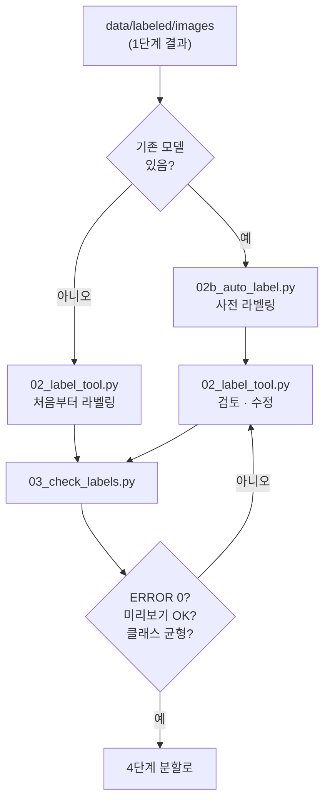

# 라벨링 가이드 (1~3단계)

> 모델 성능의 80%는 데이터와 라벨 품질에서 결정됩니다.
> 이 문서는 **"무엇을, 어떻게, 얼마나"** 라벨링할지 정합니다. 여러 명이 나눠서 라벨링할 때는 이 규칙을 먼저 공유하세요.

---

## 1. 라벨링 작업 흐름



---

## 2. 클래스 정의 (Raspbot V2)

| ID | 이름 | 무엇을 | 박스 범위 | 주의 |
|---|---|---|---|---|
| 0 | `car` | 트랙 위 앞 차량(다른 로봇/장애물 차) | 차체 전체 (바퀴 포함) | 일부만 보여도 50% 이상 보이면 라벨 |
| 1 | `green` | **켜진** 초록 신호 | 빛나는 원(램프) 부분 | 꺼진 램프는 라벨하지 않음 |
| 2 | `oo` | O 표지판 | 표지판 판 전체 | 각도가 심해 O 가 안 보이면 제외 |
| 3 | `red` | **켜진** 빨간 신호 | 빛나는 원(램프) 부분 | `green` 과 박스 기준 동일하게 |
| 4 | `xx` | X 표지판 | 표지판 판 전체 | `oo` 와 박스 기준 동일하게 |

> 클래스 순서(= ID)는 `config.yaml` 의 `classes` 순서입니다. **한 번 학습한 뒤에는 순서를 바꾸지 마세요.**
> 클래스를 추가할 때는 맨 뒤에 붙이고, 주행 코드(`source/configs`)의 클래스 이름 설정도 함께 수정합니다.

---

## 3. 라벨링 규칙 10가지

1. **타이트하게**: 박스는 객체 가장자리에 딱 맞게. 여백이 크면 mAP50-95 가 떨어집니다.
2. **빠짐없이**: 이미지 안의 해당 클래스 객체는 **전부** 라벨링. 하나라도 빠지면 모델은 "그건 배경"이라고 배웁니다.
3. **가려진 객체**: 보이는 부분이 대략 50% 이상이면 보이는 부분만 박스. 그 이하면 생략.
4. **잘린 객체**(이미지 경계): 보이는 부분까지만 박스.
5. **너무 작은 객체**: 사람이 봐도 구분이 안 되면 라벨하지 않음 (03 점검에서 '매우 작은 박스' 경고).
6. **반사·화면 속 이미지**: 유리 반사, 모니터 속 신호등은 라벨하지 않음 (실제 주행과 무관).
7. **애매하면 일관되게**: 기준을 정했으면 끝까지 같은 기준. 팀이라면 애매한 예시를 공유 폴더에 모아 두기.
8. **배경 이미지 포함**: 객체가 없는 트랙 이미지도 전체의 5~15% 정도 넣기 → 빈 라벨로 저장 (`d` 키). 오탐 감소 효과.
9. **좌우 반전 주의**: O/X, 신호등 위치처럼 방향 의미가 있으면 `config.yaml` 의 `fliplr: 0.0` 유지.
10. **검토 후 저장**: 사전 라벨링 결과는 반드시 한 장씩 확인. 틀린 박스를 그대로 두는 것이 가장 나쁩니다.

### 좋은 박스 vs 나쁜 박스

```
 좋은 예 (타이트)          나쁜 예 (여백 과다)         나쁜 예 (잘림)
 ┌──────┐                 ┌──────────────┐             ┌────┐
 │ ███  │                 │              │             │ ███│█
 │█████ │                 │    ███       │             │████│█
 │ ███  │                 │   █████      │             │ ███│
 └──────┘                 │    ███       │             └────┘
                          └──────────────┘
```

---

## 4. 얼마나 모아야 하나? (데이터 양 기준)

| 수준 | 클래스당 박스 수 | 기대 |
|---|---|---|
| 최소 | 50~100 | 일단 동작 확인 (수업/데모) |
| 권장 | 300~1,000 | 실제 트랙에서 안정적 |
| 우수 | 1,500+ | 다양한 환경에서도 강건 |

**다양성이 양보다 중요**합니다. 같은 장면 1,000장보다 다른 조건 300장이 낫습니다.

| 다양성 축 | 예시 |
|---|---|
| 거리 | 가까이(크게) / 중간 / 멀리(작게) |
| 각도 | 정면 / 좌우 비스듬히 / 커브에서 |
| 조명 | 형광등 / 자연광 / 어두움 / 역광 |
| 배경 | 트랙 여러 위치, 주변 사물 |
| 상태 | 정지 / 주행 중(모션 블러) |
| 혼합 | 한 장에 여러 객체 (신호등 + 차량 등) |

> 💡 실제 로봇 카메라(320×240)로 수집한 데이터가 가장 좋습니다. 운영 환경과 같은 화질·화각이기 때문입니다.

---

## 5. YOLO 라벨 포맷

이미지 1장당 같은 이름의 `.txt` 1개. 한 줄 = 객체 1개.

```
<class_id> <x_center> <y_center> <width> <height>
```

- 모든 좌표는 이미지 크기로 나눈 **0~1 정규화** 값
- `x_center`, `y_center` 는 박스 **중심**

예시 — 640×480 이미지, 빨간 신호등 박스 (x1=300, y1=100, x2=340, y2=140):

```
3 0.500000 0.250000 0.062500 0.083333
```

계산: `xc = (300+340)/2/640 = 0.5`, `yc = (100+140)/2/480 = 0.25`, `w = 40/640`, `h = 40/480`

빈 파일 = 객체 없는 배경 이미지 (정상). **txt 파일이 아예 없는 이미지 = 아직 검토 안 한 이미지** → 4단계에서 제외됩니다.

```
data/labeled/
├── images/
│   ├── track1_000010.jpg
│   └── track1_000020.jpg
├── labels/
│   ├── track1_000010.txt     ← "3 0.5 0.25 0.0625 0.0833"
│   └── track1_000020.txt     ← (빈 파일 = 배경)
└── classes.txt               ← car / green / oo / red / xx
```

---

## 6. 라벨링 도구 비교

| 도구 | 설치 | 장점 | 단점 | 추천 상황 |
|---|---|---|---|---|
| **02_label_tool.py** (이 폴더) | 불필요 | 바로 실행, config 클래스 자동 연동, 미검토 이미지 추적 | 기능 단순, 클래스 10개까지 | 수업·소규모 |
| LabelImg | `pip install labelImg` | 익숙한 UI, YOLO 저장 지원 | 개발 중단, Python 3.10+ 에서 오류 잦음 | 기존 사용자 |
| Label Studio | `pip install label-studio` | 웹 기반, 협업, 다양한 export | 설정이 다소 복잡 | 여러 명 협업 |
| Roboflow / CVAT | 웹 | 증강·관리 기능, 자동 라벨 | 계정 필요, 데이터 업로드 | 대규모 |

외부 도구를 쓴 경우 **YOLO 포맷**으로 export 해서 `data/labeled/images` 와 `data/labeled/labels` 에 넣고,
`classes.txt` 순서가 `config.yaml` 의 `classes` 와 같은지 꼭 확인하세요.

---

## 7. 3단계 점검 결과 읽는 법

```
  클래스        박스수  이미지수  평균크기   분포
  0:car           412      380     8.2%   ██████
  1:green         655      640     0.9%   ██████████
  2:oo            298      290     4.1%   ████
  3:red           701      690     0.9%   ███████████
  4:xx             61       60     3.8%   █
  ⚠ 클래스 '4:xx' 라벨 61개 (권장: 클래스당 최소 100~300개 이상)
  ⚠ 클래스 불균형 큼 (최대/최소 = 11.5배)
```

| 메시지 | 조치 |
|---|---|
| 값이 5개가 아님 / 숫자가 아님 | 해당 줄 삭제 후 다시 라벨 (`--fix` 는 그 줄 삭제) |
| 클래스 ID 범위 밖 | 다른 클래스 목록으로 라벨한 파일 → 재라벨 또는 ID 매핑 |
| 박스가 이미지 밖 | `--fix` 로 클리핑 |
| 매우 작은 박스 | 실수로 클릭한 박스인지 확인 |
| 중복 박스 의심 | 같은 객체에 박스 2개 → 하나 삭제 |
| 미라벨 이미지 | `02_label_tool.py --only-unlabeled` 로 이어서 작업 |
| 클래스 불균형 | 적은 클래스 데이터를 추가 수집 (가장 효과적) |
