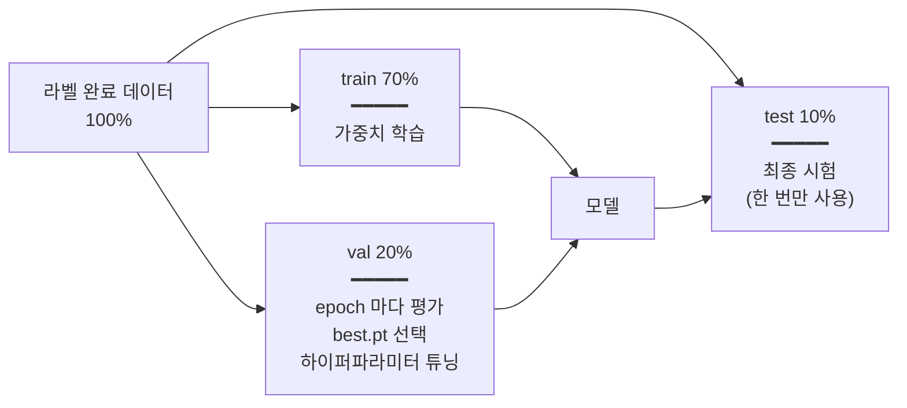
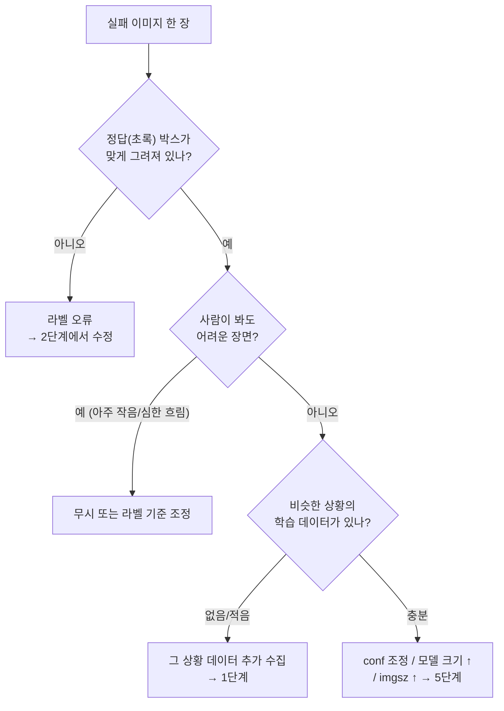

# 검증 · 테스트 가이드 (5~9단계)

> "학습이 끝났다"와 "쓸 수 있는 모델이다"는 다릅니다.
> 이 문서는 **학습 결과를 어떻게 읽고, 어떤 기준으로 합격시키고, 실패하면 무엇을 고칠지** 정리합니다.

---

## 1. 데이터 3분할의 역할



| 구분 | 언제 사용 | 이걸 보고 무엇을 바꾸나 |
|---|---|---|
| train | 학습 중 매 batch | (모델이 자동으로 학습) |
| val | 매 epoch 끝, 6단계 | epochs, 모델 크기, 증강, 데이터 보강 여부 |
| test | 모든 결정이 끝난 뒤 6단계 `--split test`, 7단계 | **아무것도 바꾸지 않음** — 실제 성능 추정용 |

> 연속 프레임이 train·test 에 나뉘면 사실상 같은 사진을 시험 보는 셈이라 점수가 부풀려집니다.
> 그래서 4단계는 기본으로 **동영상(그룹) 단위 분할**을 합니다.

---

## 2. 학습 중 그래프 읽기 (`runs/train/<이름>/results.png`)

| 그래프 | 정상 | 문제 신호 | 조치 |
|---|---|---|---|
| `train/box_loss`, `cls_loss` | 꾸준히 감소 | 거의 안 줄어듦 | 라벨 오류 확인, lr/epochs 확인 |
| `val/box_loss`, `cls_loss` | train 과 함께 감소 | train ↓ 인데 val ↑ (과적합) | 데이터 추가, 증강 ↑, `patience` 로 조기 종료 |
| `metrics/mAP50(B)` | 상승 후 평평 | 계속 상승 중 종료 | epochs ↑ |
| `metrics/mAP50-95(B)` | 상승 후 평평 | mAP50 대비 매우 낮음 | 박스 정밀도 문제 → 라벨 타이트하게 |

---

## 3. 평가 지표 한눈에

```
                         실제로 객체가 있음      실제로 없음
 모델이 "있다"           TP (정탐)              FP (오탐)
 모델이 "없다"           FN (미탐)              -
```

| 지표 | 식 | 의미 | Raspbot 에서의 영향 |
|---|---|---|---|
| **Precision (정밀도)** | TP / (TP+FP) | "있다"고 한 것 중 맞은 비율 | 낮으면 **없는 신호에 멈춤** (불필요한 정지) |
| **Recall (재현율)** | TP / (TP+FN) | 실제 객체 중 찾은 비율 | 낮으면 **빨간불을 못 보고 통과** (위험) |
| **F1** | 2PR/(P+R) | P·R 균형 | 하나의 숫자로 비교할 때 |
| **IoU** | 겹친 면적 / 합친 면적 | 예측 박스와 정답 박스가 얼마나 겹치나 | 0.5 이상이면 '맞춤'으로 판정 |
| **mAP50** | IoU 0.5 기준 AP 의 클래스 평균 | 찾았는가 | 주 지표 |
| **mAP50-95** | IoU 0.5~0.95 AP 평균 | 박스 위치까지 정확한가 | 거리 추정·면적 기반 판단에 영향 |

> 🚦 자율주행에서는 보통 **red 의 Recall** 이 가장 중요합니다 (놓치면 위험).
> 반대로 `car` 오탐이 많으면 불필요하게 정지합니다. 클래스별로 무엇이 더 위험한지 생각하고 기준을 정하세요.

---

## 4. 합격 기준 (`config.yaml` → `validate.thresholds`)

```yaml
validate:
  thresholds:
    map50: 0.80              # 전체 mAP50
    map50_95: 0.50           # 전체 mAP50-95
    precision: 0.80
    recall: 0.80
    per_class_map50_min: 0.60  # 모든 클래스가 최소 이 값 이상
```

| 등급 | mAP50 | mAP50-95 | 판단 |
|---|---|---|---|
| 부족 | < 0.70 | < 0.40 | 데이터·라벨부터 재점검 |
| 사용 가능 | 0.80 ~ 0.90 | 0.50 ~ 0.65 | 트랙 주행 테스트 진행 |
| 우수 | > 0.95 | > 0.75 | 배포 (참고: 현재 `source/models/yolo/best.pt` 는 mAP50 0.988 / mAP50-95 0.769) |

`06_validate.py` 는 기준 미달 시 **종료 코드 2** 를 반환하므로 자동화(`run_pipeline.py`, CI)에서 바로 감지할 수 있습니다.

---

## 5. 6단계(검증)와 7단계(테스트)의 차이

| | 6단계 `06_validate.py` | 7단계 `07_test.py` |
|---|---|---|
| 목적 | 표준 지표로 모델 비교·합격 판정 | **실제 운영 설정**에서 어떤 실수를 하는지 |
| conf | 0.001 (모든 신뢰도 구간 평가) | 0.5 (로봇과 동일) |
| imgsz | 학습 크기 (640) | 운영 크기 (320) |
| 결과 | mAP, P, R, PR 곡선, 혼동행렬 | 이미지별 TP/FP/FN, 오분류 쌍, 실패 이미지, 지연시간 |
| 질문 | "이 모델 좋은가?" | "로봇에 올리면 어디서 틀리나?" |

> 640 으로 학습하고 320 으로 운영하면 작은 객체(멀리 있는 신호등) 성능이 떨어질 수 있습니다.
> 7단계에서 Recall 이 크게 떨어지면 `train.imgsz: 320` 으로 다시 학습하거나 운영 imgsz 를 올려 비교하세요.

---

## 6. 실패 원인 분석 (`reports/test_failures/`)

파일 이름 앞부분이 실패 유형입니다: `FP_...`, `FN_...`, `WRONG_...` (초록=정답, 빨강=예측)



| 실패 유형 | 흔한 원인 | 처방 |
|---|---|---|
| FN (미탐) 많음 | 멀리 있는 작은 객체, 역광, 흐림 | 해당 조건 데이터 추가, imgsz ↑, conf ↓ |
| FP (오탐) 많음 | 비슷한 색/모양 배경 (빨간 물체를 red 로) | 그 배경을 **빈 라벨**로 추가 (hard negative), conf ↑ |
| WRONG red↔green | 조명으로 색이 변함, 라벨 실수 | 라벨 재확인, 다양한 조명 데이터, `hsv_h` 증강 낮게 유지 |
| WRONG oo↔xx | 저해상도에서 모양 구분 어려움 | 가까운/중간 거리 데이터 보강, imgsz ↑ |
| 박스 위치 부정확 | 라벨 박스 기준이 사람마다 다름 | 라벨링 규칙 통일 → 재라벨 |

---

## 7. conf 임계값 정하기

conf 를 올리면 Precision ↑ Recall ↓, 내리면 반대입니다. `runs/val/val/` 의 `BoxF1_curve.png` 에서
F1 이 최대인 conf 가 출발점입니다. 그 다음 7단계로 직접 비교하세요.

```bash
python scripts/07_test.py --conf 0.35
```

```bash
python scripts/07_test.py --conf 0.6
```

정한 값은 `config.yaml` 의 `test.conf`, `predict.conf` 와 주행 코드 `source/configs/*.yaml` 의 `perception.yolo.conf` 에 같이 반영합니다.

---

## 8. 배포 전 최종 체크리스트

- [ ] 3단계: ERROR 0, 모든 클래스 박스 ≥ 100
- [ ] 5단계: `results.png` 에서 과적합 없음
- [ ] 6단계 val: PASS
- [ ] 6단계 test: PASS (val 과 큰 차이 없음 — 차이가 크면 데이터 누수/과적합 의심)
- [ ] 7단계: red→green / green→red 오분류 0, 실패 이미지 원인 파악 완료
- [ ] 8단계: 학습에 쓰지 않은 **새 주행 영상**에서 육안 확인
- [ ] 9단계: 변환 모델 일치율 ≥ 95%
- [ ] 라즈베리파이 `08_predict.py --benchmark 100` 으로 목표 FPS 확인
- [ ] 기존 `source/models/yolo/best.pt` 백업 후 교체, `models/train_info.json` 함께 보관
