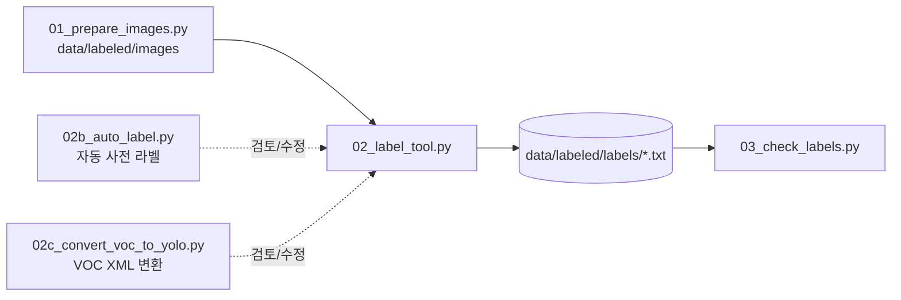
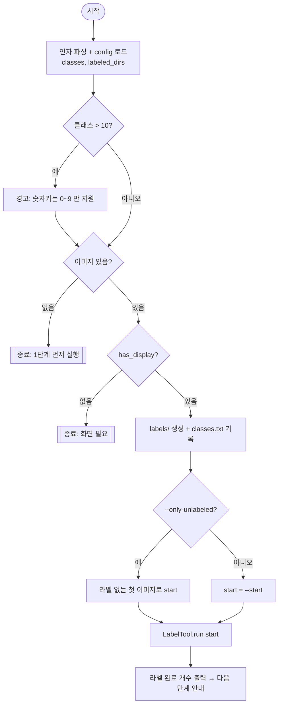
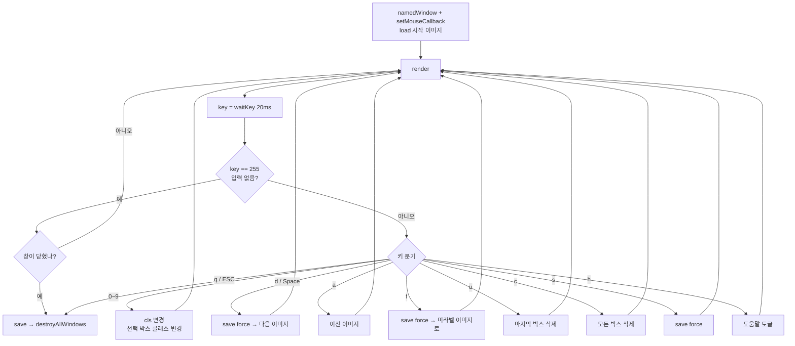
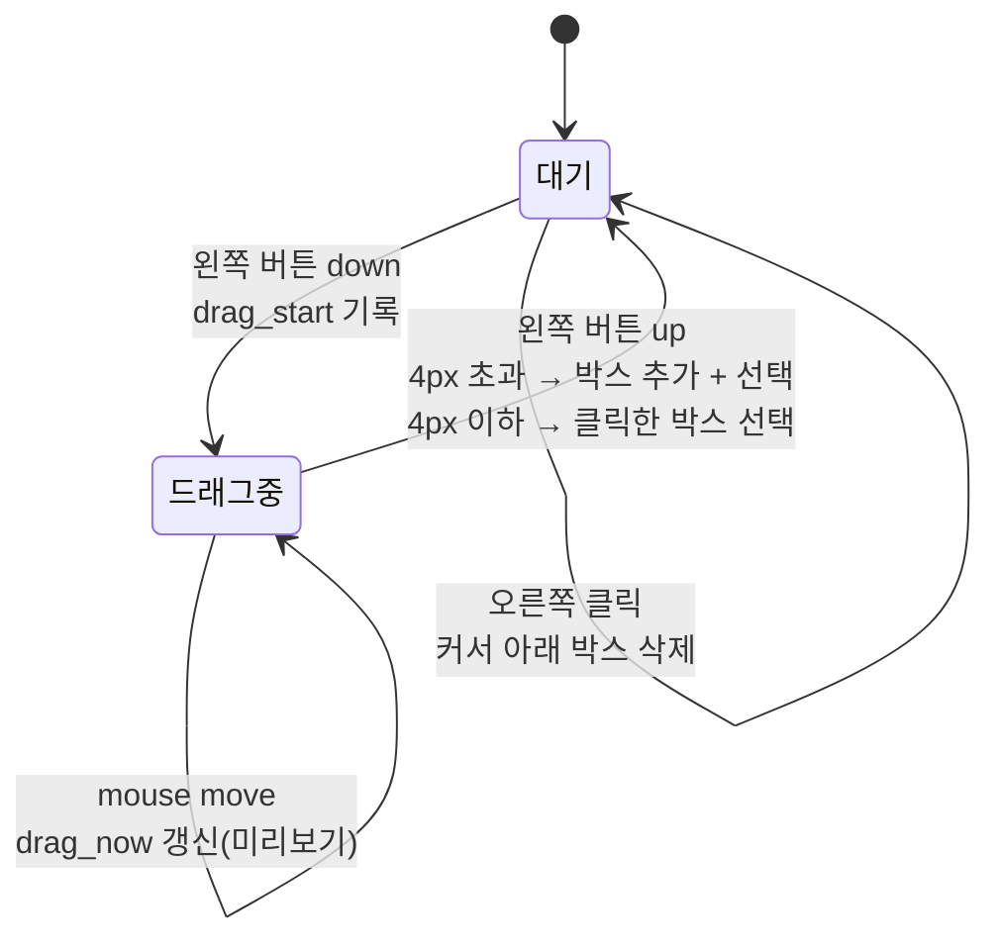

# 02_label_tool.py 구조 분석 — OpenCV 라벨링 도구

> 파이프라인 **2단계**. 1단계에서 정리한 이미지에 사람이 직접 바운딩 박스를 그려
> YOLO 포맷(`class xc yc w h`, 0~1 정규화) 라벨 txt 를 만드는 GUI 도구입니다.
> 외부 라벨링 프로그램 설치 없이 OpenCV 창 하나로 동작합니다.

---

## 1. 한눈에 보기

| 항목 | 내용 |
|---|---|
| 실행 | `python scripts/02_label_tool.py [--only-unlabeled] [--start N]` |
| 입력 | `data/labeled/images/**/*.jpg` (1단계 결과), 기존 라벨 txt(있으면 불러와 수정) |
| 출력 | `data/labeled/labels/<이미지이름>.txt`, `data/labeled/classes.txt` |
| 의존 | `cv2`(OpenCV), `common.py` (경로·라벨 I/O·좌표 변환·박스 그리기) |
| 필요 환경 | **화면(DISPLAY)** 이 있어야 함 — SSH 접속 라즈베리파이에서는 실행 불가 |
| 이전 단계 | `01_prepare_images.py` (또는 `02b_auto_label.py` 로 사전 라벨) |
| 다음 단계 | `03_check_labels.py` (라벨 품질 점검) |



---

## 2. 코드 구성

```
02_label_tool.py
├── 상수: WIN, MAX_W/MAX_H, HELP
├── class LabelTool
│   ├── __init__          상태 변수 초기화
│   ├── [파일]  label_file / load / save
│   ├── [마우스] on_mouse / box_at
│   ├── [화면]  render / goto / next_unlabeled
│   └── [루프]  run       ← 이벤트 루프 (키 입력 처리)
└── main()                CLI → 사전 점검 → LabelTool.run()
```

### 2.1 상태 변수 (`LabelTool.__init__`)

| 변수 | 타입 | 의미 |
|---|---|---|
| `images` | `list[Path]` | 라벨링 대상 이미지 목록 (정렬됨) |
| `idx` | `int` | 현재 이미지 인덱스 |
| `cls` | `int` | 새 박스에 붙일 **현재 클래스** (숫자키 0~9) |
| `boxes` | `list[[cls,x1,y1,x2,y2]]` | 현재 이미지의 박스 — **원본 픽셀 좌표** |
| `selected` | `int \| None` | 선택된 박스 인덱스 (굵게 표시, 숫자키로 클래스 변경 대상) |
| `drag_start` / `drag_now` | `(x, y) \| None` | 드래그 시작점 / 현재점 (원본 좌표) |
| `img` | `ndarray` | 현재 원본 이미지 (BGR) |
| `scale` | `float ≤ 1` | 화면 표시 배율 |
| `dirty` | `bool` | 마지막 저장 이후 변경 여부 |
| `show_help` | `bool` | 도움말 오버레이 표시 여부 |

### 2.2 메서드 역할

| 메서드 | 역할 | 핵심 포인트 |
|---|---|---|
| `label_file(i)` | 이미지 → 라벨 경로 | `images/a/b.jpg` → `labels/a/b.txt` (하위 폴더 구조 유지) |
| `load()` | 이미지 + 기존 라벨 로드 | YOLO 정규화 좌표 → 픽셀 좌표로 변환해 `boxes` 에 저장, `scale` 계산 |
| `save(force)` | 라벨 저장 | 픽셀 → 정규화 변환, 2px 미만 박스 제거, `force` 면 빈 txt 도 생성 |
| `on_mouse()` | 마우스 콜백 | 화면 좌표 ÷ `scale` = 원본 좌표. 드래그=박스 생성, 클릭=선택, 우클릭=삭제 |
| `box_at(x, y)` | 좌표 아래 박스 찾기 | 겹치면 **면적이 가장 작은 박스** 선택 |
| `render()` | 화면 그리기 | 원본 크기에 그린 뒤 통째로 축소 → 상태줄/도움말 오버레이 |
| `goto(i)` | 이미지 이동 | 저장 → 인덱스 클램프 → 로드 (손상 이미지는 목록에서 제거) |
| `next_unlabeled()` | 미라벨 이미지 찾기 | 현재 위치 다음부터 **순환 탐색** |
| `run(start)` | 이벤트 루프 | 20ms 주기 `render → waitKey → 키 처리` |

---

## 3. 실행 흐름

### 3.1 `main()` 흐름



### 3.2 이벤트 루프 (`run`)



> 마우스 이벤트는 루프와 별개로 `on_mouse` 콜백에서 처리되고, 루프는 매 20ms 마다
> 변경된 상태를 다시 그릴 뿐입니다 (상태 변경 ↔ 화면 그리기 분리).

### 3.3 마우스 동작 (`on_mouse`)



---

## 4. 핵심 로직 상세

### 4.1 두 개의 좌표계

라벨링 도구에서 가장 실수하기 쉬운 부분이 **좌표계 변환**입니다. 이 코드는 규칙을 단순하게 정했습니다.

| 좌표계 | 쓰는 곳 | 변환 |
|---|---|---|
| 화면 좌표 | OpenCV 마우스 이벤트 `(x, y)` | `÷ scale` → 원본 좌표 |
| **원본 픽셀 좌표** | `self.boxes` (내부 저장의 기준) | — |
| YOLO 정규화 좌표 | 디스크의 txt | `load()` 에서 `yolo_to_xyxy`, `save()` 에서 `xyxy_to_yolo` |

```
화면(축소본)  --÷scale-->  원본 픽셀 [x1,y1,x2,y2]  --xyxy_to_yolo-->  txt: cls xc yc w h (0~1)
                              ↑                                          |
                              +---------------yolo_to_xyxy---------------+
```

`render()` 는 박스를 **원본 크기 이미지에 먼저 그린 뒤 전체를 `scale` 로 축소**합니다.
그래서 그리기 단계에서는 좌표 변환이 필요 없고, 변환은 마우스 입력 한 곳(`/ self.scale`)에서만 일어납니다.

### 4.2 `scale` 계산

```python
self.scale = min(1.0, MAX_W / w, MAX_H / h)
```

- 1280×800 안에 들어오도록 축소, **확대는 하지 않음**(최대 1.0).
- 예: 1920×1080 → `min(1, 0.667, 0.741) = 0.667`

### 4.3 박스 생성 / 선택 판정

```python
if abs(x2 - x1) * self.scale > 4 and abs(y2 - y1) * self.scale > 4:   # 화면 기준 4px 초과
    boxes.append([cls, min(x1,x2), min(y1,y2), max(x1,x2), max(y1,y2)])
else:
    selected = box_at(ox, oy)                                          # 단순 클릭
```

- 판정 기준을 **화면 픽셀**로 둔 이유: 원본 기준이면 큰 이미지에서 손 떨림이 박스로 인식되기 쉬움.
- `min/max` 정렬로 **어느 방향으로 드래그해도** (좌상단, 우하단) 형태로 저장.

### 4.4 `box_at` — 겹친 박스 중 가장 작은 것

```python
hits = [(면적, i) for i, b in enumerate(boxes) if 점이 박스 안]
return min(hits)[1]
```

튜플 비교는 첫 원소(면적)부터 비교하므로 가장 작은 박스가 선택됩니다.
차량 박스 안의 신호등처럼 **큰 박스에 가려진 작은 박스**도 클릭/삭제할 수 있게 하는 장치입니다.

### 4.5 저장 정책 (`save`)

```python
if self.img is None or (not self.dirty and not force and self.label_file().exists()):
    return
```

| dirty | force | 라벨 파일 존재 | 결과 |
|---|---|---|---|
| True | - | - | 저장 |
| False | True | - | 저장 (박스 0개면 **빈 txt**) |
| False | False | 있음 | 생략 (불필요한 쓰기 방지) |
| False | False | **없음** | **저장 → 빈 txt 생성** |

저장 시 폭/높이가 2px 미만인 박스는 버립니다(실수로 만든 점 박스 제거).

### 4.6 빈 txt = "검토 완료된 배경"

YOLO 학습에서 **라벨 파일이 비어 있으면** "이 이미지에는 객체가 없다"는 정답으로 쓰입니다.
배경 이미지는 오탐(FP)을 줄이는 데 도움이 되므로, `d`/`Space` 로 넘길 때 `force=True` 로 빈 txt 를 만들어
"사람이 보고 객체가 없다고 확인했다"는 기록을 남깁니다. 반대로 **txt 가 아예 없는 이미지**는
`03_check_labels.py` 에서 '미라벨', `04_split_dataset.py` 에서 '학습 제외' 로 취급됩니다.

### 4.7 손상 이미지 처리 (`goto`)

이동한 이미지를 읽지 못하면 `self.images` 에서 제거하고 같은 인덱스(=다음 이미지)를 다시 로드합니다.
라벨링 도중 깨진 파일 하나 때문에 도구가 멈추지 않게 하는 처리입니다.

---

## 5. 키 / 마우스 조작 요약

| 입력 | 동작 | 저장 여부 |
|---|---|---|
| 왼쪽 드래그 | 현재 클래스로 박스 생성 (생성된 박스가 선택됨) | dirty |
| 왼쪽 클릭 | 박스 선택 | - |
| 오른쪽 클릭 | 커서 아래 박스 삭제 | dirty |
| `0`~`9` | 현재 클래스 변경 + 선택 박스 클래스 변경 | dirty(선택 시) |
| `d` / `Space` | 다음 이미지 | **force 저장** |
| `a` | 이전 이미지 | 변경분 저장 |
| `f` | 다음 미라벨 이미지 (순환 탐색) | **force 저장** |
| `u` | 마지막 박스 취소 | dirty |
| `c` | 모든 박스 삭제 | dirty |
| `s` | 즉시 저장 | **force 저장** |
| `h` | 도움말 on/off | - |
| `q` / `ESC` / 창 닫기 | 종료 | 변경분 저장 |

권장 작업 순서: `숫자키로 클래스 선택 → 드래그 → (잘못되면 클릭 후 숫자키로 클래스 수정 / 우클릭 삭제) → d`

---

## 6. 주의점과 알려진 한계

| # | 내용 | 영향 / 대응 |
|---|---|---|
| 1 | **미라벨 이미지에서 그냥 `a`(이전)나 `q`(종료)를 눌러도 빈 txt 가 생성**됩니다 (4.5 표의 마지막 줄). | 보지 않은 이미지가 '배경'으로 기록될 수 있음. 객체가 있는 이미지를 실수로 지나쳤다면 `03_check_labels.py` 의 배경 비율 경고·미리보기로 확인하세요. |
| 2 | 숫자키 0~9 만 지원 → **클래스 최대 10개** | 10개 이상이면 Label Studio 등 사용 (main 에서 경고) |
| 3 | `render()` 가 매 프레임(20ms) 전체 이미지의 라벨 파일 존재를 확인 | 수천 장 규모에서는 화면 반응이 느려질 수 있음 |
| 4 | 박스 이동·크기 조절 기능 없음 | 삭제(우클릭) 후 다시 그리기 |
| 5 | 이미지가 모두 손상되어 목록이 비면 예외 발생 | 1단계에서 손상 이미지는 이미 걸러지므로 실제로는 드묾 |
| 6 | 화면(DISPLAY) 필요 | 라즈베리파이는 VNC/모니터 연결, 또는 PC 에서 라벨링 |

---

## 7. 연관 파일

| 파일 | 관계 |
|---|---|
| `common.py` | `label_path_for`, `read/write_yolo_labels`, `yolo_to_xyxy`, `xyxy_to_yolo`, `draw_box`, `color_of`, `has_display` |
| `02b_auto_label.py` | 기존 모델로 박스를 미리 만들어 두면 이 도구로 **검토/수정만** 하면 됨 |
| `02c_convert_voc_to_yolo.py` | LabelImg(VOC) 결과를 같은 labels 폴더로 변환 |
| `03_check_labels.py` | 이 도구의 결과물(라벨)을 검사 |
| `docs/01_라벨링_가이드.md` | 라벨링 규칙(박스를 얼마나 타이트하게, 가려진 객체 처리 등) |


(venv) kimjongphil@kimjongphilui-Mac-Studio scripts % python 02_label_tool.py --config config.demo.yaml

================================================================
  [2단계] 라벨링 (YOLO 포맷)
================================================================
  이미지 240 장 | 클래스: 0:car, 1:green, 2:oo, 3:red, 4:xx
  창을 클릭한 뒤 키보드를 사용하세요. (q: 종료)

  라벨 완료: 240/240
  다음 단계 → python scripts/03_check_labels.py
(venv) kimjongphil@kimjongphilui-Mac-Studio scripts % python 02_label_tool.py --config config.demo.yaml

================================================================
  [2단계] 라벨링 (YOLO 포맷)
================================================================
  이미지 240 장 | 클래스: 0:car, 1:green, 2:oo, 3:red, 4:xx
  창을 클릭한 뒤 키보드를 사용하세요. (q: 종료)

  라벨 완료: 3/240
  다음 단계 → python scripts/03_check_labels.py


  venv) kimjongphil@kimjongphilui-Mac-Studio scripts % python 03_check_labels.py --config config.demo.yaml

================================================================
  [3단계] 라벨 품질 점검
================================================================
  전체 이미지 240 | 라벨 완료 240 | 미라벨 0 | 배경(빈 라벨) 20 | 이미지 없는 라벨 0

  클래스        박스수  이미지수  평균크기   분포
  0:car            82       70     3.7%   █████
  1:green          77       67     1.8%   █████
  2:oo            100       88     1.9%   ██████
  3:red            94       85     1.8%   ██████
  4:xx             89       72     1.9%   ██████

  ERROR 0 건 | WARN 0 건

  리포트: /Users/kimjongphil/Documents/GitHub/Raspbot-v2-self-driving-car/05_yolo11_pipeline/demo/reports/label_check.md
  미리보기: /Users/kimjongphil/Documents/GitHub/Raspbot-v2-self-driving-car/05_yolo11_pipeline/demo/reports/label_preview  ← 박스 위치가 맞는지 눈으로 확인하세요
  다음 단계 → python scripts/04_split_dataset.py
(venv) kimjongphil@kimjongphilui-Mac-Studio scripts % 


