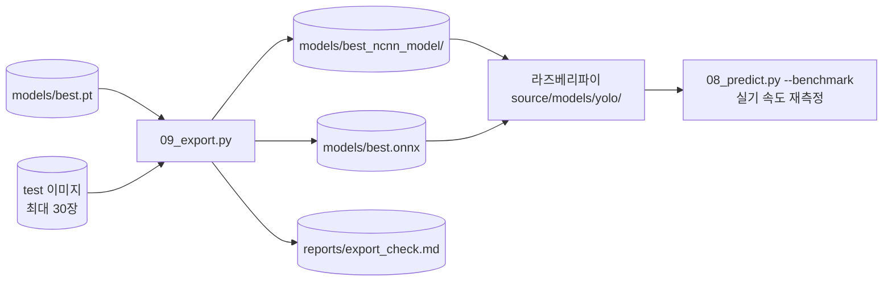
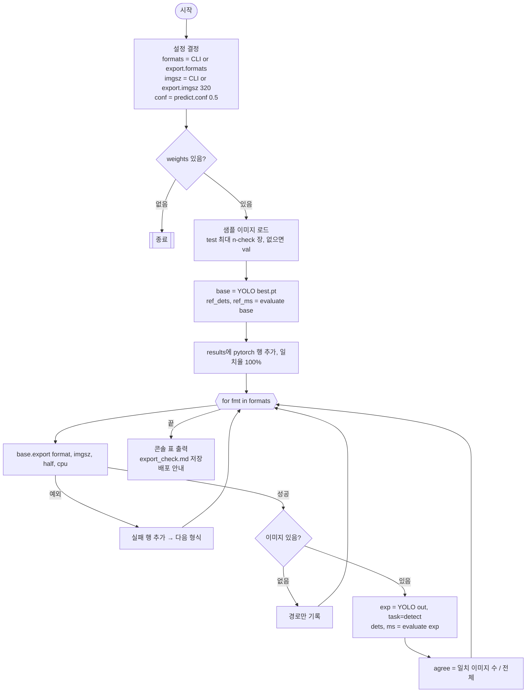

# 09_export.py 구조 분석 — 배포용 변환(ONNX / NCNN) + 변환 검증

> 파이프라인 **9단계(마지막)**. 학습된 `models/best.pt`(PyTorch)를 라즈베리파이 CPU 에서 빠르게 도는
> 형식(ONNX, NCNN 등)으로 변환하고, **변환 전후 결과가 같은지**와 **속도**를 같은 이미지로 비교합니다.

---

## 1. 한눈에 보기

| 항목 | 내용 |
|---|---|
| 실행 | `python scripts/09_export.py [--weights W] [--formats onnx ncnn ...] [--imgsz S] [--n-check N]` |
| 입력 | `models/best.pt`, 비교용 이미지 `datasets/raspbot/images/test` (없으면 `val`) |
| 출력 | `models/best.onnx`, `models/best_ncnn_model/`, `reports/export_check.md` |
| 설정 | `config.yaml` 의 `export:` (formats, imgsz, half) + `predict.conf` |
| 이전 단계 | `06_validate.py` / `07_test.py` 에서 합격한 모델 |
| 다음 | 라즈베리파이로 복사 → `08_predict.py --benchmark` 로 실기 속도 측정 |



---

## 2. 왜 변환하는가

| 형식 | 실행 엔진 | 특징 | 라즈베리파이 CPU |
|---|---|---|---|
| `.pt` | PyTorch | 학습·실험용, 유연하지만 무겁다 | 기준 (느림) |
| `.onnx` | ONNX Runtime | 범용 표준 포맷, 그래프 최적화 | 빠름 |
| `_ncnn_model/` | NCNN (Tencent) | ARM/모바일 CPU 에 특화 | **가장 빠름 (권장)** |
| `openvino`, `tflite` ... | 각 엔진 | `--formats` 로 추가 가능 | 환경에 따라 |

README·docstring 기준으로 NCNN/ONNX 는 라즈베리파이에서 `.pt` 대비 **2~4배** 빠릅니다.
다만 변환 과정에서 연산 정밀도·전처리 차이로 결과가 달라질 수 있으므로, **변환 후 검증**이 이 스크립트의 핵심입니다.

---

## 3. 코드 구성

```
09_export.py
├── evaluate(model, images, imgsz, conf)   워밍업 1회 → 이미지별 탐지 클래스 + 평균 지연시간
└── main()
    ├── 1) 인자/설정 (formats, imgsz, conf, weights)
    ├── 2) 비교용 샘플 이미지 준비 (test → val 대체)
    ├── 3) 원본 .pt 기준값 측정
    ├── 4) 형식별 export → 로드 → evaluate → 일치율
    └── 5) 콘솔 표 + reports/export_check.md
```

`results` 리스트의 각 원소: `(형식 이름, 출력 경로 또는 실패 메시지, 평균 지연 ms, 일치율 0~1)`

---

## 4. 실행 흐름



---

## 5. 핵심 로직 상세

### 5.1 `evaluate()` — 공정한 비교를 위한 장치

```python
model.predict(images[0], ...)                 # ① 워밍업 (측정 제외)
for im in images:                             # ② 이미 메모리에 올린 ndarray 사용
    t0 = time.perf_counter()
    r = model.predict(im, imgsz=imgsz, conf=conf, device="cpu", verbose=False)[0]
    ts.append((time.perf_counter() - t0) * 1000)
    dets.append(sorted(int(c) for c in r.boxes.cls.tolist()))   # ③ 정렬된 클래스 리스트
```

| 장치 | 이유 |
|---|---|
| ① 워밍업 1회 | 첫 추론은 모델 초기화·메모리 할당으로 느림 → 평균을 왜곡하지 않도록 제외 |
| ② 이미지를 미리 `cv2.imread` | 디스크 읽기 시간을 추론 시간에서 분리 |
| `device="cpu"` 고정 | 라즈베리파이 환경(CPU)과 같은 조건으로 비교. ONNX/NCNN 도 CPU 로 실행 |
| 같은 `imgsz`, `conf` | 모든 형식을 **운영 조건(320, 0.5)** 으로 동일하게 비교 |
| ③ `sorted(...)` | 탐지 순서가 달라도 같은 결과로 취급 |

### 5.2 일치율(agreement) 정의

```python
agree = sum(a == b for a, b in zip(ref_dets, dets)) / len(dets)
```

이미지마다 `.pt` 의 결과와 변환 모델의 결과가 **"정렬된 클래스 ID 리스트"로 완전히 같으면** 1점.

| 이미지 | .pt 결과 | ncnn 결과 | 일치? |
|---|---|---|---|
| a.jpg | `[0, 3]` (car, red) | `[0, 3]` | ✅ |
| b.jpg | `[1]` | `[1]` | ✅ |
| c.jpg | `[0, 0, 4]` | `[0, 4]` (car 하나 놓침) | ❌ |
| → 일치율 | | | 2/3 = 67% |

- **보는 것**: 클래스 종류와 개수가 바뀌는 큰 변화
- **보지 않는 것**: 박스 좌표 차이, 신뢰도(conf) 차이
- 따라서 conf 가 임계값(0.5) 근처인 객체는 미세한 수치 차이로 생기거나 사라져 일치율을 낮출 수 있습니다.
  리포트의 권장 기준은 **95% 이상**입니다.

### 5.3 `export()` 호출

```python
out = base.export(format=fmt, imgsz=imgsz, half=ec.get("half", False), device="cpu")
```

| 인자 | 의미 |
|---|---|
| `format` | `onnx`, `ncnn`, `openvino`, `tflite` ... |
| `imgsz` | **입력 크기가 모델에 고정**됨 → 운영(320)과 반드시 같게 |
| `half` | FP16 변환. CPU 에서는 이득이 적고 정확도 차이를 만들 수 있어 기본 `false` |
| `device="cpu"` | GPU 없이도 변환 가능 |

- 출력은 원본 가중치 옆에 생성됩니다: `models/best.onnx`, `models/best_ncnn_model/`.
- 변환 실패(패키지 미설치 등)는 `try/except` 로 잡아 **해당 형식만 실패 처리**하고 나머지 형식은 계속 진행합니다.
- 변환된 모델은 `YOLO(out, task="detect")` 로 다시 열어, `.pt` 와 **같은 API(`predict`)** 로 검증합니다.

### 5.4 비교 이미지 선택

```python
sample = list_images(test)[:n_check] or list_images(val)[:n_check]
```

- **test 우선**: 학습에 쓰지 않은 데이터로 비교.
- test 가 비어 있으면 val 로 대체, 둘 다 없으면 **변환만 하고 검증은 생략**(지연·일치율 0 으로 기록).
- 기본 30장 (`--n-check`) — 정확도 평가가 아니라 "변환 전후 동일성" 확인용이라 적은 수로 충분.

---

## 6. 출력 예시

콘솔:

```
  형식              평균 지연(ms)     .pt 와 결과 일치율
  pytorch (.pt)           38.2                100%
  onnx                    21.5                100%
  ncnn                    14.9                 97%
  (이 PC CPU 기준, test 이미지 30 장. 라즈베리파이에서는 08_predict.py --benchmark 로 재측정)
```

`reports/export_check.md`:

| 형식 | 경로 | 평균 지연(ms, CPU) | .pt 와 탐지 결과 일치율 |
|---|---|---|---|
| pytorch (.pt) | `models/best.pt` | 38.2 | 100% |
| onnx | `models/best.onnx` | 21.5 | 100% |
| ncnn | `models/best_ncnn_model` | 14.9 | 97% |

(숫자는 형식 예시입니다.)

---

## 7. 결과 판단과 문제 해결

| 증상 | 원인 후보 | 대응 |
|---|---|---|
| `❌ ncnn 변환 실패` | ncnn / pnnx 관련 패키지 미설치·다운로드 실패 | `pip install ncnn` 후 재시도, 네트워크 확인 |
| `❌ onnx 변환 실패` | `onnx` 패키지 없음 | `pip install onnx onnxruntime` |
| 일치율 < 95% | `half=true`, imgsz 불일치, conf 경계값 객체 | `half: false`, imgsz 를 운영과 동일하게, 실패 이미지는 08 단계로 눈으로 확인 |
| 변환 모델이 PC 에서 더 느림 | PC CPU/스레드 특성 | 정상일 수 있음 — **라즈베리파이에서 `08_predict.py --benchmark` 로 재측정**이 최종 기준 |
| 비교 이미지 0 장 | 4단계 미실행 | `04_split_dataset.py` 실행 후 다시 변환 |

---

## 8. 배포 절차

```bash
# 1) PC 에서 변환
python scripts/09_export.py

# 2) 라즈베리파이로 복사 (폴더 통째로)
scp -r models/best_ncnn_model pi@<라즈베리파이>:~/Raspbot-v2-self-driving-car/source/models/yolo/

# 3) 라즈베리파이에서 실기 속도 측정
python scripts/08_predict.py --weights models/best_ncnn_model --benchmark 100
```

> 스크립트 마지막 안내대로 `models/best.pt` 또는 `best_ncnn_model/` 을 `source/models/yolo/` 로 복사합니다.
> NCNN 모델은 **폴더 단위**(`model.ncnn.param`, `model.ncnn.bin`, `metadata.yaml`)로 옮겨야 합니다.

---

## 9. 주의점

| # | 내용 |
|---|---|
| 1 | 측정 지연시간은 **이 PC 의 CPU 기준**입니다. 라즈베리파이 실측값과 다릅니다. |
| 2 | 일치율은 클래스 리스트만 비교하는 단순 지표 — 박스 위치 정확도는 6/7단계 방식으로 따로 확인해야 합니다. |
| 3 | 변환 시 imgsz 가 고정되므로, 운영 코드에서 다른 입력 크기로 추론하지 않도록 맞추세요. |
| 4 | 재실행하면 같은 경로의 변환 파일과 리포트를 덮어씁니다. |

---

## 10. 연관 파일

| 파일 | 관계 |
|---|---|
| `common.py` | `default_weights`(models/best.pt), `list_images`, `path_of`, `load_config` |
| `05_train.py` | 변환할 `models/best.pt` 를 생성 |
| `07_test.py` | 운영 조건(conf 0.5, imgsz 320)에서의 정확도 — 변환 전 모델의 기준 성능 |
| `08_predict.py` | 변환 모델로 추론/`--benchmark` (라즈베리파이 실측) |
| `config.yaml` `export:` | formats, imgsz, half |
