# Raspbot V2 자율주행 자동차 20시간 교육과정 운영계획서

> **컴퓨터 비전 기반 자율주행 — 이론으로 원리를 이해하고, 실습으로 직접 완성하는 20시간**

| 항목 | 내용 |
|---|---|
| **교육 기간** | 2026년 11월 26일(목) ~ 12월 7일(월), 총 6회 |
| **총 교육 시간** | 20시간 (이론 2시간 40분 / 실습 17시간 20분) |
| **교육 대상** | Python 기초 문법(변수·조건문·반복문·함수)을 아는 학습자, 팀당 2~3명 |
| **교육 장비** | Raspbot V2 (Raspberry Pi + 확장 쉴드 + 카메라), 트랙, 신호등·표지판 소품 |
| **운영 원칙** | **단계도 먼저 → 이론 핵심 → 시연 → 실습 → 미션 → 통과 점검** |
| **이론 운영** | 차시당 1시간 이내 (실제 배정: 10~50분), 슬라이드 5~10장 + 화이트보드 도식 |
| **소개 영상** | [video/20시간_교육과정_차시별_소개.mp4](video/20시간_교육과정_차시별_소개.mp4) (약 1분 34초, 1차시 오리엔테이션 재생) / 짧은 버전 [video/20시간_교육과정_구조도_소개.mp4](video/20시간_교육과정_구조도_소개.mp4) (약 57초) |

---

## 목차

- [0. 과정 개요](#0-과정-개요)
- [1. 전체 학습 목표](#1-전체-학습-목표)
- [2. 커리큘럼 구조도](#2-커리큘럼-구조도)
- [3. 일정 및 시간 배분 총괄](#3-일정-및-시간-배분-총괄)
- [4. 교수·학습 운영 모형](#4-교수학습-운영-모형)
- [5. 1차시 — 간단 조립, 앱으로 실행](#5-1차시--간단-조립-앱으로-실행)
- [6. 2차시 — 라즈봇 동작 방법, 개발환경 셋팅, 동작 제어 테스트](#6-2차시--라즈봇-동작-방법-개발환경-셋팅-동작-제어-테스트)
- [7. 3차시 — 기본 자율주행 테스트](#7-3차시--기본-자율주행-테스트)
- [8. 4차시 — Haar Cascade 간단 설명, YOLO11 기본 train·test](#8-4차시--haar-cascade-간단-설명-yolo11-기본-traintest)
- [9. 5차시 — 기본 자율주행 + YOLO11 위주 주행](#9-5차시--기본-자율주행--yolo11-위주-주행)
- [10. 6차시 — 최종 테스트, 코칭](#10-6차시--최종-테스트-코칭)
- [11. 평가 체계](#11-평가-체계)
- [12. 준비물 및 환경 체크리스트](#12-준비물-및-환경-체크리스트)
- [13. 안전 수칙 및 리스크 관리](#13-안전-수칙-및-리스크-관리)
- [14. 참고 자료](#14-참고-자료)

---

## 0. 과정 개요

### 0-1. 과정의 성격 — 컴퓨터 비전 개발 프로세스를 배우는 과정

이 과정은 **ROI 도로선 인식 자율주행**과 **YOLO11 객체 인식**으로 **신호등 · 장애물 · 자동 주차**까지 수행하는 프로젝트입니다.
핵심은 "코드를 따라 치는 것"이 아니라, 현업의 **컴퓨터 비전 개발 프로세스**를 처음부터 끝까지 직접 경험하는 것입니다.

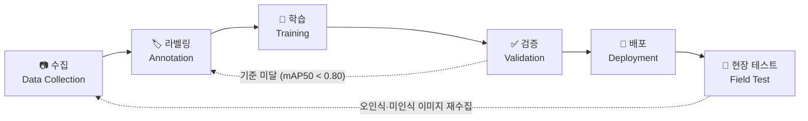

### 0-2. 크로스 개발 구조 (PC ↔ Raspbot V2)

- 코드는 **PC에서 작성**하고 라즈봇으로 보내 **라즈봇에서 실행**합니다 (SSH · FTP 배포, VNC 화면·로그로 확인).
- **이미지 데이터 생성과 모델 제작은 PC에서** 하고, **PC에서 검증을 통과한 모델만** 라즈봇에 배포합니다.
- 라즈베리파이는 연산 자원이 작으므로 **"무거운 일(학습)은 PC, 가벼운 일(추론·제어)은 라즈봇"** 이 원칙입니다.

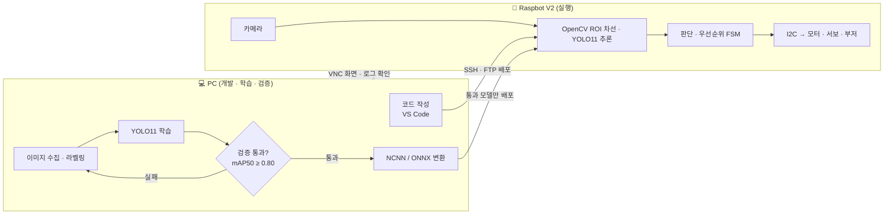

### 0-3. 인식 대상과 방법

| 인식 대상 | 방법 | 클래스 (class_id) | 주행 중 동작 |
|---|---|---|---|
| 도로선 | OpenCV · ROI · 색상 필터 · 좌/중/우 히스토그램 | — | 좌회전 / 직진 / 우회전 |
| 신호등 | YOLO11 | `red`(3), `green`(1) | 빨간불 정지 → 초록불 출발 |
| 장애물 (앞 차량) | YOLO11 | `car`(0) | 정지 + 경고음 → 재개 |
| 주차 표지 | YOLO11 | `oo`(2) 주차 목표, `xx`(4) 주차 금지 | `oo` 접근 후 주차 정지 / `xx` 표시만 |

> class_id 순서는 `09_yolo11_pipeline/config.yaml`의 `classes` 순서와 동일합니다 (`car, green, oo, red, xx`). 학습 후에는 순서를 바꾸지 않습니다.

### 0-4. 시스템 아키텍처 (인식 → 판단 → 제어)

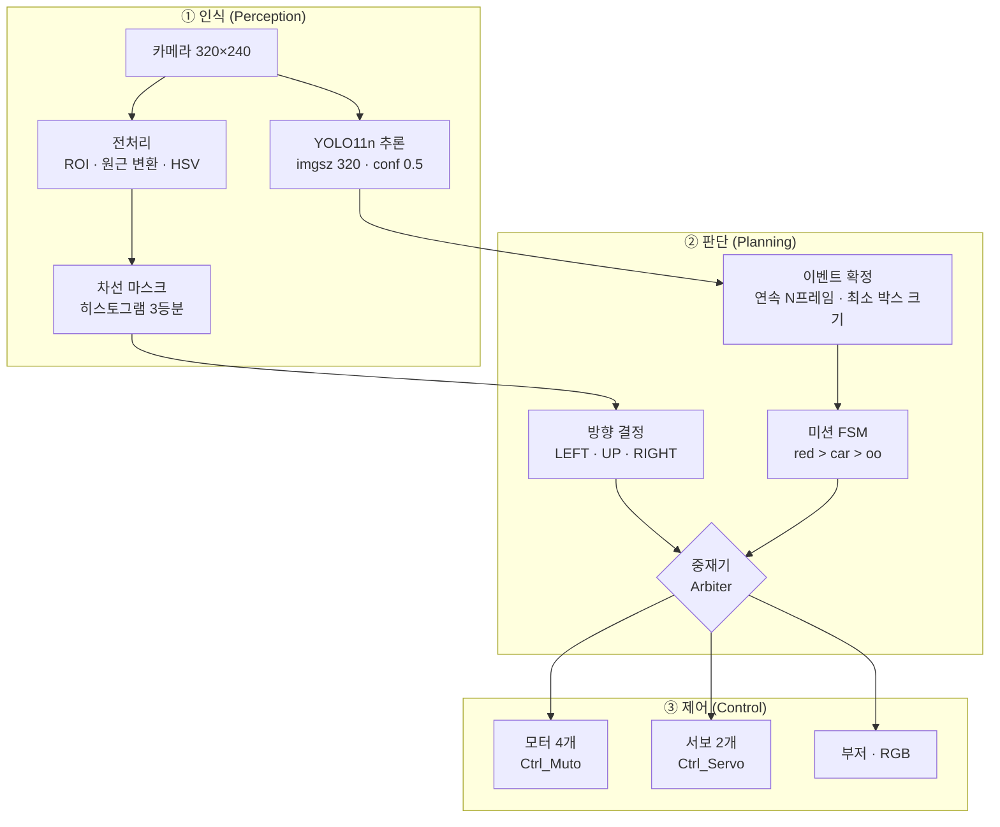

---

## 1. 전체 학습 목표

### 1-1. 최종 성취 목표 (Terminal Objective)

> 학습자는 20시간 과정을 마치면 **Raspbot V2가 카메라만으로 차선을 따라 주행하면서, 직접 학습시킨 YOLO11 모델로 신호등·앞 차량·주차 표지를 인식해 정지·재출발·자동 주차를 수행하도록** 설계·구현·검증할 수 있다.

### 1-2. 영역별 학습 목표

| 영역 | 이론 목표 (이해한다 · 설명한다) | 실습 목표 (구현한다 · 수행한다) |
|---|---|---|
| **하드웨어** | 라즈베리파이 · 확장 쉴드 · 모터 · 서보 · 센서의 역할과 I2C 연결 구조를 설명한다 | Raspbot V2를 조립하고 배선·전원·부팅을 점검한다 |
| **개발 환경** | 크로스 개발(PC 작성 → 원격 실행) 구조와 SSH·VNC·FTP의 차이를 설명한다 | PC에서 원격 접속해 코드를 업로드·실행·디버깅한다 |
| **제어 프로그래밍** | 4륜 차동 구동(좌·우 속도 차이로 회전)의 원리를 설명한다 | Python으로 모터·서보·부저·RGB·초음파·라인센서를 제어한다 |
| **영상 처리** | ROI, 색 공간(BGR·HSV·Gray), 이진화, 모폴로지, 히스토그램의 의미를 설명한다 | OpenCV로 차선 마스크를 만들고 좌/중/우 비교로 방향을 결정한다 |
| **객체 인식** | Haar Cascade와 YOLO의 차이, 바운딩 박스·IoU·Precision·Recall·mAP를 설명한다 | 데이터 수집 → 라벨링 → 학습 → 검증 → 테스트 파이프라인을 수행해 `best.pt`를 만든다 |
| **시스템 통합** | 인식 → 판단 → 제어 구조와 상태 머신(FSM), 우선순위 중재를 설명한다 | 차선 주행 + YOLO11 이벤트를 통합해 미션 주행 코드를 완성한다 |
| **문제 해결** | 파라미터·데이터·성능 문제의 원인을 구분하는 방법을 설명한다 | 주행 로그·영상을 근거로 문제를 진단하고 개선 루프를 1회 이상 수행한다 |
| **협업·태도** | 팀 역할 분담과 기록(파라미터표·회고)의 중요성을 이해한다 | 팀별 기록표·주행 영상·회고를 작성·공유한다 |

### 1-3. 핵심 역량 맵

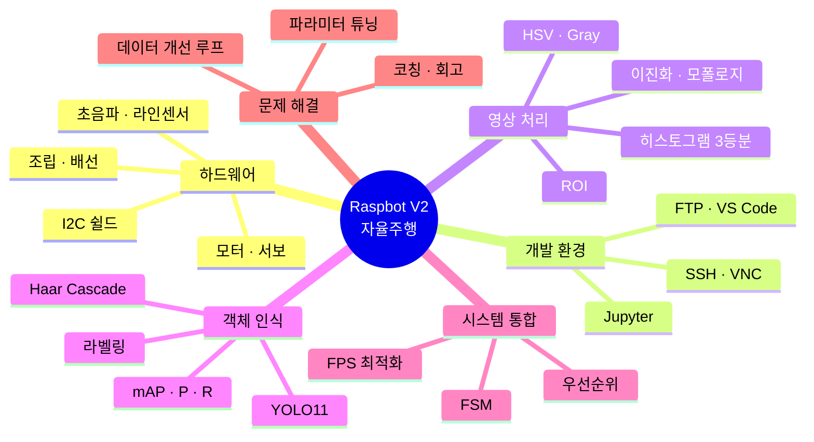

### 1-4. 차시별 학습 목표 한눈에 보기

| 차시 | 이론 학습 목표 | 실습 학습 목표 | 핵심 산출물 |
|:---:|---|---|---|
| 1 | 자율주행 시스템 구성(인식·판단·제어)과 Raspbot V2 부품 역할을 설명한다 | 로봇을 조립하고 앱으로 원격 주행·카메라를 확인한다 | 조립된 Raspbot, 부품 체크리스트 |
| 2 | I2C 제어 구조, 차동 구동 원리, 크로스 개발 구성을 설명한다 | SSH·VNC 접속 후 코드로 모터·서보·센서를 제어한다 | 접속 정보표, 센서 테스트 결과 |
| 3 | ROI·HSV·이진화·히스토그램 기반 방향 결정 알고리즘을 설명한다 | 차선 마스크를 튜닝해 트랙 1바퀴를 완주한다 | 팀별 파라미터 기록표 |
| 4 | Haar Cascade와 YOLO11의 원리 차이, 학습 지표(mAP·P·R)를 설명한다 | 5개 클래스 데이터셋을 만들고 YOLO11을 학습·검증한다 | `best.pt`, 검증 리포트 |
| 5 | 인식-판단-제어 통합 구조와 FSM 우선순위(`red > car > oo`)를 설명한다 | 라즈봇에 모델을 배포하고 미션 통합 주행을 수행한다 | 통합 주행 코드, 주행 영상 |
| 6 | 평가 기준과 문제 진단 체계(파라미터·데이터·성능)를 설명한다 | 최종 코스를 주행·평가받고 코칭으로 개선한다 | 최종 점수, 개선 항목, 회고 |

### 1-5. 블룸(Bloom) 인지 수준별 목표 배치

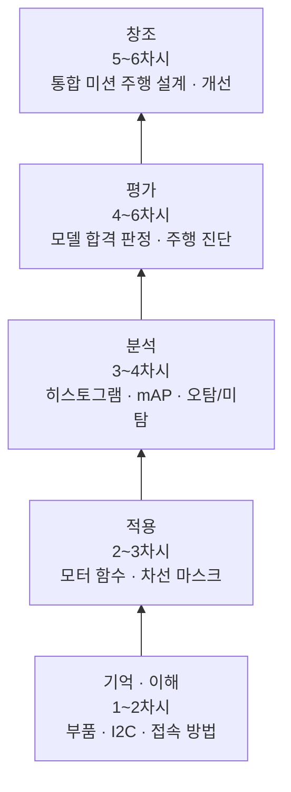

---

## 2. 커리큘럼 구조도

### 2-1. 전체 단계도 (Stage Gate)

> 매 차시 시작할 때 이 단계도를 보여 주고 **"오늘은 어느 단계이고, 끝나면 무엇이 되어 있어야 하는지"** 부터 확인합니다.

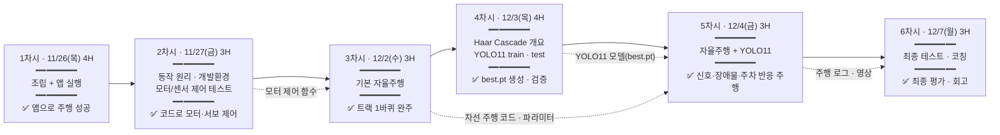

### 2-2. 텍스트 버전

```
[1차시] 조립·앱 실행 ──▶ [2차시] 동작 원리·개발환경·제어 테스트 ──▶ [3차시] 기본 자율주행
   (하드웨어 완성)         (코드로 움직이기)                          (차선 주행 완주)
                                                                           │
[6차시] 최종 테스트·코칭 ◀── [5차시] 자율주행 + YOLO11 ◀── [4차시] Haar 개요 + YOLO11 학습
   (평가·개선)                (통합 주행)                   (객체 인식 모델 완성)
```

### 2-3. 3단계 성장 구조 (Phase)

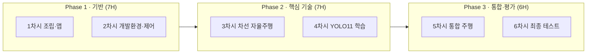

| Phase | 차시 | 시간 | 핵심 질문 | 완료 모습 |
|---|:---:|:---:|---|---|
| 1. 기반 | 1~2 | 7H | "로봇은 어떻게 움직이는가?" | 코드로 로봇을 원하는 대로 움직일 수 있다 |
| 2. 핵심 기술 | 3~4 | 7H | "로봇은 무엇을 어떻게 보는가?" | 차선을 따라가고, 객체를 인식하는 모델이 있다 |
| 3. 통합·평가 | 5~6 | 6H | "본 것을 어떻게 판단해 행동하는가?" | 미션 코스를 스스로 주행하고 평가받는다 |

### 2-4. 단계별 통과 조건 (다음 차시로 넘어가기 전 확인)

| 차시 | 단계 | 통과 조건 (Gate) | 산출물 | 미통과 시 보완 |
|:---:|---|---|---|---|
| 1 | 조립·앱 실행 | 전원 ON → 앱 연결 → 전/후/좌/우 주행 + 카메라 화면 확인 | 조립된 Raspbot, 체크리스트 | 2차시 시작 전 20분 보충 (강사 점검) |
| 2 | 동작 원리·개발환경 | SSH/VNC 접속, `i2cdetect`로 쉴드 확인, 코드로 모터·서보·센서 동작 | 접속 정보표, 테스트 결과 | 3차시 카메라 확인 시간에 병행 |
| 3 | 기본 자율주행 | 트랙 1바퀴 이탈 없이 완주 (2회 중 1회 이상) | 팀별 파라미터 기록표 | 5차시 통합 전 강사 기준 파라미터 제공 |
| 4 | Haar·YOLO11 | YOLO11 학습 완료, 검증 리포트에서 클래스별 인식 확인 | `best.pt`, 검증 리포트 | 기준 모델(`source/models/yolo/best.pt`) 사용 후 6차시에 개선 |
| 5 | 자율주행 + YOLO11 | 빨간불 정지 → 출발, 앞 차량 정지·경고, `oo` 표지 접근 자동 주차 | 통합 주행 코드, 주행 영상 | 6차시 리허설 시간에 기능별 우선 보완 |
| 6 | 최종 테스트 | 최종 코스 주행 평가 + 코칭 반영 | 최종 점수, 회고 | — |

### 2-5. 차시 간 지식 연결도

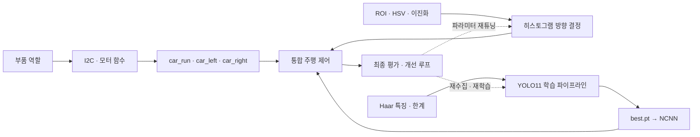

---

## 3. 일정 및 시간 배분 총괄

### 3-1. 차시별 일정

| 차시 | 날짜 | 시간 | 주제 | 이론 | 실습 | 이론 비율 |
|:---:|---|:---:|---|:---:|:---:|:---:|
| 1 | 11월 26일(목) | 4H | 간단 조립, 앱으로 실행 | 20분 | 3시간 40분 | 8% |
| 2 | 11월 27일(금) | 3H | 라즈봇 동작 방법, 개발환경 셋팅, 동작 제어 테스트 | 30분 | 2시간 30분 | 17% |
| 3 | 12월 2일(수) | 3H | 기본 자율주행 테스트 | 30분 | 2시간 30분 | 17% |
| 4 | 12월 3일(목) | 4H | Haar Cascade 간단 설명, YOLO11 기본 train·test | 50분 | 3시간 10분 | 21% |
| 5 | 12월 4일(금) | 3H | 기본 자율주행 + YOLO11 위주 주행 | 20분 | 2시간 40분 | 11% |
| 6 | 12월 7일(월) | 3H | 최종 테스트, 코칭 | 10분 | 2시간 50분 | 6% |
| **합계** | | **20H** | | **2시간 40분 (13%)** | **17시간 20분 (87%)** | |

### 3-2. 일정 간트 차트

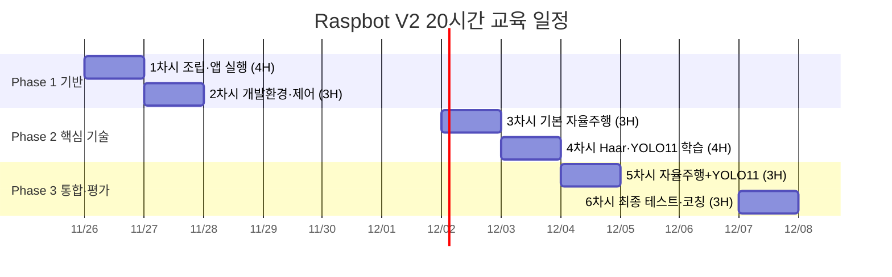

### 3-3. 시간 배분

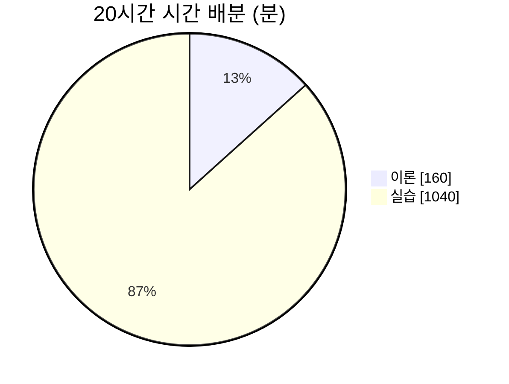

```mermaid
xychart-beta
    title "차시별 이론 · 실습 시간 (분)"
    x-axis ["1차시", "2차시", "3차시", "4차시", "5차시", "6차시"]
    y-axis "시간(분)" 0 --> 240
    bar [240, 180, 180, 240, 180, 180]
    bar [20, 30, 30, 50, 20, 10]
```

> 막대 2개 중 위 막대는 차시 전체 시간, 아래 막대는 그중 이론 시간입니다.

### 3-4. 실습 유형별 시간 분포

| 실습 유형 | 1차시 | 2차시 | 3차시 | 4차시 | 5차시 | 6차시 | 합계 |
|---|:---:|:---:|:---:|:---:|:---:|:---:|:---:|
| 하드웨어 조립·점검 | 150분 | — | 20분 | — | — | 20분 | 190분 |
| 환경 구축·접속 | 50분 | 45분 | — | — | 30분 | — | 125분 |
| 코딩·단위 테스트 | — | 75분 | 90분 | 110분 | 60분 | — | 335분 |
| 데이터·모델 작업 | — | — | — | 80분 | — | — | 80분 |
| 트랙 주행·미션 | 20분 | 30분 | 40분 | — | 70분 | 110분 | 270분 |
| 코칭·회고 | — | — | — | — | — | 40분 | 40분 |
| **합계** | **220분** | **150분** | **150분** | **190분** | **160분** | **170분** | **1,040분** |

### 3-5. 운영 규칙

- 매 차시 **첫 5분은 단계도 확인** (이론 시간에 포함): 오늘의 단계, 통과 조건, 산출물
- 이론은 **실습에 바로 필요한 내용만** 슬라이드 5~10장 이내로 진행, 나머지는 실습 중 현장 설명 (Just-in-Time)
- 휴식은 진행 상황에 맞춰 약 50분마다 10분 (실습 블록 안에서 유동 운영)
- 팀 구성: 2~3인 1팀, 1팀 1대 / 역할은 **드라이버(코딩) · 네비게이터(검토·기록) · 테스터(트랙·촬영)** 를 차시마다 교대
- 차시 종료 10분 전 **"오늘의 통과 조건"** 체크 → 미통과 팀은 보완 계획 기록

---

## 4. 교수·학습 운영 모형

### 4-1. 차시 공통 흐름 (I-D-P-M-C 모형)

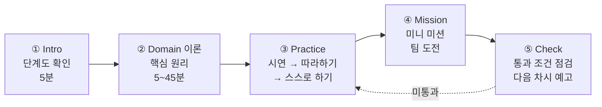

| 단계 | 강사 활동 | 학습자 활동 | 비고 |
|---|---|---|---|
| ① Intro | 단계도에서 오늘 위치 표시, 통과 조건 제시 | 지난 차시 산출물 확인 | 매 차시 5분 고정 |
| ② 이론 | 도식 중심 설명, 실제 코드 위치 연결 | 핵심 개념 메모, 질문 | 슬라이드 5~10장 |
| ③ 실습 | 화면 공유 시연 → 순회 지도 | 따라하기 → 값 바꿔 보기 | "I do → We do → You do" |
| ④ 미션 | 미션 규칙·시간 안내, 기록 | 팀별 도전·반복 개선 | 성공 기준 명확화 |
| ⑤ 점검 | 체크리스트 점검, 보완 안내 | 통과 조건 자가 점검 | 미통과 사유 기록 |

### 4-2. 실습 3단계 (I do → We do → You do)

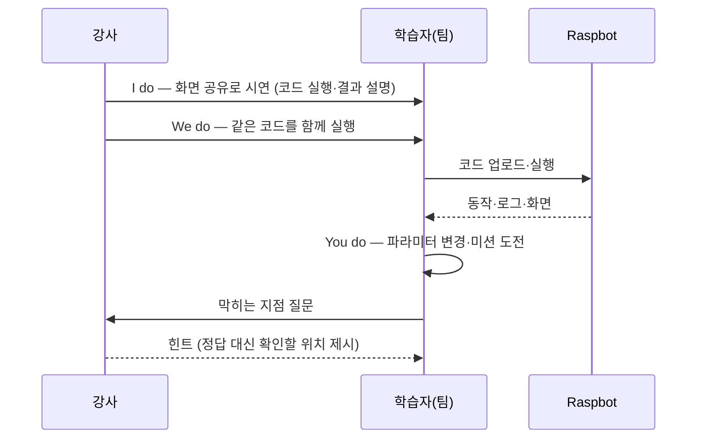

### 4-3. 팀 역할 로테이션

| 차시 | 드라이버 (코딩) | 네비게이터 (검토·기록) | 테스터 (트랙·촬영) |
|:---:|:---:|:---:|:---:|
| 1 | A | B | C |
| 2 | B | C | A |
| 3 | C | A | B |
| 4 | A | B | C |
| 5 | B | C | A |
| 6 | 팀 합의 | 팀 합의 | 팀 합의 |

> 2인 팀은 네비게이터와 테스터를 한 사람이 맡습니다.

### 4-4. 수준별 지원 전략

| 수준 | 판단 기준 | 지원 방법 |
|---|---|---|
| 빠른 팀 | 통과 조건을 시간의 70% 안에 달성 | **도전 과제** 제공 (각 차시 "확장 미션" 참고) |
| 표준 팀 | 시간 내 통과 | 기본 진행 |
| 지원 필요 팀 | 실습 중반까지 단계 진입 실패 | 강사·조교 1:1 지원, **완성 코드/기준 파라미터** 제공 후 원리 설명 |

---

## 5. 1차시 — 간단 조립, 앱으로 실행

### 5-1. 차시 개요

| 항목 | 내용 |
|---|---|
| **일시** | 2026년 11월 26일(목) · 4시간 (이론 20분 / 실습 3시간 40분) |
| **단계** | Phase 1 · 기반 — "하드웨어 완성" |
| **핵심 질문** | 자율주행 자동차는 어떤 부품으로 이루어지고, 각 부품은 무슨 일을 하는가? |
| **준비물** | Raspbot V2 키트, 드라이버 세트, 충전된 배터리, 스마트폰, 트랙 |
| **산출물** | 조립된 Raspbot, 부품 체크리스트, 앱 주행 기록 |

### 5-2. 학습 목표

**이론 목표**
1. 자율주행 시스템의 3요소(**인식 · 판단 · 제어**)를 Raspbot V2 부품에 대응시켜 설명할 수 있다.
2. 라즈베리파이 · 확장 쉴드 · 기어 모터 · 서보 · 카메라 · 초음파 · 라인센서의 역할을 구분할 수 있다.
3. 20시간 과정의 단계도와 최종 미션(차선 + 신호등 + 장애물 + 주차)을 설명할 수 있다.

**실습 목표**
1. 부품 체크리스트로 누락·파손 부품을 확인할 수 있다.
2. 매뉴얼 순서대로 섀시 → 모터 → 쉴드·Pi → 서보·카메라를 조립할 수 있다.
3. 배선·전원·부팅을 점검하고 앱으로 원격 주행과 카메라 화면을 확인할 수 있다.
4. 앱 조종으로 트랙 1바퀴를 주행하며 로봇의 회전 반경·속도 감각을 익힐 수 있다.

### 5-3. 단계도

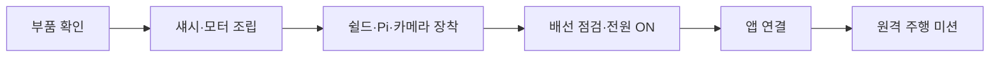

### 5-4. 이론 (20분)

#### ① 자율주행의 3요소와 Raspbot V2 부품 대응

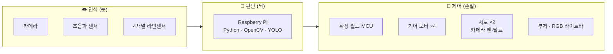

#### ② 부품 역할 정리

| 부품 | 역할 | 사람에 비유 | 이후 차시 연결 |
|---|---|---|---|
| Raspberry Pi | 프로그램 실행, 영상 처리, AI 추론 | 뇌 | 2~6차시 모든 코드 실행 |
| 확장 쉴드 (MCU) | Pi 명령(I2C)을 받아 모터·서보 구동 | 척수·신경 | 2차시 I2C 제어 |
| 기어 모터 ×4 | 바퀴 회전 (좌 2 · 우 2) | 다리 | 2차시 모터 함수, 3차시 조향 |
| 서보 ×2 | 카메라 좌우(팬) · 상하(틸트) 각도 | 목 | 3차시 카메라 각도 조정 |
| 카메라 | 도로·객체 영상 입력 | 눈 | 3~6차시 핵심 센서 |
| 초음파 센서 | 앞 물체까지 거리 측정 | 박쥐의 초음파 | 2차시 거리 정지 미션 |
| 라인센서 (4채널) | 바닥 검은선/흰선 감지 | 발바닥 감각 | 2차시 센서 테스트 |
| 부저 · RGB | 상태 알림 (경고음, 색상) | 목소리·표정 | 5차시 경고음 |
| 배터리 | 전원 공급 | 심장 | 매 차시 충전 확인 |

#### ③ 과정 오리엔테이션
- 소개 영상 재생 (구조도 영상 약 57초 또는 차시별 영상 약 1분 34초)
- 최종 미션 시연 영상 1편 시청 → "6차시에 우리 팀 로봇이 이것을 한다"는 목표 공유
- 팀 구성, 역할(드라이버·네비게이터·테스터), 장비 관리 규칙 안내

### 5-5. 시간표

| 시간 | 구분 | 내용 | 강사 활동 | 학습자 활동 |
|---|:---:|---|---|---|
| 00:00 ~ 00:05 | 이론 | 단계도 확인 | 6단계 단계도·최종 미션 제시 | 목표 확인 |
| 00:05 ~ 00:20 | 이론 | 오리엔테이션: 소개 영상, 자율주행 3요소, 부품 역할 | 영상 재생, 부품 실물 시연 | 부품 역할표 메모 |
| 00:20 ~ 00:40 | 실습 | 부품 개수·상태 확인 | 체크리스트 배포 | 부품 분류·체크 |
| 00:40 ~ 01:20 | 실습 | 섀시 + 기어 모터 4개 조립 | 모터 방향 주의점 시연 | 조립, 모터 위치 라벨링 |
| 01:20 ~ 01:30 | 휴식 | — | — | — |
| 01:30 ~ 02:10 | 실습 | 확장 쉴드 · 라즈베리파이 장착 | 스페이서·핀 정렬 점검 | 장착, 헤더 핀 정렬 확인 |
| 02:10 ~ 02:30 | 실습 | 서보 · 카메라 장착 | 리본 케이블 방향 시연 | 장착, 서보 중앙값 확인 |
| 02:30 ~ 02:50 | 실습 | 배선 점검, 배터리 장착, 전원 ON·부팅 확인 | 팀별 순회 점검 | 부팅 LED·부저 확인 |
| 02:50 ~ 03:00 | 휴식 | — | — | — |
| 03:00 ~ 03:40 | 실습 | 앱 연결(Wi-Fi), 전/후/좌/우 주행, 카메라·조명 체험 | 연결 절차 시연 | 기능별 체험·기록 |
| 03:40 ~ 03:55 | 실습 | 미니 미션: 앱으로 트랙 1바퀴 | 시간 기록 | 팀별 주행 |
| 03:55 ~ 04:00 | 점검 | 통과 조건 점검, 정리·다음 차시 안내 | 체크리스트 확인 | 장비 정리, 배터리 충전 |

> 휴식 20분은 실습 시간 안에서 유동 운영합니다 (실습 총 3시간 40분 기준).

### 5-6. 실습 상세

#### 실습 1-1. 부품 확인 (20분)

| 분류 | 확인 항목 | 수량 확인 | 상태 |
|---|---|:---:|:---:|
| 본체 | 섀시 상판·하판 | ☐ | ☐ |
| 구동부 | 기어 모터 ×4, 바퀴 ×4 | ☐ | ☐ |
| 제어부 | Raspberry Pi, 확장 쉴드, microSD | ☐ | ☐ |
| 센서 | 카메라 + 리본 케이블, 초음파, 라인센서 | ☐ | ☐ |
| 서보 | 서보 ×2, 팬·틸트 브래킷 | ☐ | ☐ |
| 전원 | 배터리, 충전기 | ☐ | ☐ |
| 체결 | 나사·너트·스페이서 (종류별 분류 트레이) | ☐ | ☐ |

- 나사는 길이별로 트레이에 분류 → 조립 중 혼동 방지
- 파손 부품 발견 시 즉시 강사에게 보고 (예비 부품 교체)

#### 실습 1-2. 조립 (1시간 50분)

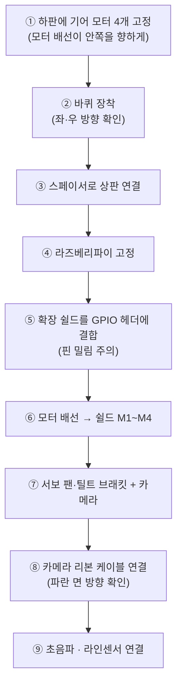

**조립 주의 포인트**

| 단계 | 흔한 실수 | 확인 방법 |
|---|---|---|
| 모터 고정 | 좌·우 모터 방향이 반대로 장착 | 2차시 모터 테스트에서 한쪽만 역회전 → 배선/설정 확인 |
| 모터 배선 | M1~M4 순서 혼동 | 모터에 `M1(좌앞) M2(좌뒤) M3(우앞) M4(우뒤)` 라벨 부착 |
| GPIO 결합 | 핀이 한 칸 밀려 꽂힘 | 측면에서 핀 정렬 육안 확인 |
| 카메라 케이블 | 리본 방향 반대 | 커넥터의 접점 면 방향을 매뉴얼과 비교 |
| 서보 | 각도 끝에서 강제로 돌림 | 서보 혼은 전원 OFF 상태에서 손으로 무리하게 돌리지 않기 |

#### 실습 1-3. 전원 확인 (20분)
1. 배터리 충전 상태 확인 (충전기 LED)
2. 전원 스위치 ON → 쉴드 LED, 부저 비프음, 라즈베리파이 부팅 LED 확인
3. 부팅 약 30~60초 대기 → Wi-Fi 핫스팟 또는 공용 네트워크 연결 확인
4. 이상 증상 시 아래 트러블슈팅 표로 점검

#### 실습 1-4. 앱 실행 (40분)
1. 스마트폰을 로봇 Wi-Fi(또는 같은 네트워크)에 연결
2. 제조사 앱 실행 → 로봇 검색·연결
3. 기능 체험 순서: **전진 → 후진 → 좌회전 → 우회전 → 정지 → 속도 변경 → 카메라 화면 → 서보(카메라 각도) → 조명·부저**
4. 기능별 동작 여부를 체크리스트에 기록

| 기능 | 동작 여부 | 관찰 메모 (예: 회전 반경, 지연 시간) |
|---|:---:|---|
| 전진 / 후진 | ☐ | |
| 좌회전 / 우회전 | ☐ | |
| 속도 변경 | ☐ | |
| 카메라 화면 | ☐ | |
| 서보 (카메라 방향) | ☐ | |
| 조명 / 부저 | ☐ | |

#### 실습 1-5. 미니 미션 — 앱 조종 트랙 1바퀴 (15분)
- **규칙**: 앱으로만 조종, 트랙 1바퀴, 차선 이탈 시 이탈 지점에서 재출발
- **기록**: 완주 시간, 이탈 횟수, "코너에서 어려웠던 점" 1줄
- **목적**: 사람이 운전할 때 무엇을 보고 판단하는지 체감 → 3차시 알고리즘 설계의 출발점

### 5-7. 트러블슈팅

| 증상 | 원인 후보 | 조치 |
|---|---|---|
| 전원이 켜지지 않음 | 배터리 방전, 극성 반대 | 충전 확인, 배터리 방향 재확인 |
| 부팅 LED만 켜지고 Wi-Fi 없음 | microSD 미장착·불량 | microSD 재장착, 예비 카드 교체 |
| 앱에서 로봇이 검색되지 않음 | 스마트폰이 다른 Wi-Fi에 연결 | 로봇과 같은 네트워크 연결, 모바일 데이터 OFF |
| 카메라 화면이 검게 나옴 | 리본 케이블 방향·체결 불량 | 전원 OFF 후 케이블 재체결 |
| 한쪽 바퀴만 반대로 회전 | 모터 배선 극성 반대 | 해당 모터 커넥터 방향 확인 |
| 서보가 떨림 | 전압 부족, 기구 간섭 | 배터리 충전, 브래킷 간섭 확인 |

### 5-8. 통과 조건 체크리스트
- [ ] 부품 체크리스트 작성 완료
- [ ] 바퀴 4방향 정상 회전 (앱 조작 기준)
- [ ] 서보 좌·우 동작 확인
- [ ] 앱에서 카메라 화면 확인
- [ ] 앱으로 트랙 1바퀴 주행

### 5-9. 형성 평가 (Exit Ticket)
1. 자율주행의 3요소를 쓰고, 각각에 해당하는 Raspbot 부품을 1개씩 적으시오.
2. 라즈베리파이가 모터를 **직접** 돌리지 않고 확장 쉴드를 거치는 이유를 추측해 보시오.
3. 앱 조종 중 코너에서 무엇을 보고 핸들(방향)을 결정했는가?

### 5-10. 확장 미션 (빠른 팀)
- 트랙 1바퀴 **최단 시간** 기록 도전, 이탈 0회 유지
- 카메라 화면만 보고(로봇을 직접 보지 않고) 1바퀴 주행 → "카메라 시야의 한계" 체험

### 5-11. 강사 메모
- 조립 단계는 진도 차이가 크게 벌어지므로 **조교 1명당 3팀 이내**로 순회
- 01:20 시점 모터 조립 미완료 팀은 강사가 직접 보조
- 종료 시 **배터리 전량 충전** 지시 (2차시 시작 지연 방지)

---

## 6. 2차시 — 라즈봇 동작 방법, 개발환경 셋팅, 동작 제어 테스트

### 6-1. 차시 개요

| 항목 | 내용 |
|---|---|
| **일시** | 2026년 11월 27일(금) · 3시간 (이론 30분 / 실습 2시간 30분) |
| **단계** | Phase 1 · 기반 — "코드로 움직이기" |
| **핵심 질문** | PC에서 작성한 코드가 어떻게 라즈봇의 바퀴를 돌리는가? |
| **준비물** | 노트북(VNC Viewer · FileZilla · VS Code), 팀별 IP 확인표, 조립된 Raspbot |
| **산출물** | 개발환경 접속 정보표, 센서 테스트 결과표, 미니 미션 코드 |

### 6-2. 학습 목표

**이론 목표**
1. 라즈베리파이 → I2C → 쉴드 MCU → 모터/서보로 이어지는 **제어 신호 흐름**을 설명할 수 있다.
2. 4륜 **차동 구동**(좌·우 바퀴 속도 차이로 회전)의 원리와 속도 값(-255 ~ 255)의 의미를 설명할 수 있다.
3. SSH(명령), VNC(화면), FTP(파일)의 용도 차이와 **크로스 개발** 흐름을 설명할 수 있다.
4. 초음파 센서의 거리 측정 원리(음파 왕복 시간)와 라인센서의 반사광 감지 원리를 설명할 수 있다.

**실습 목표**
1. 라즈베리파이의 IP를 확인하고 PC에서 SSH·VNC로 접속할 수 있다.
2. `raspi-config`로 SSH·VNC·I2C를 활성화하고 `i2cdetect`로 쉴드를 확인할 수 있다.
3. `02_Basic/` 노트북을 실행해 부저·RGB·서보·모터·초음파·라인센서·카메라를 제어할 수 있다.
4. 모터 함수로 사각형 경로를 주행하고, 초음파 거리로 정지하는 코드를 작성할 수 있다.

### 6-3. 단계도

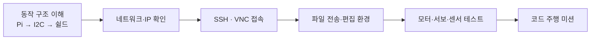

### 6-4. 이론 (30분)

#### ① 제어 신호 흐름 (10분)

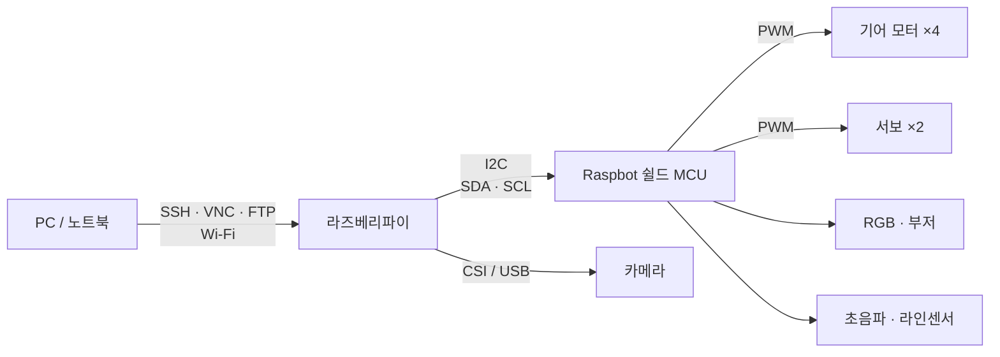

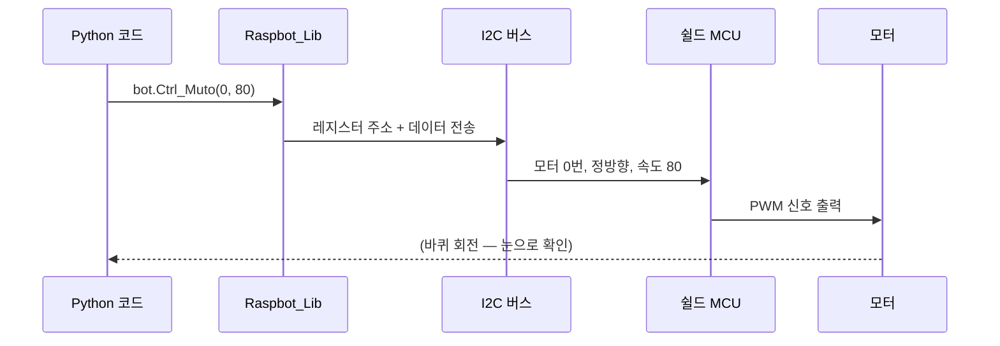

- **I2C**: 두 가닥 선(SDA 데이터 · SCL 클럭)으로 여러 장치와 통신하는 방식. 장치마다 **주소**가 있음 → `i2cdetect -y 1`로 확인
- 라즈베리파이 GPIO는 모터를 직접 돌릴 만큼 전류를 낼 수 없으므로, **쉴드 MCU가 모터 드라이버 역할**을 대신함

#### ② 차동 구동 원리 (10분)

| 동작 | 왼쪽 바퀴 (M1·M2) | 오른쪽 바퀴 (M3·M4) | 원리 |
|---|:---:|:---:|---|
| 전진 | +속도 | +속도 | 양쪽 같은 속도 |
| 후진 | -속도 | -속도 | 양쪽 반대 방향 |
| 좌회전 (제자리) | -속도 | +속도 | 좌우 반대 회전 → 제자리 회전 |
| 우회전 (제자리) | +속도 | -속도 | 좌우 반대 회전 |
| 완만한 좌회전 | 낮은 속도 | 높은 속도 | 속도 차이만큼 곡선 주행 |
| 정지 | 0 | 0 | — |

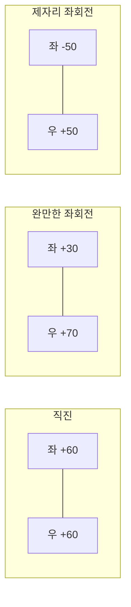

- 속도 범위: **-255 ~ 255** (부호 = 방향, 크기 = 속도)
- 너무 낮은 속도(약 20 이하)는 마찰 때문에 바퀴가 돌지 않을 수 있음 → **최소 구동 속도**를 실습에서 찾기

#### ③ 크로스 개발과 원격 접속 (5분)

| 도구 | 프로토콜 | 용도 | 언제 쓰나 |
|---|---|---|---|
| 터미널 `ssh` | SSH | 명령 실행 | 코드 실행, 설정 변경, 로그 확인 |
| VNC Viewer | VNC | 원격 데스크톱 화면 | OpenCV 창(카메라·마스크) 확인 |
| FileZilla | SFTP | 파일 전송 | PC에서 작성한 코드·모델 업로드 |
| VS Code (Remote-SSH) | SSH | 원격 편집 | 라즈봇의 코드를 PC에서 바로 수정 |
| Jupyter | HTTP | 셀 단위 실행 | `02_Basic/` 노트북 테스트 |

#### ④ 센서 원리 (5분)

| 센서 | 원리 | 출력 | 실습 활용 |
|---|---|---|---|
| 초음파 | 음파를 쏘고 반사되어 돌아오는 시간 측정 → 거리 = 시간 × 음속 ÷ 2 | 거리(mm) | 20cm 이하 정지 |
| 라인센서 (4채널) | 적외선 반사광 세기 (검은색은 흡수 → 반사 약함) | 채널별 0/1 | 바닥 선 감지 확인 |
| 카메라 | 이미지 센서, 초당 수십 장 프레임 | BGR 이미지 | 3차시 이후 핵심 |

### 6-5. 시간표

| 시간 | 구분 | 내용 | 강사 활동 | 학습자 활동 |
|---|:---:|---|---|---|
| 00:00 ~ 00:05 | 이론 | 단계도 확인 | 오늘 위치·통과 조건 제시 | 1차시 산출물 확인 |
| 00:05 ~ 00:30 | 이론 | 제어 신호 흐름, 차동 구동, 크로스 개발, 센서 원리 | 도식 설명, 코드 위치 연결 | 개념 메모 |
| 00:30 ~ 00:45 | 실습 | Wi-Fi·IP 확인, `raspi-config` 설정 | 시연 | IP 확인표 작성 |
| 00:45 ~ 01:05 | 실습 | SSH · VNC 접속, FileZilla · VS Code 연결 | 순회 지도 | 접속 성공 확인 |
| 01:05 ~ 01:15 | 실습 | Jupyter 실행, `i2cdetect` 확인 | 시연 | I2C 주소 기록 |
| 01:15 ~ 01:40 | 실습 | 부저 → RGB → 서보 테스트 | 시연 → 순회 | 노트북 실행·값 변경 |
| 01:40 ~ 02:10 | 실습 | 모터 → 초음파 → 라인센서 → 카메라 테스트 | 안전 주의 (바퀴 띄우기) | 결과표 작성 |
| 02:10 ~ 02:15 | 휴식 | — | — | — |
| 02:15 ~ 02:55 | 실습 | 미니 미션: 사각형 주행, 초음파 거리 정지 | 미션 규칙 안내 | 코드 작성·테스트 |
| 02:55 ~ 03:00 | 점검 | 통과 조건 점검, 3차시 예고 | 체크 | 자가 점검 |

### 6-6. 실습 상세

#### 실습 2-1. 개발환경 셋팅 (45분)

**STEP 1 — 라즈베리파이 IP 확인 및 인터페이스 활성화** (VNC 또는 모니터 연결 상태에서)

```bash
hostname -I            # 라즈베리파이 IP 확인 (예: 192.168.0.23)
sudo raspi-config      # Interface Options → SSH / VNC / I2C 활성화
i2cdetect -y 1         # 쉴드 I2C 주소 확인 (표에 주소가 보이면 정상)
```

**STEP 2 — PC에서 SSH 접속**

```bash
ssh pi@<라즈봇_IP>
```

**STEP 3 — VNC Viewer로 원격 데스크톱 접속** → 주소창에 `<라즈봇_IP>` 입력

**STEP 4 — 파일 전송·편집 환경**
- FileZilla: 호스트 `sftp://<라즈봇_IP>`, 포트 22 → PC의 코드 폴더를 라즈봇 홈 폴더로 업로드
- VS Code: Remote-SSH 확장 → `pi@<라즈봇_IP>` 연결 → 원격 폴더 열기

**팀별 접속 정보표 (작성)**

| 항목 | 값 |
|---|---|
| 팀 번호 / 로봇 번호 | |
| 라즈봇 IP | |
| SSH 접속 성공 | ☐ |
| VNC 접속 성공 | ☐ |
| FileZilla 업로드 성공 | ☐ |
| I2C 주소 | |

#### 실습 2-2. 동작 제어 테스트 (55분) — `02_Basic/` 노트북을 순서대로 실행

| 순서 | 파일 | 확인 내용 | 핵심 API | 바꿔 볼 값 |
|:---:|---|---|---|---|
| 1 | `01_Buzzer driver.ipynb` | 부저 ON/OFF | `bot.Ctrl_BEEP_Switch(1/0)` | 울림 간격 |
| 2 | `02_RGB Light bar test.ipynb` | RGB 라이트 색상 변경 | 라이트바 제어 함수 | 색상·효과 |
| 3 | `03_Servo control.ipynb` | 서보 각도 제어 (카메라 방향) | `bot.Ctrl_Servo(id, angle)` | 0~180° |
| 4 | `04_Motor control.ipynb` | 전진·후진·좌회전·우회전·정지, 속도 변경 | `bot.Ctrl_Muto(motor, speed)` | -255 ~ 255 |
| 5 | `05_Ultrasonic distance measurement.ipynb` | 초음파 거리 측정 | `bot.Ctrl_Ulatist_Switch(1)`, `read_data_array(0x1A/0x1B, 1)` | 측정 거리 |
| 6 | `06_Status of four-way line patrol module.ipynb` | 4채널 라인센서 값 확인 | `read_data_array(0x0A, 1)` | 바닥 색 |
| 7 | `07_Camera_Driving.ipynb` | 카메라 영상 + 주행 | OpenCV `VideoCapture` | 해상도 |

> 모터 테스트는 **로봇을 받침대 위에 올려 바퀴를 띄운 상태**에서 먼저 실행합니다.

**모터 제어 함수 (2차시 핵심 코드)**

```python
from Raspbot_Lib import Raspbot
import time

bot = Raspbot()

def car_run(speed_left, speed_right):
    """직진: 왼쪽(M1·M2), 오른쪽(M3·M4) 속도 지정 (-255 ~ 255)"""
    bot.Ctrl_Muto(0, speed_left)   # M1 왼쪽 앞
    bot.Ctrl_Muto(1, speed_left)   # M2 왼쪽 뒤
    bot.Ctrl_Muto(2, speed_right)  # M3 오른쪽 앞
    bot.Ctrl_Muto(3, speed_right)  # M4 오른쪽 뒤

def car_left(speed):
    """제자리 좌회전"""
    car_run(-speed, speed)

def car_right(speed):
    """제자리 우회전"""
    car_run(speed, -speed)

def car_stop():
    for motor_id in range(4):
        bot.Ctrl_Muto(motor_id, 0)

car_run(60, 60); time.sleep(1.0)
car_stop()
```

**초음파 거리 읽기**

```python
bot.Ctrl_Ulatist_Switch(1)          # 초음파 ON
time.sleep(0.1)
high = bot.read_data_array(0x1B, 1)[0]
low = bot.read_data_array(0x1A, 1)[0]
distance_mm = (high << 8) | low      # 상위 바이트 + 하위 바이트
print(f"거리: {distance_mm} mm")
bot.Ctrl_Ulatist_Switch(0)          # 사용 후 OFF
```

**센서 테스트 결과표 (작성)**

| 장치 | 동작 | 측정·관찰 값 | 비고 |
|---|:---:|---|---|
| 부저 | ☐ | | |
| RGB | ☐ | | |
| 서보 1 (좌우) | ☐ | 중앙 각도: | |
| 서보 2 (상하) | ☐ | 중앙 각도: | |
| 모터 | ☐ | 최소 구동 속도: | |
| 초음파 | ☐ | 10cm 실측값: / 30cm 실측값: | |
| 라인센서 | ☐ | 흰 바닥: / 검은 선: | |
| 카메라 | ☐ | 해상도: | |

#### 실습 2-3. 미니 미션 (40분)

**미션 A — 사각형 경로 주행**

```mermaid
flowchart LR
    S((출발)) --> F1[전진 1초] --> T1[우회전 90°] --> F2[전진 1초] --> T2[우회전 90°] --> F3[전진 1초] --> T3[우회전 90°] --> F4[전진 1초] --> T4[우회전 90°] --> E((도착))
```

- 회전 90°에 필요한 시간(`time.sleep`)을 실험으로 찾기 → 바닥 재질·배터리 잔량에 따라 달라짐을 관찰
- 성공 기준: 출발점에서 **30cm 이내**로 복귀

**미션 B — 초음파 거리 기반 정지**

```mermaid
flowchart TD
    A[초음파 ON] --> B[거리 측정]
    B --> C{거리 ≤ 200mm?}
    C -- 예 --> D[정지 + 부저]
    C -- 아니오 --> E[전진]
    E --> B
    D --> F{장애물 사라짐?}
    F -- 예 --> B
    F -- 아니오 --> D
```

```python
try:
    bot.Ctrl_Ulatist_Switch(1)
    while True:
        h = bot.read_data_array(0x1B, 1)[0]
        l = bot.read_data_array(0x1A, 1)[0]
        dist = (h << 8) | l
        if dist <= 200:          # 20cm 이하
            car_stop()
            bot.Ctrl_BEEP_Switch(1)
        else:
            bot.Ctrl_BEEP_Switch(0)
            car_run(40, 40)
        time.sleep(0.05)
finally:
    car_stop()
    bot.Ctrl_BEEP_Switch(0)
    bot.Ctrl_Ulatist_Switch(0)
```

> `try ... finally`로 **프로그램이 중단되어도 모터가 반드시 멈추도록** 작성하는 습관을 이 차시에서 들입니다.

### 6-7. 트러블슈팅

| 증상 | 원인 후보 | 조치 |
|---|---|---|
| `ssh: connect ... timed out` | PC와 라즈봇이 다른 네트워크 | 같은 공유기 연결 확인, IP 재확인 |
| VNC 검은 화면 | 헤드리스 해상도 미설정 | `raspi-config` → Display Options → 해상도 지정 |
| `i2cdetect`에 주소가 없음 | I2C 비활성화, 쉴드 결합 불량 | I2C 활성화 후 재부팅, 헤더 핀 재결합 |
| `Raspbot_Lib` import 오류 | 라이브러리 경로·가상환경 | 기본 Python 환경에서 실행, 경로 확인 |
| 다른 프로그램 실행 후 장치 응답 없음 | 이전 프로세스가 `bot` 객체 점유 | 노트북 커널 재시작, `del bot` 후 재실행 |
| 모터 한쪽만 반대 | 배선 극성 | 해당 모터 속도 부호 반전 또는 배선 교체 |
| 초음파 값이 0 또는 튐 | 센서 OFF, 측정 각도 | `Ctrl_Ulatist_Switch(1)` 확인, 평평한 벽으로 측정 |

### 6-8. 통과 조건 체크리스트
- [ ] PC에서 SSH·VNC 접속 성공
- [ ] `i2cdetect`에서 쉴드 주소 확인
- [ ] 모터·서보·초음파·라인센서·카메라 테스트 모두 동작
- [ ] 미니 미션 1개 이상 성공

### 6-9. 형성 평가 (Exit Ticket)
1. `bot.Ctrl_Muto(0, -80)`은 어떤 동작을 하는가? (모터 번호, 방향, 속도)
2. 왼쪽 30, 오른쪽 70으로 주행하면 로봇은 어느 방향으로 휘는가? 이유는?
3. SSH와 VNC 중 OpenCV 카메라 창을 보려면 무엇을 써야 하는가?

### 6-10. 확장 미션 (빠른 팀)
- 초음파 거리에 **비례해 속도를 줄이는** 코드 (멀면 빠르게, 가까우면 천천히)
- 라인센서 4채널 값으로 검은 선을 따라가는 **라인트레이서** 구현 → 3차시 카메라 방식과 비교

### 6-11. 강사 메모
- 접속 단계에서 가장 시간이 많이 소요됨 → **팀별 IP 확인표를 미리 칠판에 게시**
- 모터 테스트 전 "바퀴 띄우기" 안전 확인 필수
- 미니 미션 B의 `try ... finally` 패턴은 3~6차시 모든 주행 코드의 기본 구조임을 강조

---

## 7. 3차시 — 기본 자율주행 테스트

### 7-1. 차시 개요

| 항목 | 내용 |
|---|---|
| **일시** | 2026년 12월 2일(수) · 3시간 (이론 30분 / 실습 2시간 30분) |
| **단계** | Phase 2 · 핵심 기술 — "차선 주행 완주" |
| **핵심 질문** | 카메라 영상만으로 로봇은 어떻게 "왼쪽으로 꺾어야 한다"고 판단하는가? |
| **준비물** | 차선 트랙(직선·좌코너·우코너), 조명 환경, VNC 접속 PC |
| **산출물** | 디버깅 화면 캡처, 팀별 파라미터 기록표, 완주 기록 |

### 7-2. 학습 목표

**이론 목표**
1. **ROI**(관심 영역)를 설정하는 이유와 원근 변환(Bird's-eye view)의 효과를 설명할 수 있다.
2. BGR · HSV · Gray 색 공간의 차이와, 빨간 차선을 HSV 두 구간(0~10°, 170~180°)으로 찾는 이유를 설명할 수 있다.
3. 이진화 · 모폴로지(열림·닫힘)로 노이즈를 제거하는 원리를 설명할 수 있다.
4. 히스토그램 **좌/중/우 3등분** 비교로 방향을 결정하는 알고리즘을 순서대로 설명할 수 있다.

**실습 목표**
1. 카메라 각도(서보)와 ROI 범위를 조정해 차선이 화면 아래쪽에 잘 들어오게 할 수 있다.
2. 기본 자율주행 코드를 실행하고 디버깅 화면(마스크·히스토그램)으로 판단 근거를 확인할 수 있다.
3. 트랙바로 `Detect_Value`, `Direction_Threshold`, `Up_Threshold`, 속도를 튜닝할 수 있다.
4. 트랙 1바퀴를 완주하고 최적 파라미터를 기록표로 남길 수 있다.

### 7-3. 단계도

```mermaid
flowchart LR
    A[카메라 확인] --> B[ROI 설정] --> C[색상 필터<br/>HSV · 그레이] --> D[이진화 · 노이즈 제거] --> E[히스토그램 3등분<br/>좌·중·우 비교] --> F[방향 결정 · 모터 제어] --> G[파라미터 튜닝 · 완주]
```

### 7-4. 이론 (30분)

#### ① 영상 처리 파이프라인 전체 (5분)

```mermaid
flowchart LR
    A["원본 프레임<br/>320×240 BGR"] --> B["ROI 자르기<br/>ROI_Top_Y ~ ROI_Bottom_Y"]
    B --> C["원근 변환<br/>위에서 본 시점"]
    C --> D1["HSV 변환<br/>빨간색 2구간"]
    C --> D2["Gray 변환<br/>밝은 회색·흰색"]
    D1 --> E["마스크 결합<br/>OR 연산"]
    D2 --> E
    E --> F["모폴로지<br/>CLOSE → OPEN"]
    F --> G["열(column)별 합<br/>히스토그램"]
    G --> H["좌·중·우 3등분"]
    H --> I["방향 결정<br/>LEFT · UP · RIGHT"]
```

#### ② ROI와 원근 변환 (5분)

| 개념 | 설명 | 효과 |
|---|---|---|
| ROI (Region of Interest) | 화면 중 도로가 보이는 아래쪽만 잘라 사용 | 먼 곳 배경·조명 반사 같은 노이즈 제거, 연산량 감소 |
| 원근 변환 | 사다리꼴 영역을 직사각형으로 펴서 "위에서 내려다본" 영상으로 변환 | 차선 폭이 거리와 무관하게 일정 → 좌우 비교가 공정해짐 |

```
   원본 화면                       원근 변환 후
 ┌───────────────┐              ┌───────────────┐
 │   (배경·벽)    │              │ │           │ │
 │   ╱       ╲   │  ROI 자르기   │ │           │ │
 │  ╱  도로   ╲  │ ──────────▶  │ │   도로    │ │
 │ ╱           ╲ │  원근 변환    │ │           │ │
 └───────────────┘              └───────────────┘
```

#### ③ 색 공간과 차선 마스크 (8분)

| 색 공간 | 구성 | 장점 | 사용처 |
|---|---|---|---|
| BGR | 파랑·초록·빨강 | 카메라 원본 | 화면 표시 |
| HSV | 색상(H)·채도(S)·명도(V) | 조명이 바뀌어도 색상(H)이 비교적 안정 | **빨간 차선** 검출 |
| Gray | 밝기 하나 | 단순·빠름 | **흰/회색 차선** 검출 |

- **빨간색은 HSV 색상환의 양 끝**에 걸쳐 있음 → `0~10°`와 `170~180°` 두 구간을 각각 찾아 합침
- 흰/회색 차선: Gray에서 `max(Detect_Value - 30, 80)`보다 밝은 픽셀, 단 50 이하(검정 도로)는 제외

```python
# 03_self_driving/1_autoplot___test.py — detect_road_lines() 핵심
hsv = cv2.cvtColor(color_frame, cv2.COLOR_BGR2HSV)
mask_red1 = cv2.inRange(hsv, (0, 70, 50), (10, 255, 255))
mask_red2 = cv2.inRange(hsv, (170, 70, 50), (180, 255, 255))
mask_red = cv2.bitwise_or(mask_red1, mask_red2)

threshold_gray = max(detect_value - 30, 80)
_, mask_gray = cv2.threshold(gray_frame, threshold_gray, 255, cv2.THRESH_BINARY)

mask_lines = cv2.bitwise_or(mask_red, mask_gray)
kernel = np.ones((3, 3), np.uint8)
mask_lines = cv2.morphologyEx(mask_lines, cv2.MORPH_CLOSE, kernel)  # 끊긴 선 메우기
mask_lines = cv2.morphologyEx(mask_lines, cv2.MORPH_OPEN, kernel)   # 작은 점 노이즈 제거
```

| 모폴로지 연산 | 동작 | 효과 |
|---|---|---|
| 팽창 (Dilate) | 흰 영역을 키움 | 끊긴 선 연결 |
| 침식 (Erode) | 흰 영역을 줄임 | 작은 점 제거 |
| 닫힘 (CLOSE) | 팽창 → 침식 | 선 내부 구멍·끊김 메우기 |
| 열림 (OPEN) | 침식 → 팽창 | 작은 노이즈 점 제거 |

#### ④ 히스토그램 3등분과 방향 결정 (10분)

- 마스크에서 **흰색(255) = 도로선(경계)**, **검정(0) = 달릴 수 있는 도로**
- 각 열(column)의 흰 픽셀 합을 구해 화면을 **좌(0~33%) · 중(33~66%) · 우(66~100%)** 로 나눠 합산
- **합이 큰 쪽 = 도로선이 많은 쪽 = 막힌 쪽** → 반대쪽(도로선이 적은 쪽)으로 회전

```
  마스크(위에서 본 도로)          열별 합(히스토그램)
 ┌──────┬──────┬──────┐
 │      │      │ ████ │          LEFT    CENTER   RIGHT
 │      │      │ ████ │          ▁▁▁▁    ▁▁▁▁     ████
 │      │      │ ████ │          작음     작음     큼   → 오른쪽이 막힘 → LEFT
 └──────┴──────┴──────┘
```

```mermaid
graph TD
    A[도로선 마스크] --> B[좌 · 중 · 우 3등분 픽셀 합]
    B --> C{"|right - left| ><br/>Direction_Threshold?"}
    C -- 예 --> C2{right > left?}
    C2 -- 예 --> L["LEFT<br/>(오른쪽에 도로선이 많음)"]
    C2 -- 아니오 --> R["RIGHT<br/>(왼쪽에 도로선이 많음)"]
    C -- 아니오 --> D{"center_ratio < 0.2?<br/>(중앙이 비어 있음)"}
    D -- 예 --> U[UP 직진]
    D -- 아니오 --> E{"(left + right) / 2 <<br/>Up_Threshold?"}
    E -- 예 --> X["막다른 길<br/>부저 3회 + 무작위 LEFT/RIGHT"]
    E -- 아니오 --> U2[UP 직진 · 기본값]
```

> **우선순위**: ① 좌우 차이(회전) → ② 중앙 비어 있음(직진) → ③ 막다른 길 감지 → ④ 기본 직진
> 출처: `03_self_driving/1_autoplot___test.py`의 `analyze_histogram()`, `decide_direction()`

#### ⑤ 판단 → 모터 제어 연결 (2분)

| 방향 | 모터 동작 | 사용 속도 |
|---|---|---|
| UP | 좌·우 같은 속도 전진 | `Motor_Up_Speed` |
| LEFT | 왼쪽 느리게·오른쪽 빠르게 (또는 제자리) | `Motor_Down_Speed` (코너 속도) |
| RIGHT | 왼쪽 빠르게·오른쪽 느리게 (또는 제자리) | `Motor_Down_Speed` |

### 7-5. 시간표

| 시간 | 구분 | 내용 | 강사 활동 | 학습자 활동 |
|---|:---:|---|---|---|
| 00:00 ~ 00:05 | 이론 | 단계도 확인 | 2차시 연결(모터 함수) | — |
| 00:05 ~ 00:30 | 이론 | 영상 처리 파이프라인, ROI, 색 공간, 이진화, 히스토그램 3등분, 방향 결정 | 디버깅 화면 시연 | 알고리즘 순서도 메모 |
| 00:30 ~ 00:50 | 실습 | 카메라 확인, 서보 각도 조정, 트랙·조명 환경 세팅 | 기준 카메라 각도 안내 | `camera_test.py` 실행 |
| 00:50 ~ 01:30 | 실습 | 기본 자율주행 코드 실행 · 동작 관찰 | 관찰 포인트 제시 | 직선·코너별 판단 기록 |
| 01:30 ~ 01:40 | 휴식 | — | — | — |
| 01:40 ~ 02:20 | 실습 | 색상 필터 적용 + 트랙바로 파라미터 튜닝 | 팀별 순회 코칭 | 파라미터 변경 실험 |
| 02:20 ~ 02:55 | 실습 | 트랙 완주 테스트, 팀별 파라미터 기록 | 완주 기록 | 2회 주행·기록표 작성 |
| 02:55 ~ 03:00 | 점검 | 통과 조건 점검, 4차시 예고 | — | 자가 점검 |

### 7-6. 실습 상세 — `03_self_driving/`

| 순서 | 파일 | 실습 내용 | 관찰 포인트 |
|:---:|---|---|---|
| 1 | `camera_test.py` | 카메라 영상 확인, 카메라 각도(서보) 조정 | 차선이 화면 하단 1/2 안에 들어오는가 |
| 2 | `1_autoplot___test.py` | 기본 자율주행 실행 → 직선·코너 동작 관찰 | 터미널의 LEFT/CENTER/RIGHT 합과 결정 |
| 3 | `2_autoplot___rgb_filter.py` | 빨강/흰색(회색) 차선 색상 필터 적용 | 마스크에서 차선만 흰색으로 남는가 |
| 4 | `3_autoplot_ rgb_filter_setting.py` | 트랙바로 임계값·속도·ROI 실시간 조정 | 값 변경 즉시 마스크·주행 변화 |

#### 실습 3-1. 카메라·환경 세팅 (20분)

```bash
cd ~/Raspbot-v2-self-driving-car/03_self_driving
python3 camera_test.py
```

- 서보 2(상하)를 조정해 **로봇 바로 앞 ~ 약 40cm** 도로가 보이도록 설정
- 조명: 형광등 반사가 트랙에 강하게 비치면 위치 조정 또는 커튼으로 차단
- 기준 각도를 기록표에 기록 (이후 차시에서 재사용)

#### 실습 3-2. 기본 자율주행 실행·관찰 (40분)

```bash
python3 1_autoplot___test.py
```

**관찰 기록표 (구간별)**

| 구간 | LEFT 합 | CENTER 합 | RIGHT 합 | 결정 | 실제 동작이 맞았나? |
|---|---:|---:|---:|:---:|:---:|
| 직선 | | | | | ☐ |
| 좌코너 진입 | | | | | ☐ |
| 우코너 진입 | | | | | ☐ |
| 코너 탈출 | | | | | ☐ |

- 로봇을 손으로 트랙 위 여러 위치에 놓아 보며 **판단이 바뀌는 경계**를 찾기
- 판단이 틀린 구간은 마스크 화면을 캡처해 원인(반사광·ROI·임계값) 추정

#### 실습 3-3. 색상 필터 + 트랙바 튜닝 (40분)

```bash
python3 1_autoplot___test.py                  # 임계값 트랙바: Detect · Direction · Up · 속도 · ROI
python3 "3_autoplot_ rgb_filter_setting.py"   # 색 가중치 트랙바: R · G · B_weight · ROI · 카메라 화질
```

> `3_autoplot_ rgb_filter_setting.py`는 Gray 변환 시 R·G·B 채널 가중치(`R_weight`, `G_weight`, `B_weight`)를 조절해 **빨간 차선과 흰 차선이 모두 잘 보이는 회색 영상**을 만드는 실험용입니다. 임계값(`Detect_Value`, `Direction_Threshold`, `Up_Threshold`)과 속도 튜닝은 `1_autoplot___test.py`의 트랙바에서 진행합니다.

| 트랙바 | 의미 | 값을 올리면 | 값을 내리면 |
|---|---|---|---|
| `ROI_Top_Y` | ROI 위쪽 경계 | 가까운 곳만 봄 (반응 늦음) | 먼 곳까지 봄 (노이즈 증가) |
| `ROI_Bottom_Y` | ROI 아래쪽 경계 | 차체 바로 앞까지 포함 | 앞쪽 일부 제외 |
| `Detect_Value` | 흰/회색 판정 밝기 기준 | 밝은 것만 차선 (반사광 제거) | 어두운 회색도 차선 (놓침 감소) |
| `Direction_Threshold` | 좌우 차이 회전 기준 | 회전을 덜 함 (코너 반응 늦음) | 작은 차이에도 회전 (직진 흔들림) |
| `Up_Threshold` | 막다른 길 판정 기준 | 막다른 길 판정이 잦아짐 | 막다른 길 판정이 드물어짐 |
| `Motor_Up_Speed` | 직진 속도 | 빠름 (코너 진입 시 이탈 위험) | 느림 (안정적) |
| `Motor_Down_Speed` | 회전 속도 | 회전이 빠름 (과회전 위험) | 회전이 느림 (코너 못 돎) |
| `R_weight` · `G_weight` · `B_weight` | Gray 변환 시 채널별 가중치 | 해당 색이 더 밝게 보임 (예: R↑ → 빨간 차선 강조) | 해당 색이 어둡게 보임 |
| `Servo_1/2_Angle` | 카메라 팬·틸트 | — | — |
| Brightness · Contrast · Saturation · Gain | 카메라 화질 | 조명 환경 보정 | |

**튜닝 순서 (권장)**

```mermaid
flowchart LR
    A["① 카메라 각도<br/>Servo"] --> B["② ROI 범위"]
    B --> C["③ Detect_Value<br/>마스크 품질"]
    C --> D["④ Direction_Threshold<br/>직진 안정성"]
    D --> E["⑤ 속도<br/>Up · Down"]
    E --> F["⑥ Up_Threshold<br/>막다른 길 오판 제거"]
    F --> G{완주?}
    G -- 아니오 --> C
    G -- 예 --> H[기록표 저장]
```

> **한 번에 하나의 값만 바꾸고**, 바꾼 값과 결과를 기록합니다. (실험 설계의 기본 원칙)

#### 실습 3-4. 트랙 완주 테스트 (35분)

**튜닝 포인트 (증상 → 조정)**

| 항목 | 증상 | 조정 방향 |
|---|---|---|
| ROI 범위 | 먼 곳 노이즈(벽·물건)에 반응 | `ROI_Top_Y`를 화면 아래쪽으로 |
| 색상 임계값 | 조명 반사를 차선으로 인식 | `Detect_Value` 상향, 조명 위치 조정 |
| `Direction_Threshold` | 직진에서 좌우로 흔들림 | 값 상향 |
| `Direction_Threshold` | 코너에서 늦게 꺾여 이탈 | 값 하향 |
| `Up_Threshold` | 정상 도로에서 부저 3회 + 엉뚱한 회전 | 값 하향 (막다른 길 판정 줄이기) |
| 속도 | 코너 이탈 | `Motor_Up_Speed` 하향, `Motor_Down_Speed` 조정 |

**팀별 파라미터 기록표 (작성)**

| 시도 | Servo1/2 | ROI Top/Bottom | Detect | Dir_Th | Up_Th | Up_Speed | Down_Speed | 결과 (완주/이탈 위치) |
|:---:|---|---|:---:|:---:|:---:|:---:|:---:|---|
| 1 | | | | | | | | |
| 2 | | | | | | | | |
| 3 | | | | | | | | |
| 최종 | | | | | | | | |

### 7-7. 트러블슈팅

| 증상 | 원인 후보 | 조치 |
|---|---|---|
| OpenCV 창이 뜨지 않음 | SSH로 실행(디스플레이 없음) | VNC 터미널에서 실행 |
| 마스크가 전부 흰색 | `Detect_Value` 너무 낮음, 조명 과다 | 값 상향, 카메라 Brightness 하향 |
| 마스크가 전부 검정 | 값 너무 높음, 카메라 각도 | 값 하향, 차선이 ROI 안에 있는지 확인 |
| 항상 한쪽으로만 회전 | 카메라가 한쪽으로 틀어짐 | `Servo_1_Angle` 중앙 재조정 |
| 코너 진입 후 반대로 꺾음 | ROI가 너무 멀리 봄 | ROI 아래로 이동, 속도 하향 |
| 화면 지연이 심함 | 디버깅 창 과다, 해상도 | 320×240 유지, 불필요한 창 닫기 |
| 정상 도로에서 부저 3회 | 막다른 길 오판 (`Up_Threshold` 과다) | `Up_Threshold` 하향 |

### 7-8. 통과 조건 체크리스트
- [ ] 디버깅 화면(마스크·히스토그램)으로 차선 검출 확인
- [ ] 직선·좌코너·우코너 각각 통과
- [ ] 트랙 1바퀴 완주 (2회 중 1회 이상)
- [ ] 팀별 파라미터 기록표 작성

### 7-9. 형성 평가 (Exit Ticket)
1. 히스토그램 합이 LEFT 1,200 · CENTER 300 · RIGHT 9,800이고 `Direction_Threshold`가 3,000이면 로봇의 결정은? 이유는?
2. 빨간색을 HSV에서 두 구간으로 나눠 찾는 이유는?
3. 직진에서 좌우로 흔들릴 때 가장 먼저 조정할 파라미터는?

### 7-10. 확장 미션 (빠른 팀)
- 코너 구간에서만 속도를 낮추는 **가변 속도 제어** (좌우 차이가 클수록 감속)
- `03_self_driving/AUTOPLOT_v3_가이드.md` 참고: PID 기반 조향(`source/configs/phase1_pid.yaml`의 `kp`, `kd`)과 3등분 방식 비교
- `two_line_auto_plot/` — 양쪽 차선 2개를 이용한 중앙 추종 방식 체험

### 7-11. 강사 메모
- 가장 흔한 실패 원인은 **조명과 카메라 각도** → 튜닝 전에 환경부터 고정
- `Up_Threshold`는 "직진 흔들림"과 무관한 **막다른 길 감지 기준**임을 정확히 설명
- 완주 실패 팀에는 강사 기준 파라미터를 제공하되, **어떤 값이 왜 달랐는지** 비교하게 함

---

## 8. 4차시 — Haar Cascade 간단 설명, YOLO11 기본 train·test

### 8-1. 차시 개요

| 항목 | 내용 |
|---|---|
| **일시** | 2026년 12월 3일(목) · 4시간 (이론 50분 / 실습 3시간 10분) |
| **단계** | Phase 2 · 핵심 기술 — "객체 인식 모델 완성" |
| **핵심 질문** | 로봇이 신호등·차량·표지판을 "알아보게" 하려면 무엇을 준비하고, 어떻게 가르치고, 어떻게 확인하는가? |
| **준비물** | GPU PC 또는 Google Colab, 신호등·O/X 표지·차량 모형, 촬영용 Raspbot 카메라 또는 스마트폰 |
| **산출물** | 라벨링 데이터셋, `best.pt`, 검증 리포트(mAP·P·R), Haar vs YOLO 비교 1줄 정리 |

### 8-2. 학습 목표

**이론 목표**
1. Haar Cascade의 원리(밝기 차이 특징 · 단계별 분류기)와 장단점을 설명할 수 있다.
2. YOLO11이 한 번의 추론으로 **위치(바운딩 박스) + 클래스 + 신뢰도**를 예측하는 방식을 설명할 수 있다.
3. 수집 → 라벨링 → 점검 → 분할 → 학습 → 검증 → 테스트 → 추론의 **8단계 파이프라인**과 각 단계의 목적을 설명할 수 있다.
4. IoU · Precision · Recall · mAP50 · mAP50-95의 의미를 설명하고 **합격 기준**으로 모델을 판정할 수 있다.
5. 전이학습(사전 학습된 `yolo11n.pt`에서 출발)과 데이터 증강의 효과를 설명할 수 있다.

**실습 목표**
1. Haar Cascade 예제를 실행하고 거리·각도·조명에 따른 검출 한계를 관찰할 수 있다.
2. 5개 클래스(`car`, `green`, `oo`, `red`, `xx`) 이미지를 수집·정리할 수 있다.
3. 바운딩 박스 라벨링을 수행하고 라벨 점검 ERROR 0건을 달성할 수 있다.
4. 데이터셋을 train/val/test로 분할하고 YOLO11n 전이학습으로 `best.pt`를 만들 수 있다.
5. 검증·테스트 리포트를 읽고 클래스별 문제(오탐·미탐)를 찾아 개선 계획을 세울 수 있다.

### 8-3. 단계도

```mermaid
flowchart LR
    H[Haar Cascade 체험] --> P1[① 이미지 수집·정리] --> P2[② 라벨링] --> P3[③ 라벨 점검] --> P4[④ 데이터 분할] --> P5[⑤ 학습] --> P6[⑥ 검증] --> P7[⑦ 테스트] --> P8[⑧ 추론·Haar 비교]
    P6 -. "기준 미달" .-> P1
```

### 8-4. 이론 Part A — Haar Cascade (20분)

#### ① Haar 특징 (Haar-like Feature)

- 이미지의 **밝은 영역과 어두운 영역의 밝기 차이**를 특징으로 사용
- 예: 얼굴에서 눈 부위는 볼보다 어둡다 → 가로 2칸 사각형 특징으로 검출

```
  가장자리 특징       선 특징           4칸 특징
 ┌────┬────┐      ┌───┬───┬───┐     ┌────┬────┐
 │ ░░ │ ██ │      │░░ │██ │░░ │     │ ░░ │ ██ │
 │ ░░ │ ██ │      │░░ │██ │░░ │     ├────┼────┤
 └────┴────┘      └───┴───┴───┘     │ ██ │ ░░ │
                                    └────┴────┘
 특징값 = (흰 영역 밝기 합) - (검은 영역 밝기 합)
```

#### ② 단계별 분류기 (Cascade)

```mermaid
flowchart LR
    W[검사 창<br/>Sliding Window] --> S1{1단계<br/>특징 2개}
    S1 -- 통과 --> S2{2단계<br/>특징 10개}
    S1 -- 탈락 --> N1[객체 아님]
    S2 -- 통과 --> S3{…}
    S2 -- 탈락 --> N2[객체 아님]
    S3 -- 통과 --> SN{N단계<br/>특징 수백 개}
    SN -- 통과 --> Y[✅ 객체 검출]
    SN -- 탈락 --> N3[객체 아님]
```

- 앞 단계에서 대부분의 "객체가 아닌 영역"을 빠르게 버려 **CPU에서도 빠름**
- `detectMultiScale(scaleFactor, minNeighbors, minSize)`로 크기별 검색

#### ③ Haar Cascade vs YOLO11 비교

| 항목 | Haar Cascade | YOLO11 |
|---|---|---|
| 방식 | 사람이 정한 밝기 특징 + 단계별 분류기 | 딥러닝(CNN)이 특징을 스스로 학습 |
| 클래스 | 모델 1개 = 클래스 1개 | 모델 1개로 여러 클래스 동시 인식 |
| 출력 | 위치(박스) | 위치 + 클래스 + 신뢰도 |
| 색 정보 | 사용하지 않음 (흑백) | 사용 (빨간불/초록불 구분 가능) |
| 각도·조명 변화 | 약함 | 강함 (증강·데이터로 보완) |
| 학습 데이터 | 수천 장의 양성/음성 이미지 | 클래스당 수백 장 + 전이학습 |
| 속도 (Pi) | 빠름 | 상대적으로 느림 → 경량 모델·입력 축소 필요 |
| 이 과정에서 | 체험·비교용 | **주력 인식 방법** |

### 8-5. 이론 Part B — YOLO11 (30분)

#### ① YOLO의 핵심 아이디어 (8분)

```mermaid
flowchart LR
    I["입력 이미지<br/>640×640"] --> B["Backbone<br/>특징 추출"]
    B --> N["Neck<br/>여러 크기 특징 결합"]
    N --> H["Head<br/>박스 · 클래스 · 신뢰도 예측"]
    H --> NMS["NMS<br/>겹친 박스 정리"]
    NMS --> O["결과<br/>red 0.91 (x,y,w,h)"]
```

- **You Only Look Once**: 이미지를 한 번만 신경망에 통과시켜 모든 객체를 동시에 찾음
- **yolo11n**(nano): 가장 작고 빠른 모델 → 라즈베리파이 권장
- **전이학습**: COCO 데이터(80종)로 이미 학습된 `yolo11n.pt`에서 출발 → 적은 데이터로 빠르게 학습

#### ② 라벨 형식 (5분)

```
# labels/img_0001.txt   (YOLO 형식: 한 줄 = 객체 1개)
# class_id  x_center  y_center  width  height   (모두 0~1로 정규화)
3 0.512 0.304 0.081 0.162      ← red 신호등
2 0.731 0.655 0.140 0.210      ← oo 표지
```

| class_id | 클래스 | 대상 | 라벨링 팁 |
|:---:|---|---|---|
| 0 | `car` | 앞 차량(장애물) | 차체 전체를 박스로 |
| 1 | `green` | 초록 신호등 | 켜진 램프 부분 중심으로 일관되게 |
| 2 | `oo` | 주차 목표 표지 O | 표지판 테두리까지 |
| 3 | `red` | 빨간 신호등 | `green`과 같은 기준으로 |
| 4 | `xx` | 주차 금지 표지 X | `oo`와 같은 기준으로 |

#### ③ 평가 지표 (12분)

```mermaid
flowchart TB
    subgraph IoU["IoU (Intersection over Union)"]
        I1["겹친 면적 ÷ 합친 면적<br/>IoU ≥ 0.5 → 맞춘 것(TP)"]
    end
    subgraph PR["Precision · Recall"]
        P["Precision = TP ÷ (TP + FP)<br/>'찾았다고 한 것 중 진짜 비율'<br/>낮으면 → 오탐 많음"]
        R["Recall = TP ÷ (TP + FN)<br/>'진짜 중 찾아낸 비율'<br/>낮으면 → 미탐 많음"]
    end
    subgraph MAP["mAP"]
        M1["AP = PR 곡선 아래 면적 (클래스별)"]
        M2["mAP50 = IoU 0.5 기준 AP의 평균"]
        M3["mAP50-95 = IoU 0.5~0.95 평균 (더 엄격)"]
    end
    IoU --> PR --> MAP
```

| 상황 | 자율주행에서의 의미 | 어떤 지표가 낮아지나 |
|---|---|---|
| 빨간불이 아닌데 빨간불로 인식 (오탐 FP) | 불필요한 정지 | Precision ↓ |
| 빨간불을 놓침 (미탐 FN) | **신호 위반 — 더 위험** | Recall ↓ |

**합격 기준** (`09_yolo11_pipeline/config.yaml` → `validate.thresholds`, 하나라도 미달이면 FAIL)

| 지표 | 기준 |
|---|:---:|
| mAP50 | ≥ 0.80 |
| mAP50-95 | ≥ 0.50 |
| Precision | ≥ 0.80 |
| Recall | ≥ 0.80 |
| 클래스별 최소 mAP50 | ≥ 0.60 |

#### ④ 학습 설정의 의미 (5분)

| 설정 (`config.yaml`) | 값 | 의미 |
|---|---|---|
| `train.model` | `yolo11n.pt` | 전이학습 시작 모델 (nano) |
| `train.epochs` | 100 (수업은 축소) | 전체 데이터 반복 학습 횟수 |
| `train.imgsz` | 640 | 학습 입력 크기 |
| `train.patience` | 30 | 개선 없으면 조기 종료 |
| `split` | 0.7 / 0.2 / 0.1 | train / val / test |
| `split.group_by_prefix` | true | 같은 영상의 프레임은 같은 split → **데이터 누수 방지** |
| `extra.fliplr` | 0.0 | 좌우 반전 끄기 (방향 의미가 있는 표지 보호) |
| `extra.hsv_*` | 0.015 / 0.7 / 0.4 | 색·밝기 증강 → 조명 변화에 강해짐 |
| `test.imgsz` · `test.conf` | 320 · 0.5 | **라즈베리파이 운영 조건과 동일**하게 테스트 |

### 8-6. 시간표

| 시간 | 구분 | 내용 | 강사 활동 | 학습자 활동 |
|---|:---:|---|---|---|
| 00:00 ~ 00:05 | 이론 | 단계도 확인 | 3차시 → 4차시 연결 ("차선 다음은 객체") | — |
| 00:05 ~ 00:20 | 이론 | Haar Cascade: 특징 · 단계별 분류기 · 장단점 | 도식 설명 | 메모 |
| 00:20 ~ 00:50 | 실습 | Haar Cascade 실행: 정지 표지판 검출 체험, 거리·각도·조명 실험 | 시연 | 실험 기록표 작성 |
| 00:50 ~ 01:20 | 이론 | YOLO11 개념, 라벨 형식, 학습 파이프라인, 지표, 학습 설정 | 리포트 예시 해설 | 지표 정의 메모 |
| 01:20 ~ 02:00 | 실습 | ① 이미지 수집·정리 (클래스별 촬영 계획에 따라) | 촬영 조건 안내 | 촬영·정리 |
| 02:00 ~ 02:10 | 휴식 | — | — | — |
| 02:10 ~ 02:40 | 실습 | ② 라벨링 + ③ 라벨 점검 | 라벨 품질 점검 | 라벨링·ERROR 수정 |
| 02:40 ~ 03:20 | 실습 | ④ 분할 + ⑤ 학습 (PC GPU/Colab, 소규모 epoch) | 학습 로그 해설 | 학습 실행·곡선 관찰 |
| 03:20 ~ 03:55 | 실습 | ⑥ 검증 + ⑦ 테스트 + ⑧ 추론, Haar vs YOLO 비교 | 리포트 판정 코칭 | 리포트 분석·개선 계획 |
| 03:55 ~ 04:00 | 점검 | 통과 조건 점검, 5차시 예고 (모델 배포) | — | 자가 점검 |

> 이론 합계 50분 (단계도 5분 + Haar 15분 + YOLO11 30분)

### 8-7. 실습 상세

#### 실습 4-1. Haar Cascade 체험 (30분) — `04_cascade/`

```bash
cd ~/Raspbot-v2-self-driving-car/04_cascade
python3 stop_haarcascade.py                 # 정지 표지판 검출 (Stop_cascade.xml)
python3 2_object_camera_haarcascade.py      # 카메라 실시간 객체 검출
```

**Haar 실험 기록표**

| 조건 | 거리 20cm | 거리 50cm | 거리 100cm | 45° 기울임 | 어두운 조명 | 역광 |
|---|:---:|:---:|:---:|:---:|:---:|:---:|
| 검출 성공 여부 | ☐ | ☐ | ☐ | ☐ | ☐ | ☐ |
| 오검출(엉뚱한 곳) | ☐ | ☐ | ☐ | ☐ | ☐ | ☐ |

- `detectMultiScale`의 `scaleFactor`(1.05~1.3), `minNeighbors`(3~8)를 바꿔 **검출률 vs 오검출** 변화 관찰
- 마무리 질문: **"Haar로 빨간불과 초록불을 구분할 수 있을까?"** → 색을 쓰지 않으므로 어려움 → YOLO가 필요한 이유

#### 실습 4-2. YOLO11 학습 파이프라인 — `09_yolo11_pipeline/`

> 데이터 생성 · 학습 · 검증은 모두 **PC에서** 수행합니다. 검증(⑥) 합격 기준을 통과한 모델만 5차시에 라즈봇으로 배포합니다.

```mermaid
flowchart TB
    subgraph S1["① 수집 · 정리 — 01_prepare_images.py"]
        a1[data/raw<br/>사진 · 동영상] --> a2[프레임 추출<br/>10프레임마다 1장] --> a3[리사이즈<br/>긴 변 ≤ 1280] --> a4[중복 제거<br/>dHash ≤ 4]
    end
    subgraph S2["②③ 라벨링 · 점검 — 02_label_tool.py / 03_check_labels.py"]
        b1[바운딩 박스 + 클래스] --> b2[ERROR 0건 확인<br/>클래스 분포 확인]
    end
    subgraph S3["④⑤ 분할 · 학습 — 04_split_dataset.py / 05_train.py"]
        c1[train 70 / val 20 / test 10] --> c2[yolo11n.pt 전이학습] --> c3[runs/…/best.pt]
    end
    subgraph S4["⑥⑦⑧ 검증 · 테스트 · 추론 — 06 / 07 / 08"]
        d1[mAP · P · R<br/>PASS / FAIL] --> d2[imgsz 320 · conf 0.5<br/>오탐 · 미탐 이미지] --> d3[카메라 실시간 추론]
    end
    S1 --> S2 --> S3 --> S4
    S4 -. FAIL .-> S1
```

```bash
cd 09_yolo11_pipeline
pip install -r requirements.txt               # PC 최초 1회

python scripts/01_prepare_images.py      # ① 프레임 추출 · 리사이즈 · 중복 제거
python scripts/02_label_tool.py          # ② 바운딩 박스 라벨링
python scripts/03_check_labels.py        # ③ 라벨 오류 · 클래스 분포 점검 (ERROR 0건)
python scripts/04_split_dataset.py       # ④ train 70 / val 20 / test 10 분할
python scripts/05_train.py               # ⑤ yolo11n.pt 전이학습 → best.pt
python scripts/06_validate.py            # ⑥ mAP · P · R + 합격 판정
python scripts/07_test.py                # ⑦ 운영 조건 테스트 · 오탐/미탐 분석
python scripts/08_predict.py --source 0 --show   # ⑧ 카메라 실시간 추론
```

#### 단계 ① 이미지 수집·정리 (40분)

**클래스별 촬영 계획표 (팀당 목표)**

| 클래스 | 목표 장수 | 거리 | 각도 | 조명 | 배경 |
|---|:---:|---|---|---|---|
| `red` | 60장 이상 | 20 · 40 · 80cm | 정면 · 좌 30° · 우 30° | 밝음 · 어두움 | 트랙 · 책상 |
| `green` | 60장 이상 | 동일 | 동일 | 동일 | 동일 |
| `car` | 60장 이상 | 동일 | 정면 · 측면 | 동일 | 동일 |
| `oo` | 60장 이상 | 동일 | 정면 · 비스듬히 | 동일 | 동일 |
| `xx` | 60장 이상 | 동일 | 정면 · 비스듬히 | 동일 | 동일 |
| 배경(객체 없음) | 20장 | — | — | — | 트랙만 |

- **라즈봇 카메라 높이·각도로 촬영**하는 것이 가장 좋음 (실제 운영 조건과 일치)
- 동영상으로 촬영하면 `01_prepare_images.py`가 10프레임마다 1장씩 추출
- **배경 이미지(객체 없음)** 를 일부 포함하면 오탐이 줄어듦

#### 단계 ②③ 라벨링·점검 (30분)

- `02_label_tool.py`로 박스를 그리고 클래스 번호 지정 (가이드: `docs/01_라벨링_가이드.md`)
- 라벨링 부담을 줄이려면 기준 모델로 **사전 라벨링 후 수정**:

```bash
python scripts/02b_auto_label.py --weights ../source/models/yolo/best.pt
```

- `03_check_labels.py` 결과에서 확인할 것:

| 점검 항목 | 예시 오류 | 조치 |
|---|---|---|
| 형식 오류 | 숫자 5개가 아닌 줄 | 해당 라벨 재작성 |
| 범위 오류 | 좌표가 0~1 밖 | 박스 다시 그리기 |
| 클래스 오류 | class_id가 5 이상 | 클래스 번호 수정 |
| 라벨 없음 | 이미지에 객체가 있는데 txt 없음 | 라벨 추가 (배경 이미지는 빈 파일 허용) |
| 클래스 불균형 | `xx` 10장, `red` 120장 | 부족 클래스 추가 촬영 |

#### 단계 ④⑤ 분할·학습 (40분)

- 수업 시간 내 완료를 위해 epoch를 줄여 실행 (예: 30 epoch) → 시간 여유가 있으면 100 epoch 재학습
- 학습 중 관찰할 곡선:

| 곡선 | 정상 모습 | 이상 신호 |
|---|---|---|
| `box_loss`, `cls_loss` (train) | 꾸준히 감소 | 감소하지 않음 → 라벨 오류·학습률 |
| `val` loss | train과 함께 감소 | train만 감소하고 val은 증가 → **과적합** |
| `mAP50` (val) | 증가 후 수렴 | 낮은 값에서 정체 → 데이터 부족·불균형 |

- 시간이 부족한 팀은 데모 데이터로 전체 흐름부터 확인:

```bash
python run_pipeline.py --demo
```

#### 단계 ⑥⑦⑧ 검증·테스트·추론 (35분)

**검증 리포트 읽기 (작성)**

| 클래스 | Precision | Recall | mAP50 | 판정 | 문제 유형 (오탐/미탐) | 개선 아이디어 |
|---|:---:|:---:|:---:|:---:|---|---|
| `car` | | | | | | |
| `green` | | | | | | |
| `oo` | | | | | | |
| `red` | | | | | | |
| `xx` | | | | | | |
| **전체** | | | | **PASS / FAIL** | | |

- `07_test.py`는 **imgsz 320 · conf 0.5**(라즈봇 운영 조건)로 test 세트를 평가하고 **실패 이미지**(최대 50장)를 저장 → 어떤 상황에서 틀리는지 직접 확인
- `08_predict.py --source 0 --show`로 소품을 카메라 앞에 들고 5개 클래스 실시간 확인
- Haar vs YOLO 비교 실험:

```bash
python tools/haar_vs_yolo_experiment.py
```

**개선 루프 (FAIL 또는 특정 클래스 부진 시)**

```mermaid
flowchart LR
    A[실패 이미지 확인] --> B{원인}
    B -- 라벨 오류 --> C[라벨 수정]
    B -- 데이터 부족 --> D[해당 조건 추가 촬영]
    B -- 클래스 혼동<br/>red ↔ green --> E[혼동 상황 데이터 보강]
    B -- 작은 객체 미탐 --> F[원거리 데이터 보강]
    C & D & E & F --> G[03 점검 → 04 분할 → 05 재학습]
```

**참고 문서**: `09_yolo11_pipeline/README.md`, `docs/01_라벨링_가이드.md`, `docs/02_검증_테스트_가이드.md`, `scripts/05_train.md`

### 8-8. 트러블슈팅

| 증상 | 원인 후보 | 조치 |
|---|---|---|
| 학습이 매우 느림 | CPU로 학습 중 | `device: auto` 확인, Colab GPU 사용, epoch·imgsz 축소 |
| `CUDA out of memory` | batch 과다 | `batch: 8` 또는 `-1`(자동) |
| mAP가 0에 가까움 | 라벨 class_id 순서 불일치 | `config.yaml`의 `classes` 순서와 라벨 번호 대조 |
| val 점수만 비정상적으로 높음 | 같은 영상 프레임이 train·val에 섞임 | `group_by_prefix: true` 확인 |
| red ↔ green 혼동 | 색 증강 과다, 데이터 부족 | 두 클래스 데이터 보강, 램프가 켜진 부분 중심 라벨 |
| 원거리 객체 미탐 | 작은 객체 데이터 부족 | 80cm 이상 거리 이미지 추가 |
| Haar 실행 시 xml 로드 실패 | 경로 오류 | 실행 위치를 `04_cascade/`로 이동 |

### 8-9. 통과 조건 체크리스트
- [ ] Haar Cascade 검출 결과와 한계를 1줄로 정리
- [ ] 라벨 점검 ERROR 0건
- [ ] 학습 완료 → `best.pt` 생성
- [ ] 검증 리포트에서 클래스별 mAP·P·R 확인 (목표 mAP50 ≥ 0.80)
- [ ] 카메라 실시간 추론으로 5개 클래스 인식 확인

### 8-10. 형성 평가 (Exit Ticket)
1. Haar Cascade로 빨간불/초록불을 구분하기 어려운 이유는?
2. Precision 0.95, Recall 0.60인 `red` 모델을 자율주행에 쓰면 어떤 위험이 있는가?
3. 같은 동영상의 프레임이 train과 val에 섞이면 왜 문제가 되는가?
4. `fliplr`(좌우 반전 증강)을 0으로 둔 이유는?

### 8-11. 확장 미션 (빠른 팀)
- `yolo11n` vs `yolo11s` 학습 결과 비교 (mAP · 추론 속도)
- 학습 imgsz 640 vs 320 비교 → 라즈봇 운영 조건(320)에서의 정확도 차이 분석
- 오탐 이미지만 모아 **하드 네거티브**(배경 이미지)로 추가 후 재학습

### 8-12. 강사 메모
- 학습 시간이 PC 사양에 따라 크게 달라짐 → **강사 PC에서 미리 학습한 기준 모델**(`source/models/yolo/best.pt`)을 준비해 두고, 시간 부족 팀은 기준 모델로 5차시 진행
- 라벨링은 지루해지기 쉬움 → 팀원별로 클래스를 나눠 병렬 작업
- "모델 정확도가 낮다 = 데이터 문제인 경우가 대부분"임을 반복 강조

---

## 9. 5차시 — 기본 자율주행 + YOLO11 위주 주행

### 9-1. 차시 개요

| 항목 | 내용 |
|---|---|
| **일시** | 2026년 12월 4일(금) · 3시간 (이론 20분 / 실습 2시간 40분) |
| **단계** | Phase 3 · 통합 — "신호·장애물·주차에 반응하는 주행" |
| **핵심 질문** | 차선 주행 중 빨간불과 앞 차량이 동시에 보이면 로봇은 무엇을 먼저 해야 하는가? |
| **준비물** | 3차시 파라미터 기록표, 4차시 `best.pt`, 신호등·차량 모형·O/X 표지가 배치된 트랙 |
| **산출물** | 변환 모델, FPS 기록, 통합 주행 코드, 미션 주행 영상, 문제점 기록 |

### 9-2. 학습 목표

**이론 목표**
1. **인식 → 판단 → 제어** 통합 구조에서 차선 판단과 YOLO 이벤트가 어떻게 합쳐지는지 설명할 수 있다.
2. 상태 머신(FSM)의 상태·전이 조건을 읽고, 우선순위 **`red > car > oo`** 의 이유를 설명할 수 있다.
3. 오탐을 줄이는 기법(신뢰도 임계값 · 연속 N프레임 확인 · 최소 박스 크기)을 설명할 수 있다.
4. 라즈베리파이의 FPS를 높이는 방법(NCNN 변환 · 입력 320px · N프레임마다 추론 · 디버깅 창 최소화)을 설명할 수 있다.

**실습 목표**
1. PC에서 모델을 NCNN/ONNX로 변환하고 라즈봇에 배포할 수 있다.
2. 라즈봇에서 실시간 추론을 실행하고 FPS를 측정·기록할 수 있다.
3. 클래스별 동작(정지·경고음·접근·주차)을 소품으로 단위 테스트할 수 있다.
4. 차선 주행과 YOLO 인식을 통합해 신호·장애물·주차 미션 트랙을 1회 이상 주행할 수 있다.

### 9-3. 단계도

```mermaid
flowchart LR
    A[모델 변환·배포<br/>Pi로 복사] --> B[Pi 카메라 추론·FPS 확인] --> C[인식 → 동작 매핑] --> D[차선 주행과 통합] --> E[트랙 테스트·튜닝]
```

### 9-4. 이론 (20분)

#### ① 통합 구조 (5분)

```mermaid
flowchart TB
    CAM[카메라 프레임] --> LANE[차선 처리<br/>매 프레임]
    CAM --> YOLO{N프레임마다<br/>YOLO 추론}
    LANE --> DIR[direction<br/>LEFT · UP · RIGHT]
    YOLO --> DETS[검출 목록<br/>class · conf · box]
    DETS --> F1[신뢰도 필터<br/>conf ≥ 임계값]
    F1 --> F2[크기 필터<br/>박스 면적 비율]
    F2 --> F3[연속 확인<br/>N프레임 연속]
    F3 --> FSM[미션 FSM]
    DIR --> ARB{중재기}
    FSM --> ARB
    ARB -->|STOP| S[정지 · 경고음]
    ARB -->|PARK| P[O 표지 추종 저속 접근]
    ARB -->|DRIVE| D[차선 방향대로 주행]
```

- 차선 처리는 가벼워서 **매 프레임**, YOLO는 무거워서 **N프레임마다** 실행 (`final_08_autoplot.py`: `YOLO_EVERY_N_FRAMES = 3`)
- YOLO 결과가 "정지"를 요구하면 차선 판단보다 **우선**

#### ② 오탐 방지 3중 필터 (5분)

| 필터 | 원리 | 설정 예 | 효과 |
|---|---|---|---|
| 신뢰도 임계값 | `conf`가 기준 이상인 검출만 사용 | 신호등 0.25, 장애물 0.35 (`final_08_autoplot.py`) / 운영 기본 0.5 (`source/configs/phase1_pid.yaml`) | 확신 없는 검출 제거 |
| 최소 박스 크기 | 화면 대비 박스 면적이 작으면 무시 (= 멀리 있음) | `min_area_ratio`: `car` 0.030, `oo` 0.020, `xx` 0.015 | 먼 객체에 미리 반응하지 않음 |
| 연속 프레임 확인 | N프레임 연속 검출되어야 확정 | `TL_CONSEC = 2`, `confirm_frames: 2` | 한 프레임짜리 튀는 오탐 제거 |

#### ③ 미션 FSM과 우선순위 (10분)

트리거 우선순위: **`red` > `car` > `oo`** (같은 프레임에 여러 개가 보이면 위에서부터 처리)

```mermaid
stateDiagram-v2
    [*] --> DRIVE
    DRIVE --> WAIT_TRAFFIC_LIGHT: red 인식 (연속 2프레임)
    WAIT_TRAFFIC_LIGHT --> DRIVE: red 사라짐 / green 확인
    DRIVE --> HAZARD_ACTION: car 인식 (근접 · 박스 큼)
    HAZARD_ACTION --> DRIVE: 정지 · 경고음 후 재개 (쿨다운)
    DRIVE --> PARKING_APPROACH: oo 인식 (크기 · 중앙 조건)
    PARKING_APPROACH --> PARKING_HOLD: oo가 차체 아래로 사라짐
    PARKING_HOLD --> [*]
```

**신호등 세부 상태 (`final_08_autoplot.py` → `update_traffic_light_state()`)**

```mermaid
stateDiagram-v2
    [*] --> GO
    GO --> RED_BEEP: red conf ≥ 0.25 가 2프레임 연속
    RED_BEEP --> WAIT_GREEN: 정지 유지 1.5초 + 경고음 종료
    WAIT_GREEN --> WAIT_GREEN: red 계속 보임
    WAIT_GREEN --> GO: green conf ≥ 0.25 가 2프레임 연속
```

| 클래스 | 대상 | 주행 중 동작 | 우선순위 | 이유 |
|---|---|---|:---:|---|
| `red` | 빨간 신호등 | 정지 → 초록불 확인 후 주행 복귀 | 1 | 교통 법규 · 가장 엄격한 정지 |
| `car` | 장애물(앞 차량) | 정지 + 경고음 후 주행 재개 | 2 | 충돌 방지 |
| `oo` | 주차 목표 표지 O | 표지 중심으로 조향하며 저속 접근 → 주차 정지 | 3 | 미션 목표 (안전 확보 후 수행) |
| `green` | 초록 신호등 | 직접 트리거 없음 (대기 상태 해제 조건) | — | 출발 신호 |
| `xx` | 주차 금지 표지 X | 인식·표시만 (동작 없음) | — | 오주차 방지 확인용 |

> 출처: `source/docs/YOLO11_학습데이터_및_모델운영_가이드.md` (미션 FSM), `06_final_self_driving/final_08_autoplot.py`

**자동 주차 접근 원리**

```mermaid
flowchart LR
    A["oo 박스 중심 x<br/>화면 중심과의 오차 off_px"] --> B["조향 = 오차 × 게인<br/>(EMA로 부드럽게)"]
    B --> C["저속 전진 + 조향<br/>creep_with_steer"]
    C --> D{박스 면적이<br/>최대 후 사라짐?}
    D -- 예 --> E[주차 정지 PARKING_HOLD]
    D -- 아니오 --> A
```

### 9-5. 시간표

| 시간 | 구분 | 내용 | 강사 활동 | 학습자 활동 |
|---|:---:|---|---|---|
| 00:00 ~ 00:05 | 이론 | 단계도 확인 | 3차시 코드 + 4차시 모델 연결 제시 | 산출물 준비 |
| 00:05 ~ 00:20 | 이론 | 통합 구조, 오탐 방지 필터, FSM·우선순위, FPS 최적화 | 상태도 설명 | FSM 따라 그리기 |
| 00:20 ~ 00:50 | 실습 | 모델 변환·배포(NCNN), Pi 카메라 추론·FPS 확인 | 배포 절차 시연 | 변환·복사·FPS 기록 |
| 00:50 ~ 01:50 | 실습 | 클래스별 동작 구현·단위 테스트 (소품을 손으로 들고 반응 확인) | 순회 코칭 | 단위 테스트표 작성 |
| 01:50 ~ 02:00 | 휴식 | — | — | — |
| 02:00 ~ 02:50 | 실습 | 통합 주행 트랙 테스트 및 튜닝 | 미션 트랙 운영 | 주행·영상 촬영·튜닝 |
| 02:50 ~ 03:00 | 점검 | 문제점 기록, 최종 테스트 준비 사항 정리 | 6차시 평가 기준 예고 | 문제점 목록 작성 |

### 9-6. 실습 상세

#### 실습 5-1. 모델 변환·배포 (30분)

```bash
# PC: 모델 변환 (검증 PASS 모델만)
cd 09_yolo11_pipeline
python scripts/09_export.py              # ONNX / NCNN 변환 + .pt 대비 일치율 확인
```

```mermaid
flowchart LR
    A["PC<br/>best.pt (검증 PASS)"] --> B["09_export.py<br/>NCNN · ONNX 변환"]
    B --> C{".pt 대비<br/>일치율 확인"}
    C -- OK --> D["FileZilla 업로드<br/>source/models/yolo/"]
    C -- 불일치 --> B
    D --> E["Pi<br/>1_yolo_camera_test.py<br/>FPS 측정"]
```

- 변환 모델을 라즈베리파이 `source/models/yolo/`로 복사 (FileZilla)
- 라즈봇 의존성은 `09_yolo11_pipeline/requirements-pi.txt` 참고
- 실행 코드의 **모델 경로 상수**(예: `final_08_autoplot.py`의 `YOLO_MODEL_PATH`)를 배포 위치에 맞게 수정

#### 실습 5-2. Pi 추론·FPS 확인 (실습 5-1에 포함)

```bash
cd ~/Raspbot-v2-self-driving-car/06_final_self_driving
python3 1_yolo_camera_test.py
```

**FPS 기록표**

| 조건 | 모델 형식 | imgsz | 추론 주기 | 디버깅 창 | FPS |
|---|---|:---:|:---:|:---:|:---:|
| 기본 | `.pt` | 640 | 매 프레임 | ON | |
| 입력 축소 | `.pt` | 320 | 매 프레임 | ON | |
| 변환 | NCNN | 320 | 매 프레임 | ON | |
| 주기 조정 | NCNN | 320 | 3프레임마다 | ON | |
| 최적 | NCNN | 320 | 3프레임마다 | OFF | |

#### 실습 5-3. 클래스별 단위 테스트 (60분)

로봇을 트랙에 두고 바퀴를 띄운 상태(또는 저속)에서 소품을 손으로 들어 반응을 확인합니다.

| # | 테스트 | 기대 동작 | 결과 | 조정한 값 |
|:---:|---|---|:---:|---|
| 1 | 빨간불을 카메라 앞에 제시 | 정지 + 경고음 | ☐ | |
| 2 | 빨간불 → 초록불로 교체 | 1.5초 후 대기 해제 → 출발 | ☐ | |
| 3 | 빨간불을 치우기만 함 | (코드 정책에 따라) 출발 또는 대기 | ☐ | |
| 4 | 차량 모형을 멀리(작게) 제시 | 반응 없음 (크기 필터) | ☐ | |
| 5 | 차량 모형을 가까이(크게) 제시 | 정지 + 경고음 → 재개 | ☐ | |
| 6 | `oo` 표지 제시 후 좌우 이동 | 표지 방향으로 조향 | ☐ | |
| 7 | `oo` 표지를 로봇 아래로 이동 | 주차 정지 | ☐ | |
| 8 | `xx` 표지 제시 | 화면 표시만, 동작 없음 | ☐ | |
| 9 | 빨간불 + 차량 동시 제시 | 빨간불 우선 처리 | ☐ | |

#### 실습 5-4. 통합 주행 (50분)

```bash
python3 0_final_autoplot.py      # 기본 통합 버전
python3 final_08_autoplot.py     # 신호등 · 장애물 · O/X 주차 · 경고음 통합 버전
```

**미션 트랙 배치 예시**

```
 ┌──────────────────────────────────────────────┐
 │  START ▶ ═══════ [신호등] ═══════╗            │
 │                                  ║            │
 │  ╔═══ [ X 표지 ] ═══ [ O 표지 ]  ║            │
 │  ║        (주차 금지)  (주차 목표) ║            │
 │  ║                               ║            │
 │  ╚══════════ [앞 차량 모형] ══════╝            │
 └──────────────────────────────────────────────┘
```

**튜닝 포인트**

| 파라미터 | 증상 | 조정 |
|---|---|---|
| 신뢰도(conf) 임계값 | 오탐으로 불필요한 정지 | 상향 |
| 신뢰도(conf) 임계값 | 빨간불을 놓침 | 하향 (+ 연속 프레임 수 유지) |
| 입력 크기(imgsz) | FPS 낮음 | 320 유지 |
| 추론 주기(N프레임) | 반응 늦음 / FPS 낮음 | 반응 우선이면 N 감소, FPS 우선이면 N 증가 |
| 클래스별 최소 박스 크기 | 너무 멀리서 정지 | `min_area_ratio` 상향 |
| 주차 접근 속도·조향 게인 | 표지를 지나치거나 지그재그 | 속도 하향, 게인 하향 |
| 차선 파라미터 | 통합 후 차선 이탈 증가 | 3차시 기록표 값으로 복원 후 재튜닝 |

**참고 문서**: `source/docs/YOLO11_학습데이터_및_모델운영_가이드.md`, `06_final_self_driving/2_Readme_YOLO_FINAL_AUTOPLOT.md`, `final_08_autoplot_분석.md`, `_2단계_알고리즘_및_구현_가이드.md`

### 9-7. 트러블슈팅

| 증상 | 원인 후보 | 조치 |
|---|---|---|
| 모델 로드 실패 | 경로 상수 불일치, 변환 형식 | `YOLO_MODEL_PATH` 확인, `.pt`로 먼저 테스트 |
| `cannot connect to X server` | SSH에서 GUI 창 실행 | VNC 터미널에서 실행 또는 디스플레이 없는 버전 사용 |
| FPS 1~2 | `.pt` · 640 · 매 프레임 추론 | NCNN · 320 · N프레임 주기 |
| 빨간불 정지 후 영원히 출발 안 함 | 대기 상태 해제 조건 미충족, 상태 변수 초기화 누락 | green 연속 확인 로직·변수 초기화 점검 |
| 차량 정지 후 계속 정지 | 쿨다운 없음 → 같은 차량에 반복 반응 | 쿨다운(`car_cooldown_s: 2.0`) 적용 |
| 주차 표지 앞에서 좌우 흔들림 | 조향 게인 과다, EMA 미적용 | 게인 하향, EMA 알파 하향 |
| 통합 후 차선 이탈 증가 | YOLO 추론으로 프레임 지연 | 추론 주기 증가, 속도 하향 |

### 9-8. 통과 조건 체크리스트
- [ ] Pi에서 YOLO11 추론 동작, FPS 기록
- [ ] 빨간불 정지 → 초록불(빨간불 사라짐) 출발 성공
- [ ] 앞 차량(`car`) 정지·경고 후 재개
- [ ] `oo` 표지 접근 → 자동 주차 정지, `xx`는 동작 없이 표시만
- [ ] 신호·장애물·주차가 있는 트랙 1회 주행 영상 촬영

### 9-9. 형성 평가 (Exit Ticket)
1. YOLO를 매 프레임이 아니라 3프레임마다 실행하는 이유와 그 대가(trade-off)는?
2. 빨간불과 `oo` 표지가 동시에 보이면 로봇은 어떻게 동작해야 하는가? 이유는?
3. 차량 모형이 멀리 있을 때 반응하지 않게 만드는 필터는 무엇인가?

### 9-10. 확장 미션 (빠른 팀)
- YOLO 추론을 **별도 스레드**로 분리해 차선 주행 FPS 개선 (`04_cascade/5_MULTITHREAD_AUTOPLOT_가이드.md`, `source/raspbot/perception/yolo_async.py` 참고)
- `xx` 표지를 인식하면 해당 주차 칸을 건너뛰는 로직 추가
- 경고음 패턴을 상황별로 다르게 (빨간불 · 차량 · 주차 완료)

### 9-11. 강사 메모
- 4차시 모델이 FAIL인 팀은 **기준 모델로 통합 주행을 먼저 성공**시키고, 6차시 코칭에서 자기 모델로 교체
- 통합 단계에서 차선 주행이 나빠지는 경우가 많음 → "YOLO를 끄고 차선만 주행 → 켜고 주행" 순으로 원인 분리
- 6차시 평가 기준을 이 차시 끝에 미리 공개해 준비 방향을 명확히

---

## 10. 6차시 — 최종 테스트, 코칭

### 10-1. 차시 개요

| 항목 | 내용 |
|---|---|
| **일시** | 2026년 12월 7일(월) · 3시간 (이론 10분 / 실습 2시간 50분) |
| **단계** | Phase 3 · 평가 — "최종 평가와 개선" |
| **핵심 질문** | 우리 팀 로봇은 어디서 왜 실패했고, 무엇을 바꾸면 나아지는가? |
| **준비물** | 최종 코스, 평가표, 스톱워치, 촬영 장비, 5차시 문제점 목록 |
| **산출물** | 최종 점수(2회 중 최고), 주행 영상, 코칭 기록, 개선 항목 3개 이상, 팀 회고 |

### 10-2. 학습 목표

**이론 목표**
1. 최종 평가 항목과 배점 기준을 이해하고 팀 전략(안정성 vs 속도)을 세울 수 있다.
2. 주행 실패 원인을 **파라미터 · 데이터(모델) · 성능(FPS) · 로직(상태)** 4가지로 분류해 설명할 수 있다.

**실습 목표**
1. 주행 전 점검표로 배터리·카메라 각도·모델 경로·파라미터를 확인할 수 있다.
2. 최종 코스를 2회 주행하고 결과를 기록할 수 있다.
3. 주행 영상·로그를 근거로 문제를 진단하고 코칭을 반영해 즉시 개선할 수 있다.
4. 팀 회고(잘한 점 / 어려웠던 점 / 다음에 할 것)를 작성·공유할 수 있다.

### 10-3. 단계도

```mermaid
flowchart LR
    A[평가 기준 안내] --> B[최종 점검·리허설] --> C[최종 테스트<br/>팀별 2회] --> D[1:1 코칭] --> E[개선 재주행] --> F[회고·결과 공유]
```

### 10-4. 이론 (10분)

#### ① 최종 테스트 규칙
- 팀별 **2회 주행, 높은 점수 채택**
- 주행 중 손으로 로봇을 만지면 해당 구간 0점 (재출발은 출발점에서)
- 코드 수정은 1회차와 2회차 사이 **5분 이내** 허용
- 주행 시간 제한: 기준 시간 내 완주 (예: 3분)

#### ② 문제 진단 4분류

```mermaid
flowchart TB
    P[주행 실패] --> Q{어떤 실패인가?}
    Q --> A["① 파라미터<br/>차선 이탈 · 과회전<br/>→ ROI · 임계값 · 속도"]
    Q --> B["② 데이터 · 모델<br/>미인식 · 오인식<br/>→ 재수집 · 재라벨 · 재학습"]
    Q --> C["③ 성능<br/>반응 지연 · 늦은 정지<br/>→ 추론 주기 · 입력 크기 · 스레드"]
    Q --> D["④ 로직 · 상태<br/>정지 후 재출발 실패 · 반복 반응<br/>→ 상태 변수 · 쿨다운 · 우선순위"]
```

### 10-5. 시간표

| 시간 | 구분 | 내용 | 강사 활동 | 학습자 활동 |
|---|:---:|---|---|---|
| 00:00 ~ 00:10 | 이론 | 최종 테스트 코스·규칙·평가 기준, 문제 진단 4분류 | 평가표 배포 | 팀 전략 결정 |
| 00:10 ~ 00:50 | 실습 | 최종 점검(배터리·카메라 각도·파라미터) 및 리허설 주행 | 코스 개방·순회 | 점검표 작성·리허설 |
| 00:50 ~ 01:50 | 실습 | 최종 테스트: 팀별 2회 주행, 높은 점수 채택 | 심사·기록 | 주행·촬영 |
| 01:50 ~ 02:40 | 실습 | 팀별 1:1 코칭: 주행 영상·로그 기반 문제 진단 및 즉시 개선 | 코칭 (팀당 약 10분) | 진단·수정 |
| 02:40 ~ 02:50 | 실습 | 개선 재주행(희망 팀, 참고 점수) | 기록 | 재주행 |
| 02:50 ~ 03:00 | 실습 | 회고·결과 공유, 수료 | 총평 | 회고 발표 |

### 10-6. 실습 상세

#### 실습 6-1. 주행 전 점검표 (리허설 전)

| 점검 항목 | 확인 |
|---|:---:|
| 배터리 완충 (예비 배터리 준비) | ☐ |
| 카메라 서보 각도가 3차시 기록값과 일치 | ☐ |
| 바퀴·나사 풀림 없음 | ☐ |
| 모델 파일 경로·형식 확인 (NCNN / `.pt`) | ☐ |
| 차선 파라미터가 최종 기록표 값으로 설정 | ☐ |
| YOLO conf · 추론 주기 · 최소 박스 크기 확인 | ☐ |
| 디버깅 창 최소화 (FPS 확보) | ☐ |
| `try ... finally`로 종료 시 모터 정지 확인 | ☐ |
| 코스 조명 아래에서 마스크·인식 재확인 | ☐ |

#### 실습 6-2. 최종 테스트 평가 기준 (100점)

| 항목 | 배점 | 기준 | 세부 채점 |
|---|:---:|---|---|
| 차선 주행 | 30 | 이탈 없이 완주 | 이탈 1회당 -5, 손 개입 시 해당 구간 0점 |
| 신호등 준수 | 25 | 빨간불 정지 · 초록불 출발 | 정지 15 + 출발 10, 빨간불 통과 시 0점 |
| 앞 차량 대응 | 15 | 근접 시 정지·경고 후 재개 | 정지 10 + 재개 5, 충돌 시 0점 |
| 자동 주차 | 20 | `oo` 표지로 접근해 정지 | 접근 10 + 정지 10, `xx` 위치 주차 시 -10 |
| 완주 시간 | 10 | 기준 시간 내 완주 | 기준 내 10, 초과 30초마다 -2 |

**최종 테스트 기록표**

| 팀 | 회차 | 차선 (30) | 신호등 (25) | 차량 (15) | 주차 (20) | 시간 (10) | 합계 | 주요 실패 구간 |
|:---:|:---:|:---:|:---:|:---:|:---:|:---:|:---:|---|
| | 1 | | | | | | | |
| | 2 | | | | | | | |
| | **채택** | | | | | | | |

#### 실습 6-3. 1:1 코칭

**코칭 진행 순서 (팀당 약 10분)**

```mermaid
sequenceDiagram
    participant C as 강사(코치)
    participant T as 팀
    T->>C: 주행 영상 · 로그 · 기록표 제시
    C->>T: "가장 아쉬운 구간은 어디인가요?"
    T->>C: 실패 구간 설명
    C->>T: 진단 4분류 중 어디에 해당하는지 질문
    T->>C: 원인 가설 제시
    C-->>T: 확인 방법 제안 (값 1개만 바꿔 보기)
    T->>T: 즉시 수정 · 재확인
    C->>T: 개선 항목 3개 정리 요청
```

**코칭 체크 포인트**

| 증상 | 진단 분류 | 확인 방법 | 개선 방향 | 관련 차시 |
|---|---|---|---|:---:|
| 차선 이탈 | 파라미터 | 이탈 지점 마스크 화면 | ROI · 임계값 · 코너 속도 → 3차시 기록표와 비교 | 3 |
| 미인식 / 오인식 | 데이터·모델 | 실패 장면 캡처 | 해당 상황 이미지 수집 → 재라벨링·재학습 계획 | 4 |
| 반응 지연 | 성능 | FPS 로그 | 추론 주기, 입력 크기, 디버깅 창 끄기, 스레드 분리 | 5 |
| 정지 후 재출발 실패 | 로직·상태 | 상태 변수 출력 로그 | 대기 상태 해제 조건·상태 변수 초기화 점검 | 5 |
| 같은 차량에 반복 정지 | 로직·상태 | 정지 시각 로그 | 쿨다운 적용 | 5 |
| `xx` 위치에 주차 | 데이터·로직 | 인식 결과 화면 | `oo`/`xx` 혼동 데이터 보강, 우선순위 확인 | 4·5 |

**개선 항목 기록표 (작성)**

| # | 문제 | 진단 분류 | 원인 가설 | 개선 조치 | 결과 |
|:---:|---|---|---|---|---|
| 1 | | | | | |
| 2 | | | | | |
| 3 | | | | | |

#### 실습 6-4. 회고 (KPT)

| Keep (잘한 점 · 계속할 것) | Problem (어려웠던 점) | Try (다음에 할 것) |
|---|---|---|
| | | |

- 팀별 1분 발표: 최고 점수, 가장 어려웠던 문제와 해결 과정, 다음에 해 보고 싶은 기능

### 10-7. 통과 조건 체크리스트
- [ ] 최종 테스트 2회 기록
- [ ] 코칭 내용 기반 개선 항목 3개 이상 정리
- [ ] 팀 회고(잘한 점 / 어려웠던 점 / 다음에 할 것) 공유

### 10-8. 과정 이후 심화 학습 로드맵

```mermaid
flowchart LR
    A[이 과정 수료] --> B[PID 조향 제어<br/>source/raspbot/control/pid.py]
    A --> C[LAB 색 공간 차선 검출<br/>lane_detection_lab.py]
    A --> D[비동기 YOLO 추론<br/>yolo_async.py]
    A --> E[자동 실행 서비스<br/>docs/AUTOSTART_GUIDE.md]
    B & C & D & E --> F[나만의 자율주행 프로젝트]
```

### 10-9. 강사 메모
- 최종 테스트 순서는 **리허설 완성도가 높은 팀부터** 진행해 다른 팀이 관찰·학습하도록 운영
- 코칭은 정답 제시가 아니라 **"값 1개만 바꿔서 확인해 보자"** 식으로 진단 습관을 기르는 데 초점
- 결과보고서용 자료: 팀별 점수표, 주행 영상, 개선 항목, 회고 (→ `08_교육_보고서/`에 정리)

---

## 11. 평가 체계

### 11-1. 평가 구성

```mermaid
pie showData
    title 종합 평가 비율 (%)
    "차시별 통과 조건 (과정 평가)" : 40
    "최종 주행 테스트 (결과 평가)" : 40
    "기록 · 회고 · 협업 (태도 평가)" : 20
```

| 평가 영역 | 비율 | 평가 방법 | 평가 시점 |
|---|:---:|---|---|
| 과정 평가 | 40% | 차시별 통과 조건 체크리스트 (차시당 약 6.7%) | 매 차시 종료 |
| 결과 평가 | 40% | 최종 주행 테스트 100점 환산 | 6차시 |
| 태도 평가 | 20% | 파라미터 기록표 · 검증 리포트 · 개선 항목 · 회고 · 역할 수행 | 3·4·6차시 |

### 11-2. 영역별 루브릭

| 평가 요소 | 우수 (A) | 보통 (B) | 미흡 (C) |
|---|---|---|---|
| 하드웨어·환경 (1~2차시) | 조립·접속·센서 테스트를 스스로 완료하고 다른 팀을 도움 | 안내에 따라 완료 | 강사 도움으로 일부 완료 |
| 차선 주행 (3차시) | 2회 모두 완주, 파라미터 변경 이유를 설명 | 1회 완주, 기록표 작성 | 완주 실패, 기록 일부 |
| 객체 인식 (4차시) | 검증 PASS, 실패 원인 분석·개선 계획 수립 | `best.pt` 생성, 리포트 확인 | 데모·기준 모델로 흐름만 확인 |
| 통합 주행 (5차시) | 4개 미션 모두 성공, FPS 최적화 수행 | 미션 2~3개 성공 | 미션 1개 이하 |
| 문제 해결 (6차시) | 진단 4분류로 원인 특정 후 개선 효과 확인 | 개선 항목 3개 정리 | 개선 항목 불명확 |
| 협업·기록 | 역할 교대·기록 충실, 회고에 구체적 근거 | 역할 수행·기록 작성 | 기록 누락 다수 |

### 11-3. 수료 기준
- 출석 80% 이상 (20시간 중 16시간 이상)
- 차시별 통과 조건 6개 차시 중 **4개 차시 이상 통과**
- 최종 주행 테스트 참여 및 회고 제출

---

## 12. 준비물 및 환경 체크리스트

### 12-1. 장비·소품

| 구분 | 항목 | 수량 기준 | 비고 |
|---|---|---|---|
| 하드웨어 | Raspbot V2 키트 | 팀당 1대 + 예비 1대 | |
| 하드웨어 | 충전 배터리 · 충전기 | 팀당 2세트 | 차시 종료 시 충전 |
| 하드웨어 | microSD (OS·라이브러리 설치 이미지) | 팀당 1개 + 예비 2개 | 사전 이미지 복제 |
| 하드웨어 | 드라이버 세트, 부품 트레이 | 팀당 1세트 | |
| 하드웨어 | 로봇 받침대 (바퀴 띄우기용) | 팀당 1개 | 2·5차시 안전 테스트 |
| 트랙·소품 | 차선 트랙 (직선·좌코너·우코너) | 연습용 2~3개 + 최종 코스 1개 | |
| 트랙·소품 | 신호등 (빨강/초록) | 3개 이상 | 4차시 촬영 · 5·6차시 주행 |
| 트랙·소품 | O · X 주차 표지 | 각 3개 이상 | |
| 트랙·소품 | 앞 차량 모형 | 3개 이상 | |
| PC | 노트북 (Wi-Fi) | 팀당 1대 이상 | |
| 소프트웨어 | VNC Viewer, FileZilla, VS Code(Remote-SSH), Python 3 | 사전 설치 | |
| 학습 환경 | GPU PC 또는 Google Colab | 팀당 1환경 | 4차시 YOLO11 학습 |
| 네트워크 | 공용 공유기 또는 핫스팟 | 1대 (팀 수 × 2 이상 접속) | 팀별 IP 확인표 |
| 모바일 | 스마트폰 | 팀당 1대 | 1차시 앱 · 촬영 |

### 12-2. 사전 준비 일정 (강사)

| 시점 | 준비 항목 |
|---|---|
| D-7 | microSD 이미지 복제, 라이브러리·OpenCV·Ultralytics 설치 확인 |
| D-5 | 트랙 설치, 조명 환경 확인, 연습 코스·최종 코스 레이아웃 확정 |
| D-3 | 기준 모델(`best.pt`) 학습·검증 PASS 확인, NCNN 변환본 준비 |
| D-2 | 공유기 설정, 로봇별 IP 고정 또는 확인표 작성 |
| D-1 | 전 장비 충전, 소개 영상·슬라이드 최종 점검, 예비 부품 확인 |
| 매 차시 전 | 해당 차시 실습 코드를 로봇 1대에서 리허설 실행 |

---

## 13. 안전 수칙 및 리스크 관리

### 13-1. 안전 수칙
- 모터 테스트는 **바퀴를 띄운 상태에서 먼저** 실행
- 주행 코드는 반드시 `try ... finally`로 **종료 시 모터 정지** 처리
- 배터리 충전 중 자리 이탈 금지, 부풀거나 뜨거운 배터리는 즉시 사용 중단
- 전원 ON 상태에서 배선·카메라 케이블 탈착 금지
- 트랙 주변 바닥에 케이블·가방 등 걸림 요소 제거

### 13-2. 리스크와 대응

| 리스크 | 발생 가능성 | 영향 | 사전 대응 | 발생 시 대응 |
|---|:---:|:---:|---|---|
| 부품 파손·누락 | 중 | 중 | 예비 키트 1대, 예비 부품 | 즉시 교체 |
| Wi-Fi 혼잡·접속 불가 | 높음 | 높음 | 전용 공유기, IP 확인표 | 유선/핫스팟 대체, 팀 순차 접속 |
| microSD 손상 | 낮음 | 높음 | 예비 이미지 카드 | 카드 교체 후 코드 재업로드 |
| 학습 시간 초과 (4차시) | 높음 | 중 | 소규모 epoch, Colab, 기준 모델 | 기준 모델로 5차시 진행 |
| 조명 변화로 인식 저하 | 중 | 중 | 조명 고정, 다양한 조명 데이터 수집 | 카메라 화질 트랙바 보정 |
| 배터리 방전 | 높음 | 중 | 팀당 2세트, 차시 종료 충전 | 예비 배터리 교체 |
| 진도 편차 | 높음 | 중 | 수준별 지원 전략, 확장 미션 | 조교 1:1, 완성 코드 제공 |

---

## 14. 참고 자료

### 14-1. 차시별 저장소 자료

| 차시 | 실습 폴더 · 코드 | 참고 문서 |
|:---:|---|---|
| 1 | `01_Movies/Raspbot-조립영상/` | `08_교육_보고서/1차시_라즈베리파이_실습_정리.md` |
| 2 | `02_Basic/` (노트북 01~07, `Motor/`) | `docs/WIFI_SETUP_GUIDE.md`, `docs/Hardware_moving_GUIDE.md` |
| 3 | `03_self_driving/` (`camera_test.py`, `1_autoplot___test.py`, `2_autoplot___rgb_filter.py`, `3_autoplot_ rgb_filter_setting.py`) | `03_self_driving/AUTOPLOT_v1_v2_알고리즘_가이드.md`, `AUTOPLOT_v3_가이드.md` |
| 4 | `04_cascade/`, `09_yolo11_pipeline/` | `04_cascade/HAAR_CASCADE_가이드.md`, `09_yolo11_pipeline/README.md`, `docs/01_라벨링_가이드.md`, `docs/02_검증_테스트_가이드.md` |
| 5 | `06_final_self_driving/` (`1_yolo_camera_test.py`, `0_final_autoplot.py`, `final_08_autoplot.py`) | `06_final_self_driving/2_Readme_YOLO_FINAL_AUTOPLOT.md`, `final_08_autoplot_분석.md`, `source/docs/YOLO11_학습데이터_및_모델운영_가이드.md` |
| 6 | 최종 코스 | `채점_요약.md.pdf`, `08_교육_보고서/5차시_종합코칭_실습_정리.md`, `08_교육_보고서/5차시_알고리즘_중심_보고서.md` |
| 공통 | `source/raspbot/` (모듈형 구현), `source/configs/phase1_pid.yaml` | `docs/실행_기록_및_해결방법.md`, `docs/Python_중급_문법_가이드.md`, `docs/AUTOSTART_GUIDE.md` |

### 14-2. 핵심 용어 정리

| 용어 | 뜻 | 처음 나오는 차시 |
|---|---|:---:|
| I2C | 두 선(SDA·SCL)으로 여러 장치와 통신하는 방식 | 2 |
| 차동 구동 | 좌우 바퀴 속도 차이로 방향을 바꾸는 방식 | 2 |
| SSH / VNC / SFTP | 원격 명령 / 원격 화면 / 원격 파일 전송 | 2 |
| ROI | 영상에서 관심 있는 영역만 잘라 쓰는 것 | 3 |
| HSV | 색상·채도·명도로 색을 표현하는 색 공간 | 3 |
| 이진화 | 기준값으로 픽셀을 흰색/검정 두 값으로 나누는 것 | 3 |
| 모폴로지 | 팽창·침식으로 마스크 모양을 다듬는 연산 | 3 |
| 히스토그램 | 열별 흰 픽셀 수의 분포 | 3 |
| Haar 특징 | 밝은 영역과 어두운 영역의 밝기 차이 | 4 |
| 바운딩 박스 | 객체를 감싸는 사각형 (x, y, w, h) | 4 |
| 전이학습 | 이미 학습된 모델에서 출발해 새 데이터로 추가 학습 | 4 |
| IoU | 예측 박스와 정답 박스의 겹침 비율 | 4 |
| Precision / Recall | 찾은 것 중 정답 비율 / 정답 중 찾은 비율 | 4 |
| mAP | 클래스별 AP(정밀도-재현율 곡선 아래 면적)의 평균 | 4 |
| 과적합 | 학습 데이터에만 잘 맞고 새 데이터에는 못 맞추는 상태 | 4 |
| NCNN | 모바일·임베디드용 경량 추론 엔진 형식 | 5 |
| FPS | 초당 처리 프레임 수 | 5 |
| FSM | 상태와 전이 조건으로 동작을 정의하는 상태 머신 | 5 |
| 쿨다운 | 같은 이벤트에 반복 반응하지 않도록 두는 대기 시간 | 5 |
| EMA | 지수이동평균 — 값을 부드럽게 만드는 필터 | 5 |
