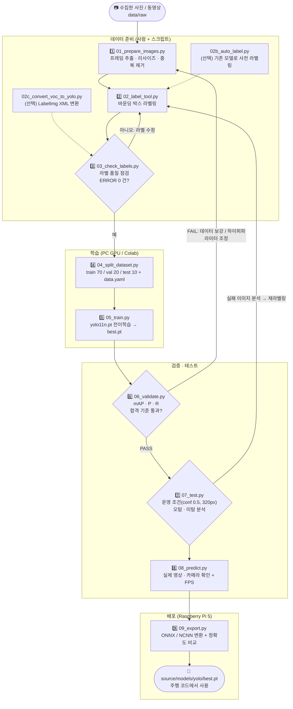
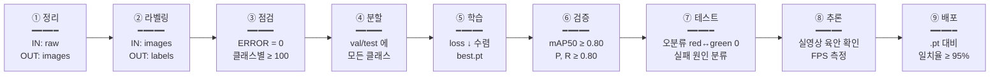
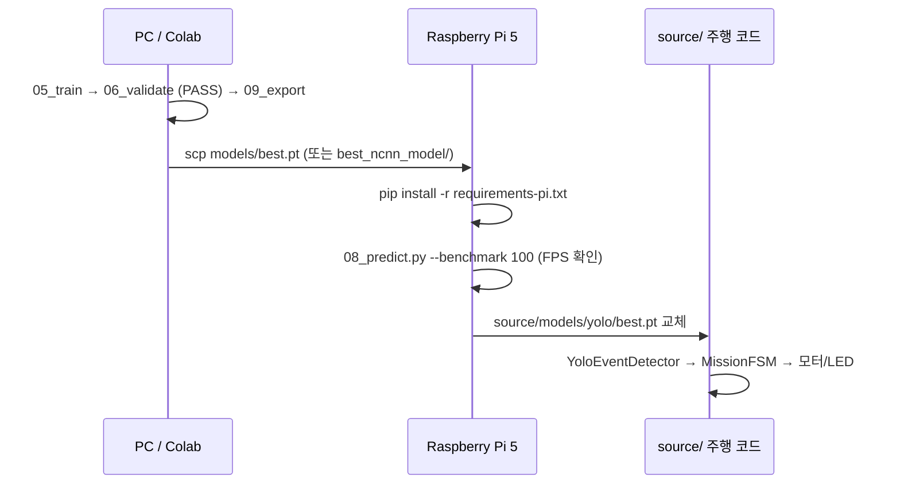
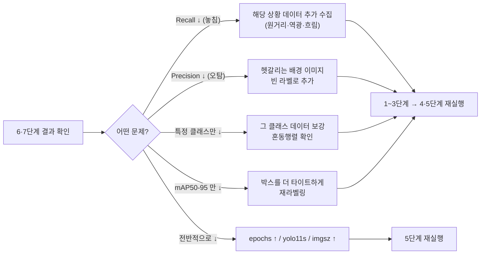

# YOLO11 학습 파이프라인 — 라벨링 → 학습 → 검증 → 테스트 → 배포

> Raspbot V2 자율주행용 객체 인식 모델(`car`, `green`, `oo`, `red`, `xx`)을
> **수집한 데이터에서 시작해 라즈베리파이에 올릴 모델까지** 만드는 전체 과정을 Python 스크립트로 정리했습니다.
> 모든 단계는 `config.yaml` 하나로 설정하고, 각 단계는 **입력 → 처리 → 출력 → 점검**이 명확하게 나뉩니다.

| 문서 | 내용 |
|---|---|
| **README.md** (이 문서) | 전체 순서도, 단계도, 설치, 단계별 명령어, 폴더 구조 |
| [docs/01_라벨링_가이드.md](docs/01_라벨링_가이드.md) | 라벨링 규칙, 클래스 정의, 도구 사용법, YOLO 포맷 |
| [docs/02_검증_테스트_가이드.md](docs/02_검증_테스트_가이드.md) | 지표 해석(mAP·P·R), 합격 기준, 실패 원인 분석·개선 루프 |
| 🎬 [docs/video/YOLO11_학습_튜토리얼.mp4](docs/video/YOLO11_학습_튜토리얼.mp4) | 9단계 전체를 설명하는 학습 영상 (자연스러운 한국어 나레이션 · 장면별 일러스트 · 전환 효과, 자막은 `docs/video/자막/`) |
| 📱 [docs/video/shorts/](docs/video/shorts/) | **세로 쇼츠 5편** (각 약 1분, 한국어 나레이션) — ① YOLO 원리 ② Haar vs YOLO 실전 실험 ③ 왜 YOLO11 ④ 라벨링→학습 실습 ⑤ 채점 원리·로봇 동작 |

> 🔬 **Haar Cascade vs YOLO11 직접 비교 실험** — `04_cascade` 의 실제 카메라 데이터와 학습된 Haar 검출기를 그대로 사용합니다.
>
> ```bash
> python tools/haar_vs_yolo_experiment.py
> ```
>
> 쇼츠 다시 만들기: `python tools/capture_video_assets_v2.py` → `python tools/make_shorts.py`
> (대본 `tools/shorts_script.py`, 나레이션은 Higgsfield 음성 캐시 `demo/shorts/audio/` 가 없으면 macOS 음성으로 대체)

> 🎬 **학습 영상 다시 만들기** — 데모 결과(`python run_pipeline.py --demo`)가 있어야 하며, macOS 의 한국어 음성(Yuna)과 ffmpeg 를 사용합니다.
>
> ```bash
> python tools/make_tutorial_video_v2.py
> ```
>
> (원본 스타일은 `tools/make_tutorial_video.py`. v2 는 Higgsfield 음성 캐시 `demo/tutorial_v2/audio/` 와 일러스트 `demo/tutorial_v2/illust/` 를 사용하고, 없으면 macOS 음성으로 대체)

---

## 1. 전체 동작 순서도



### 텍스트 버전 (Mermaid 가 보이지 않는 환경용)

```
 data/raw (사진·동영상)
      │
 [1] 01_prepare_images.py ─── 프레임 추출 / 리사이즈 / 중복 제거 ──▶ data/labeled/images
      │
 [2] 02_label_tool.py ─────── 박스 그리기 (YOLO txt) ─────────────▶ data/labeled/labels
      │      ▲  (선택) 02b_auto_label.py  사전 라벨링
      │      │  (선택) 02c_convert_voc_to_yolo.py  XML 변환
 [3] 03_check_labels.py ───── 라벨 오류 / 분포 점검 ─────────────▶ reports/label_check.md
      │      └─ ERROR 있으면 [2] 로
 [4] 04_split_dataset.py ──── train/val/test 분할 ────────────────▶ datasets/raspbot/data.yaml
      │
 [5] 05_train.py ──────────── YOLO11 전이학습 ─────────────────────▶ models/best.pt
      │
 [6] 06_validate.py ───────── mAP/P/R + 합격판정 ─────────────────▶ reports/validate_*.md
      │      └─ FAIL 이면 [1]~[5] 개선 루프
 [7] 07_test.py ───────────── 운영조건 이미지별 오류 분석 ─────────▶ reports/test_test.md, test_failures/
      │
 [8] 08_predict.py ────────── 동영상/카메라 추론, FPS ─────────────▶ runs/predict/
      │
 [9] 09_export.py ─────────── ONNX/NCNN 변환 + 일치율 검증 ────────▶ models/best_ncnn_model/
      │
 Raspberry Pi: source/models/yolo/ 로 복사 → 주행
```

---

## 2. 단계도 (Stage Gate) — 각 단계의 입력·출력·통과 조건



| 단계 | 스크립트 | 입력 | 출력 | 통과 조건 (다음 단계로 가기 전 확인) | 사람/자동 |
|---|---|---|---|---|---|
| 1 정리 | `01_prepare_images.py` | `data/raw/` 사진·동영상 | `data/labeled/images/*.jpg` | 흐린 사진·중복 제거됨, 다양한 조명/거리/각도 포함 | 자동 |
| 2 라벨링 | `02_label_tool.py` | 이미지 | `data/labeled/labels/*.txt` | 모든 이미지 검토 완료(빈 라벨 = 배경) | **사람** |
| 3 점검 | `03_check_labels.py` | images + labels | `reports/label_check.md`, `label_preview/` | ERROR 0, 클래스별 박스 ≥ 100 권장, 미리보기 육안 확인 | 자동 + 육안 |
| 4 분할 | `04_split_dataset.py` | 라벨 완료 이미지 | `datasets/raspbot/{images,labels}/{train,val,test}`, `data.yaml` | val·test 에 모든 클래스 존재 | 자동 |
| 5 학습 | `05_train.py` | `data.yaml`, `yolo11n.pt` | `runs/train/.../best.pt` → `models/best.pt` | `results.png` 에서 loss 감소·mAP 상승 후 수렴 | 자동 |
| 6 검증 | `06_validate.py` | best.pt + val/test | `reports/validate_{val,test}.md/json` | `config.yaml` 의 thresholds 모두 통과 (PASS) | 자동 판정 |
| 7 테스트 | `07_test.py` | best.pt + test, 운영 설정 | `reports/test_test.md`, `test_failures/` | 치명적 오분류(red↔green) 없음, 실패 원인 파악 | 자동 + 분석 |
| 8 추론 | `08_predict.py` | 새 영상 / 카메라 | `runs/predict/<시각>/` | 실제 주행 영상에서 육안 확인, 목표 FPS | 육안 |
| 9 배포 | `09_export.py` | best.pt | `models/best.onnx`, `models/best_ncnn_model/` | 변환 모델 결과 일치율 ≥ 95% | 자동 |

---

## 3. 폴더 구조

```
09_yolo11_pipeline/
├── README.md                    ← 이 문서 (순서도 · 단계도)
├── config.yaml                  ← ★ 모든 설정 (클래스, 경로, 학습/검증 파라미터, 합격 기준)
├── config.demo.yaml             ← 가상 데이터 데모용 설정
├── requirements.txt             ← PC / Colab 학습용 pip 패키지
├── requirements-pi.txt          ← 라즈베리파이 추론용 pip 패키지
├── run_pipeline.py              ← 3~9단계 일괄 실행기
├── scripts/
│   ├── common.py                ← 공통 함수 (설정, 라벨 I/O, IoU, 그리기)
│   ├── 01_prepare_images.py     ← [1] 수집 데이터 정리
│   ├── 02_label_tool.py         ← [2] OpenCV 라벨링 도구
│   ├── 02b_auto_label.py        ← [2] (선택) 기존 모델로 사전 라벨링
│   ├── 02c_convert_voc_to_yolo.py ← [2] (선택) VOC XML → YOLO
│   ├── 03_check_labels.py       ← [3] 라벨 품질 점검
│   ├── 04_split_dataset.py      ← [4] train/val/test 분할 + data.yaml
│   ├── 05_train.py              ← [5] 학습
│   ├── 06_validate.py           ← [6] 검증 (mAP, 합격 판정)
│   ├── 07_test.py               ← [7] 운영 조건 테스트 (오류 분석)
│   ├── 08_predict.py            ← [8] 이미지/동영상/카메라 추론 + 벤치마크
│   └── 09_export.py             ← [9] ONNX/NCNN 변환 + 검증
├── tools/
│   ├── make_demo_dataset.py     ← 가상 데이터 생성 (파이프라인 체험용)
│   ├── make_tutorial_video.py   ← 학습 영상 생성 (나레이션 + 자막 + 애니메이션)
│   ├── make_tutorial_video_v2.py ← 개선판 (일러스트 인트로·배경, 전환 효과, 자연스러운 나레이션)
│   ├── haar_vs_yolo_experiment.py ← Haar vs YOLO11 같은 데이터 비교 실험
│   ├── capture_video_assets_v2.py ← 쇼츠용 실제 실행 결과 수집 (NMS·특징맵·라벨툴·카메라)
│   ├── shorts_script.py         ← 쇼츠 5편 대본
│   └── make_shorts.py           ← 세로 쇼츠 렌더러 (1080x1920)
├── docs/
│   ├── 01_라벨링_가이드.md
│   ├── 02_검증_테스트_가이드.md
│   └── video/                   ← YOLO11_학습_튜토리얼.mp4, shorts/ (세로 쇼츠 5편), 자막/ (.srt)
│
│   ── 아래는 실행하면 생성됨 (.gitignore) ──
├── data/raw/                    ← [입력] 수집 원본
├── data/labeled/images|labels/  ← 라벨링 작업 폴더
├── datasets/raspbot/            ← 분할된 학습 데이터셋 + data.yaml
├── runs/train|val|predict/      ← Ultralytics 결과 (그래프, 가중치)
├── reports/                     ← 점검·검증·테스트 리포트
└── models/best.pt               ← 최종 모델 (+ best.onnx, best_ncnn_model/)
```

---

## 4. 설치

```bash
cd 09_yolo11_pipeline
```

```bash
python3 -m venv .venv
```

```bash
source .venv/bin/activate
```

```bash
pip install --prefer-binary -r requirements.txt
```

> `--prefer-binary` 는 미리 빌드된 패키지(휠)를 우선 받게 합니다. 이 옵션이 없으면 최신 `opencv-python` 의 휠이 아직 없는 OS/파이썬에서
> pip 가 OpenCV 를 소스에서 직접 컴파일하느라 수십 분간 멈춘 것처럼 보일 수 있습니다.

설치 확인:

```bash
python -c "import ultralytics, torch; print(ultralytics.__version__, torch.__version__, 'CUDA:', torch.cuda.is_available())"
```

- **Windows** 는 `source .venv/bin/activate` 대신 `.venv\Scripts\activate`
- **NVIDIA GPU** 가 있으면 [pytorch.org](https://pytorch.org/get-started/locally/) 에서 CUDA 버전용 torch 를 먼저 설치하세요. (CPU 학습은 매우 느림)
- **Apple Silicon Mac** 에서 `device: auto` 는 CPU 를 사용합니다. Mac GPU(MPS)는 `--device mps` 로 직접 지정할 수 있지만,
  PyTorch·macOS 버전 조합에 따라 학습 시작 직후 프로세스가 강제 종료될 수 있습니다 (예: macOS 14 + torch 2.15).
  그때는 CPU 로 학습하거나, 큰 데이터는 Colab GPU 를 쓰세요.
- **Google Colab**: 폴더를 업로드 후 `!pip install -r requirements.txt` → 아래 명령을 `!python ...` 로 실행. 런타임 유형을 GPU 로 설정하세요.
- 모든 명령은 **`09_yolo11_pipeline/` 폴더에서** 실행합니다 (`yolo11n.pt` 도 이 폴더에 자동 다운로드됨).

---

## 5. 빠른 체험 — 가상 데이터로 전체 흐름 확인 (약 3~5분)

실제 데이터가 없어도 파이프라인이 끝까지 도는지 먼저 확인할 수 있습니다.
가상 도형 이미지 240장을 만들고 3→9단계를 자동 실행합니다. (결과는 `demo/` 폴더에만 저장)

```bash
python run_pipeline.py --demo
```

---

## 6. 단계별 실행 방법

### 1단계 — 수집 데이터 정리

수집한 사진·동영상을 `data/raw/` 에 넣습니다. (하위 폴더 OK — 폴더 이름이 '촬영 세션'으로 쓰임)

```bash
python scripts/01_prepare_images.py
```

- 동영상은 `video_every_n`(기본 10) 프레임마다 1장 추출 → `<동영상이름>_<프레임번호>.jpg`
- dHash 로 거의 같은 이미지 제거 (정지 상태에서 찍힌 연속 프레임 등)
- 긴 변 1280px 초과 시 축소, 160px 미만은 제외

### 2단계 — 라벨링

```bash
python scripts/02_label_tool.py
```

| 키 / 마우스 | 동작 |
|---|---|
| 왼쪽 드래그 | 현재 클래스로 박스 그리기 |
| 오른쪽 클릭 | 박스 삭제 |
| `0`~`9` | 클래스 선택 (박스를 클릭해 선택한 상태면 그 박스의 클래스 변경) |
| `d` / `Space` | 저장 후 다음 이미지 (객체가 없으면 빈 라벨 = 배경으로 저장) |
| `a` | 이전 이미지 |
| `f` | 아직 라벨 안 된 다음 이미지로 |
| `u` / `c` | 마지막 박스 취소 / 전체 지우기 |
| `q` / `ESC` | 저장 후 종료 |

이미 학습된 모델이 있으면 **사전 라벨링 → 사람이 수정**하는 방식이 훨씬 빠릅니다.

```bash
python scripts/02b_auto_label.py --weights ../source/models/yolo/best.pt
```

다른 도구(LabelImg, Label Studio, Roboflow, CVAT)를 써도 됩니다.
**YOLO 포맷**으로 export 해서 `data/labeled/images`, `data/labeled/labels` 에 넣으면 됩니다.
LabelImg 를 PascalVOC(XML)로 저장했다면:

```bash
python scripts/02c_convert_voc_to_yolo.py --xml-dir data/labeled/xml
```

→ 자세한 라벨링 규칙: [docs/01_라벨링_가이드.md](docs/01_라벨링_가이드.md)

### 3단계 — 라벨 품질 점검

```bash
python scripts/03_check_labels.py
```

- `reports/label_check.md` : 클래스 분포, ERROR/WARN 목록
- `reports/label_preview/` : 박스를 그린 샘플 → **반드시 눈으로 확인**
- 좌표가 살짝 벗어난 박스 등은 `--fix` 로 자동 정리 가능

### 4단계 — 데이터셋 분할

```bash
python scripts/04_split_dataset.py
```

- 라벨 txt 가 있는 이미지만 사용 (미검토 이미지는 제외)
- `group_by_prefix: true` → 같은 동영상의 프레임은 같은 split 으로 (데이터 누수 방지)
- 생성된 `datasets/raspbot/data.yaml`:

```yaml
path: /.../09_yolo11_pipeline/datasets/raspbot
train: images/train
val: images/val
test: images/test
nc: 5
names: {0: car, 1: green, 2: oo, 3: red, 4: xx}
```

### 5단계 — 학습

```bash
python scripts/05_train.py
```

옵션 예시 (config 값을 덮어씀):

```bash
python scripts/05_train.py --epochs 50 --batch 8 --model yolo11s.pt
```

중단된 학습 이어서 하기:

```bash
python scripts/05_train.py --resume
```

학습이 끝나면 `runs/train/raspbot_yolo11/` 에서 확인:

| 파일 | 확인 포인트 |
|---|---|
| `results.png` | train/val loss 가 함께 내려가는지 (val loss 만 다시 오르면 과적합) |
| `labels.jpg` | 클래스 분포, 박스 위치·크기 분포 |
| `confusion_matrix_normalized.png` | 어떤 클래스끼리 헷갈리는지 |
| `val_batch0_pred.jpg` | 예측 결과 샘플 |
| `weights/best.pt` | 최종 모델 → `models/best.pt` 로 자동 복사됨 |

### 6단계 — 검증 (합격 판정)

```bash
python scripts/06_validate.py
```

최종 시험 (학습·튜닝에 한 번도 안 쓴 test 데이터 — **마지막에 한 번만**):

```bash
python scripts/06_validate.py --split test
```

출력 예시:

```
  클래스            P       R      F1   mAP50  mAP50-95
  car           0.962   0.981   0.971   0.990     0.812
  green         0.951   0.990   0.970   0.989     0.744
  ...
  ── 합격 기준 ──
  ✅ map50              0.988  (기준 ≥ 0.8)
  ✅ map50_95           0.769  (기준 ≥ 0.5)
  최종 판정: PASS ✅
```

### 7단계 — 운영 조건 테스트 (오류 분석)

```bash
python scripts/07_test.py
```

- 로봇과 동일한 `conf=0.5`, `imgsz=320` 으로 test 이미지를 추론해 정답과 1:1 비교
- 클래스별 TP / FP(오탐) / FN(미탐), **오분류 쌍**(예: red→green), 지연시간
- `reports/test_failures/` : 틀린 이미지 (초록=정답, 빨강=예측) → 원인 분석

### 8단계 — 실제 영상 / 카메라 추론

```bash
python scripts/08_predict.py --source data/raw/drive_test.mp4
```

```bash
python scripts/08_predict.py --source 0 --show
```

라즈베리파이 속도 측정 (화면 없이):

```bash
python scripts/08_predict.py --benchmark 100
```

### 9단계 — 배포용 변환

```bash
python scripts/09_export.py
```

- `models/best.onnx`, `models/best_ncnn_model/` 생성
- 변환 모델과 원본 `.pt` 의 탐지 결과 일치율, 속도를 `reports/export_check.md` 로 비교

### 일괄 실행 (라벨링 완료 후)

```bash
python run_pipeline.py
```

```bash
python run_pipeline.py --from train --to validate
```

---

## 7. Raspberry Pi 배포 & 기존 주행 코드 연결



1. PC → 라즈베리파이 복사 (예시):

```bash
scp models/best.pt pi@raspberrypi.local:~/Raspbot-v2-self-driving-car/source/models/yolo/best.pt
```

2. 주행 코드의 설정 `source/configs/*.yaml` 의 `perception.yolo` 항목:

```yaml
perception:
  yolo:
    model: models/yolo/best.pt     # NCNN 사용 시: models/yolo/best_ncnn_model
    imgsz: 320                      # 7단계 테스트와 같은 값
    conf: 0.5
```

3. **클래스 이름·순서를 바꿨다면** 주행 코드의 `min_area_ratio` 등 클래스 이름 기반 설정도 함께 수정하세요.
4. 기존 모델을 덮어쓰기 전에 `best_v1.pt` 처럼 백업해 두면 문제가 생겼을 때 되돌리기 쉽습니다.

---

## 8. 개선 루프 (모델이 기준에 못 미칠 때)



> ⚠ **test 데이터는 '최종 시험지'** 입니다. test 점수를 보고 계속 튜닝하면 test 에 과적합됩니다.
> 튜닝은 val 로 하고, test 는 최종 확인용으로만 쓰세요. 데이터를 추가했다면 4단계부터 다시 실행합니다.

자세한 지표 해석과 원인 분석: [docs/02_검증_테스트_가이드.md](docs/02_검증_테스트_가이드.md)

---

## 9. 트러블슈팅

| 증상 | 원인 / 해결 |
|---|---|
| `No module named 'ultralytics'` | 가상환경 활성화 확인 → `pip install -r requirements.txt` |
| `CUDA out of memory` | `--batch 8` (또는 4), `--imgsz 480` |
| 학습이 매우 느림 | `device` 가 `cpu` 인지 확인. GPU/Colab 사용 권장 |
| Mac 에서 `--device mps` 시 `NSInvalidArgumentException ... MPSNDArray` 후 종료 | PyTorch 가 이 macOS 에 없는 MPS 기능을 호출한 것 → `--device cpu` (기본값 auto) 로 실행하거나 macOS 업데이트 |
| `labels/*.cache` 관련 경고 | 4단계를 다시 실행하면 캐시 삭제 후 재생성 |
| mAP 가 0 에 가까움 | 라벨 class_id 와 `config.yaml` 클래스 순서 불일치 → 3단계 미리보기 확인 |
| 라벨링 도구 창이 안 뜸 (Pi SSH) | 화면 없는 환경. PC 에서 라벨링하거나 VNC 사용 |
| `--show` 시 `cannot connect to X server` | 헤드리스 환경 → `--show` 빼고 실행 (결과는 파일로 저장) |
| NCNN 변환 실패 | `pip install ncnn` 후 재실행 (또는 `--formats onnx`) |
| 라즈베리파이에서 FPS 낮음 | NCNN 모델 사용, `imgsz 320`, 추론을 별도 스레드로 (source/raspbot/perception/yolo_async.py 참고) |
