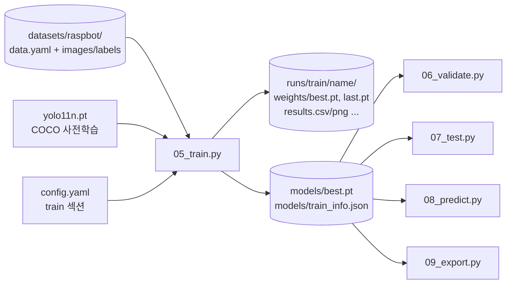
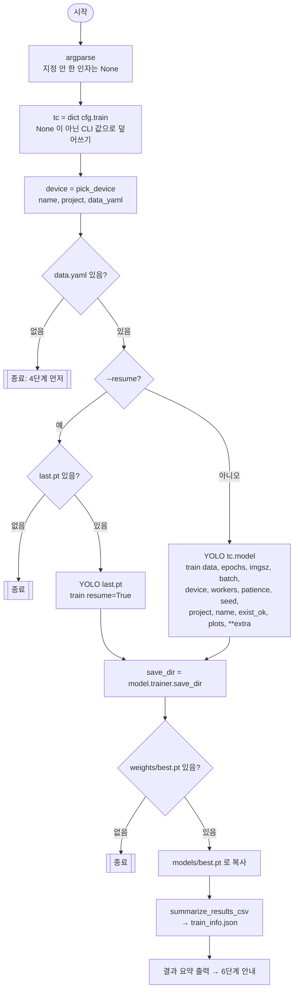

# 05_train.py 구조 분석 — YOLO11 전이학습

> 파이프라인 **5단계**. COCO 로 사전학습된 `yolo11n.pt` 에서 출발해 우리 데이터셋(`data.yaml`)으로
> 미세조정(fine-tuning)하고, 가장 좋은 가중치를 `models/best.pt` 로 정리합니다.
> 실제 학습 엔진은 Ultralytics 이고, 이 스크립트는 **설정 병합 · 실행 · 결과 정리**를 담당하는 래퍼입니다.

---

## 1. 한눈에 보기

| 항목 | 내용 |
|---|---|
| 실행 | `python scripts/05_train.py [--model M] [--epochs N] [--imgsz S] [--batch B] [--device D] [--name X] [--resume]` |
| 입력 | `datasets/raspbot/data.yaml` (4단계 결과), 시작 가중치 (`yolo11n.pt` 등) |
| 출력 | `runs/train/<name>/` (가중치·그래프·로그), `models/best.pt`, `models/train_info.json` |
| 설정 | `config.yaml` 의 `train:` 섹션 (+ `train.extra` 증강 인자) |
| 이전 단계 | `04_split_dataset.py` |
| 다음 단계 | `06_validate.py` (mAP 합격 판정) |



---

## 2. 코드 구성

```
05_train.py
├── summarize_results_csv(csv_path)   results.csv → best/last epoch 지표 요약
└── main()
    ├── 1) 인자 파싱 + config.train 병합 (CLI > config)
    ├── 2) device / 출력 경로 결정
    ├── 3) data.yaml 존재 확인
    ├── 4) 학습 (--resume 분기)
    ├── 5) best.pt → models/best.pt 복사
    ├── 6) train_info.json 기록
    └── 7) 콘솔 요약 출력
```

---

## 3. 실행 흐름



---

## 4. 핵심 로직 상세

### 4.1 설정 병합 — "CLI > config"

```python
tc = dict(cfg["train"])                          # 원본을 건드리지 않게 복사
for k in ("model", "epochs", "imgsz", "batch", "device"):
    if getattr(args, k) is not None:             # 사용자가 CLI 로 준 값만
        tc[k] = getattr(args, k)
```

- argparse 기본값을 `None` 으로 두어 "사용자가 지정했는지"를 구분합니다.
- 덮어쓸 수 있는 키: `model, epochs, imgsz, batch, device`. 나머지(`workers, patience, seed, extra`)는 config 에서만 변경.

| 값 | config.yaml 기본 | CLI 예 |
|---|---|---|
| model | `yolo11n.pt` | `--model yolo11s.pt` |
| epochs | 100 | `--epochs 50` |
| imgsz | 640 | `--imgsz 320` |
| batch | 16 | `--batch 8` |
| device | `auto` | `--device cpu` / `0` / `mps` |

### 4.2 디바이스 선택 — `pick_device()` (common.py)

| 입력 | 결과 |
|---|---|
| `auto` / 빈 값 | CUDA 가 있으면 `"0"`, 없으면 `"cpu"` |
| 그 외 (`cpu`, `0`, `mps` ...) | 그대로 사용 |

Apple **MPS 는 자동 선택하지 않습니다.** PyTorch·macOS 조합에 따라 MPS 학습이 파이썬 예외 없이
프로세스째 종료되는 경우가 있어, 필요하면 `--device mps` 로 직접 지정하도록 설계되어 있습니다.

### 4.3 전이학습 (새 학습)

```python
model = YOLO(tc["model"])        # 'yolo11n.pt' → 없으면 자동 다운로드
model.train(data=..., epochs=..., ..., **(tc.get("extra") or {}))
```

- **전이학습**: COCO(80 클래스)로 배운 특징 추출기(backbone)를 재사용하고, 탐지 헤드는 `data.yaml` 의
  `nc=5` 에 맞게 새로 구성되어 학습됩니다. 적은 데이터로도 빠르게 수렴하는 이유입니다.
- 주요 학습 인자

| 인자 | 의미 | 조절 팁 |
|---|---|---|
| `epochs` | 전체 데이터 반복 횟수 | 성능이 계속 오르면 ↑ |
| `imgsz` | 학습 입력 크기 | 작은 객체가 많으면 640 유지, 운영(320)과 차이 확인은 7단계에서 |
| `batch` | 배치 크기 | GPU 메모리 부족 시 8 또는 `-1`(자동) |
| `patience` | 개선 없을 때 조기 종료까지 epoch 수 | 기본 30 |
| `seed` | 난수 시드 | 재현성 |
| `exist_ok=True` | 같은 이름 폴더 재사용 | `name2`, `name3` 처럼 폴더가 늘어나지 않음 (대신 덮어씀) |
| `plots=True` | 그래프 저장 | `results.png`, `confusion_matrix.png` 등 |

- `train.extra` (증강) — config 값이 그대로 `train()` 에 전달됩니다.

| 키 | 값 | 의미 |
|---|---|---|
| `hsv_h / hsv_s / hsv_v` | 0.015 / 0.7 / 0.4 | 색상·채도·밝기 무작위 변화 (조명 변화 대응) |
| `degrees` | 5.0 | ±5° 회전 |
| `translate` | 0.1 | ±10% 이동 |
| `scale` | 0.5 | ±50% 크기 변화 (거리 변화 대응) |
| `fliplr` | **0.0** | 좌우 반전 끔 — 좌/우 의미가 있는 표지판·신호에 안전 |
| `mosaic` | 1.0 | 4장 합성 증강 |
| `close_mosaic` | 10 | 마지막 10 epoch 는 mosaic 끔 (실제 분포에 맞춰 마무리) |

### 4.4 이어서 학습 (`--resume`)

```python
last = project / name / "weights" / "last.pt"
YOLO(str(last)).train(resume=True)
```

- `last.pt` 안에는 가중치뿐 아니라 **epoch 위치, optimizer 상태, 원래 학습 인자**가 저장되어 있어
  `resume=True` 하나로 중단 지점부터 이어집니다.
- 따라서 resume 시에는 `--epochs`, `--batch` 등 **CLI/config 값이 무시**됩니다 (원래 설정 유지).
- 다른 이름으로 학습했다면 `--name` 을 같이 줘야 해당 `last.pt` 를 찾습니다.

### 4.5 결과 정리

```python
save_dir = Path(model.trainer.save_dir)     # 실제로 결과가 저장된 폴더
shutil.copy2(save_dir/"weights"/"best.pt", models_dir/"best.pt")
```

- 경로를 직접 조립하지 않고 `trainer.save_dir` 를 쓰는 이유: resume 이나 Ultralytics 내부 규칙에 따라
  폴더명이 달라져도 정확한 위치를 얻기 위함.
- `models/best.pt` 는 6~9단계의 **기본 모델 경로**(`common.default_weights`)입니다.

### 4.6 `summarize_results_csv()` — 학습 로그 요약

Ultralytics 는 epoch 마다 `results.csv` 에 한 줄씩 기록합니다.

```
epoch, train/box_loss, ..., metrics/precision(B), metrics/recall(B), metrics/mAP50(B), metrics/mAP50-95(B), ...
```

| 단계 | 처리 |
|---|---|
| 읽기 | `csv.DictReader` + 키/값 `strip()` (버전에 따라 공백 패딩이 있음) |
| best | `metrics/mAP50-95(B)` 가 최대인 행 |
| last | 마지막 행 |
| 반환 | `{"best": {...}, "last": {...}, "epochs_run": N}` — 파일이 없으면 `{}` |

`(B)` 는 Box(탐지) 지표라는 뜻입니다 (세그멘테이션이면 `(M)` 도 생김).

### 4.7 `models/train_info.json` 예시

```json
{
  "trained_at": "2026-11-24T11:05:00",
  "duration_min": 42.3,
  "run_dir": ".../runs/train/raspbot_yolo11",
  "base_model": "yolo11n.pt",
  "device": "0",
  "classes": ["car", "green", "oo", "red", "xx"],
  "params": {"epochs": 100, "imgsz": 640, "batch": 16},
  "results": {
    "best": {"epoch": 87, "precision": 0.93, "recall": 0.90, "mAP50": 0.95, "mAP50-95": 0.71},
    "last": {"epoch": 100, "...": "..."},
    "epochs_run": 100
  }
}
```

(숫자는 형식 예시입니다.) 나중에 "이 모델이 어떤 데이터·설정으로 만들어졌는지" 추적할 때 사용합니다.

---

## 5. 학습 결과물 읽는 법

| 파일 (`runs/train/<name>/`) | 확인할 것 |
|---|---|
| `results.png` | train/val **loss 가 함께 감소**하는지, mAP 가 증가 후 수렴하는지 |
| `confusion_matrix.png` | 어떤 클래스끼리 헷갈리는지 (예: `red ↔ green`), background 로 놓치는 비율 |
| `labels.jpg` | 클래스 분포·박스 위치/크기 분포 (데이터 편향 확인) |
| `val_batch*_pred.jpg` | 실제 예측 결과 샘플 |
| `weights/best.pt` | val 성능이 가장 좋았던 가중치 → `models/best.pt` 로 복사됨 |
| `weights/last.pt` | 마지막 epoch → `--resume` 에 사용 |

| 증상 | 의심 원인 | 대응 |
|---|---|---|
| train loss ↓, val loss ↑ | 과적합 | 데이터 추가, 증강 강화, epochs ↓ (patience 가 자동으로 멈춤) |
| 둘 다 높게 정체 | 모델 용량/데이터 부족 | `yolo11s.pt`, epochs ↑, 라벨 품질 점검 |
| 특정 클래스만 낮음 | 해당 클래스 데이터 부족 | 3단계 리포트의 클래스 분포 확인 후 보강 |

---

## 6. 주의점

| # | 내용 | 대응 |
|---|---|---|
| 1 | `exist_ok=True` 라서 **같은 `--name` 으로 다시 학습하면 이전 결과 폴더를 덮어씀** | 비교하고 싶으면 `--name exp2` 처럼 이름을 바꿔 실행 |
| 2 | `models/best.pt`, `train_info.json` 도 매번 덮어씀 (버전 관리 없음) | 좋은 모델은 별도 이름으로 백업 |
| 3 | 요약의 "best epoch" 는 mAP50-95 최대 기준이지만, Ultralytics 의 `best.pt` 는 내부 fitness(mAP50·mAP50-95 가중 조합, 버전에 따라 다름) 기준 | 두 epoch 가 드물게 다를 수 있음 — 최종 성능은 6단계 결과를 기준으로 판단 |
| 4 | `--resume` 시 CLI 인자(epochs 등) 무시 | 설정을 바꾸려면 새 학습으로 시작 (`--model runs/.../last.pt`) |
| 5 | MPS 자동 선택 안 함 | Mac 에서 GPU 를 쓰려면 `--device mps` (불안정하면 cpu) |
| 6 | 학습 imgsz(640) ≠ 운영 imgsz(320) | 7단계에서 운영 조건으로 다시 테스트하는 이유 |

---

## 7. 연관 파일

| 파일 | 관계 |
|---|---|
| `common.py` | `load_config`, `path_of`, `data_yaml_path`, `pick_device`, `banner` |
| `04_split_dataset.py` | `data.yaml` 과 train/val/test 폴더를 생성 |
| `06_validate.py` | `models/best.pt` 를 mAP 기준으로 합격/불합격 판정 |
| `config.yaml` `train:` | 학습 파라미터와 증강 설정 |
| `docs/02_검증_테스트_가이드.md` | 지표 해석과 개선 루프 |
