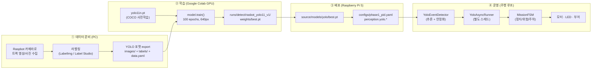
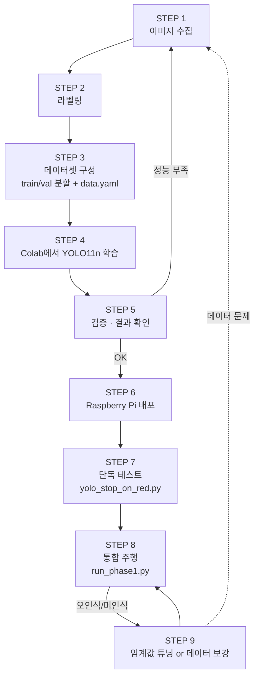
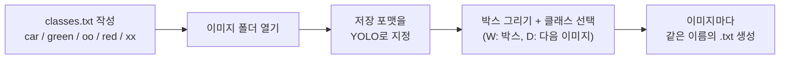
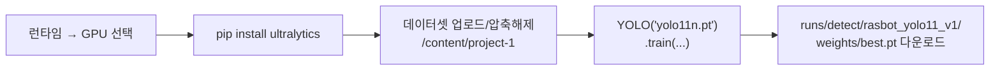
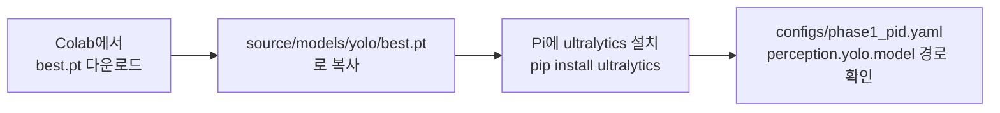
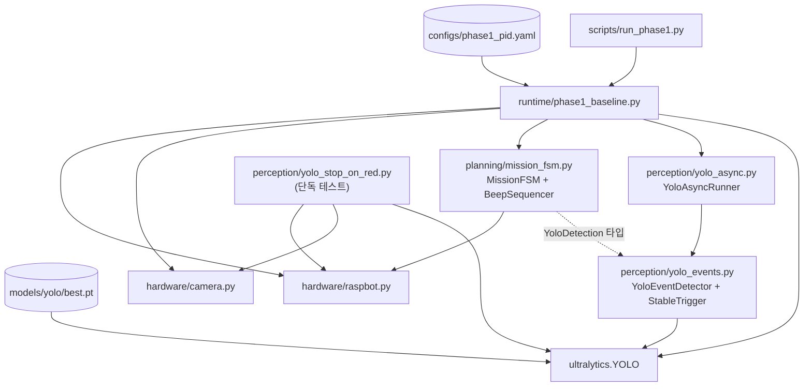
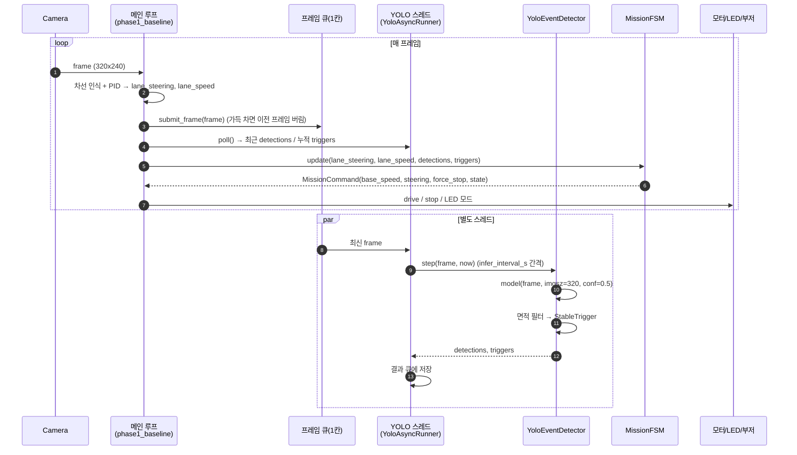
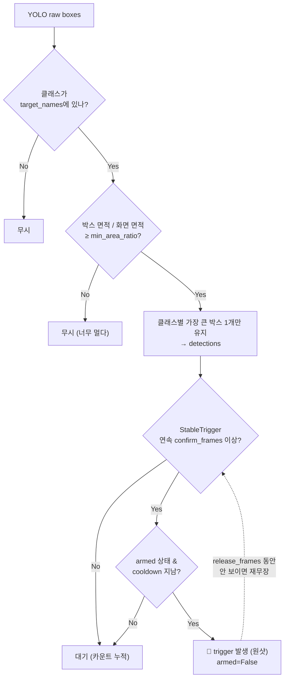
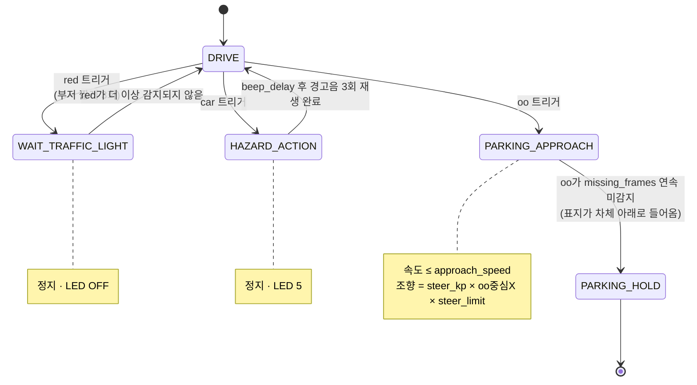
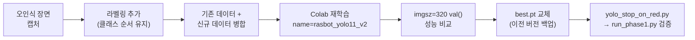

# YOLO11 학습 데이터 제작 · 모델 학습 · 운영 가이드 (Raspbot V2)

> 이 문서는 `source/` 프로젝트에서 사용하는 객체 인식 모델(`models/yolo/best.pt`)이
> **어떤 데이터로, 어떤 과정을 거쳐 만들어졌고, 어떤 Python 소스로 주행 중에 운영되는지**를 단계별로 정리합니다.

---

## 0. 한눈에 보기

| 항목 | 내용 |
|---|---|
| 모델 | **YOLO11n** (Ultralytics, 사전학습 가중치 `yolo11n.pt`에서 전이학습) |
| 결과 파일 | `models/yolo/best.pt` (5.5 MB) |
| 클래스 (5개) | `0: car` · `1: green` · `2: oo` · `3: red` · `4: xx` |
| 학습 환경 | Google Colab (GPU), Ultralytics **8.3.239**, 학습일 2025‑12‑17 |
| 학습 설정 | `epochs=100`, `batch=16`, `imgsz=640`, `name=rasbot_yolo11_v1` |
| 학습 시간 | 약 44분 (100 epoch, epoch당 약 26초) |
| 최종 성능 (best) | Precision **0.957** · Recall **0.986** · mAP50 **0.988** · mAP50‑95 **0.769** |
| 운영 환경 | Raspberry Pi 5 + USB 카메라 (320×240), 추론 `imgsz=320`, `conf=0.5` |

> **참고 — 버전 표기**
> `Readme.md`와 `docs/README_technical.md`에는 "YOLOv8n"으로 적혀 있지만,
> `best.pt` 체크포인트 메타데이터를 확인하면 실제 구조는 **`yolo11n.yaml` (YOLO11 Nano)** 입니다.
> Ultralytics 패키지(`from ultralytics import YOLO`)는 v8/11 모두 같은 API를 쓰므로 운영 코드는 그대로 동작합니다.

---

## 1. 전체 구조도



텍스트로 요약하면:

```
[카메라 수집] → [라벨링] → [YOLO 데이터셋] → [Colab 학습] → [best.pt]
                                                                │
          ┌─────────────────────────────────────────────────────┘
          ▼
[Raspberry Pi] run_phase1.py → phase1_baseline.py
                                  ├─ 차선 인식(HSV/Lab) + PID ─┐
                                  └─ YOLO(비동기) → 이벤트 ────┼→ MissionFSM → 모터/LED/부저
```

---

## 2. 클래스 정의 — 무엇을 인식하는가

| ID | 클래스 | 트랙 위 대상 | 주행 중 행동 (`mission_fsm.py`) | `min_area_ratio` |
|---|---|---|---|---|
| 0 | `car` | 장애물(차량 모형) | `HAZARD_ACTION` → 정지 + 경고음 3회 후 주행 재개 | 0.030 |
| 1 | `green` | 초록 신호등 | 직접 트리거 없음 (빨간불이 사라지면 출발) | 0.001 |
| 2 | `oo` | 주차 목표 표지(O) | `PARKING_APPROACH` → 표지 중심으로 조향하며 저속 접근 → `PARKING_HOLD` | 0.020 |
| 3 | `red` | 빨간 신호등 | `WAIT_TRAFFIC_LIGHT` → 정지, 빨간불이 안 보이면 `DRIVE` 복귀 | 0.001 |
| 4 | `xx` | 주차 금지 표지(X) | 인식·시각화만 수행 (FSM 행동 없음) | 0.015 |

> ⚠️ 클래스 **ID 순서**(`car, green, oo, red, xx`)는 라벨 파일·`data.yaml`·운영 코드가 모두 같아야 합니다.
> 운영 코드는 이름(소문자)으로 비교하므로 **클래스 이름 철자**가 바뀌면 이벤트가 동작하지 않습니다.

---

## 3. 단계도 — 학습 데이터 만들기부터 운영까지



---

### STEP 1. 이미지 수집

**목표:** 실제 주행 환경(트랙 조명, 카메라 높이·각도, 320×240 해상도)과 같은 조건의 사진을 모읍니다.

수집 원칙

- 로봇에 장착된 **같은 카메라, 같은 서보 각도**(`servo_defaults: [87, 20]`)로 촬영
- 클래스별로 **거리(멀리/가까이), 위치(좌/중앙/우), 조명(밝음/그늘)** 을 골고루
- 대상이 없는 **배경 이미지**도 일부 포함 → 오탐(false positive) 감소
- 주행 영상을 녹화한 뒤 프레임을 잘라내는 방법이 가장 효율적

수집용 예시 스크립트 (프로젝트에 포함된 파일은 아니며, 같은 `Camera` HAL을 재사용하는 예시입니다):

```python
# tools/collect_images.py  (예시)
import time, sys
from pathlib import Path
import cv2

PROJECT_ROOT = Path(__file__).resolve().parents[1]
sys.path.insert(0, str(PROJECT_ROOT))
from raspbot.hardware.camera import Camera, CameraConfig

out_dir = PROJECT_ROOT / "dataset_raw"
out_dir.mkdir(exist_ok=True)

cam = Camera(CameraConfig(index=0, resolution=(320, 240)))
print("SPACE: 저장, q: 종료")
try:
    while True:
        frame = cam.read()
        cv2.imshow("collect", frame)
        key = cv2.waitKey(1) & 0xFF
        if key == ord(" "):
            path = out_dir / f"img_{time.strftime('%Y%m%d_%H%M%S')}_{int(time.time()*1000)%1000:03d}.jpg"
            cv2.imwrite(str(path), frame)
            print("saved", path.name)
        elif key == ord("q"):
            break
finally:
    cam.release()
    cv2.destroyAllWindows()
```

---

### STEP 2. 라벨링 (Bounding Box)

도구: **LabelImg** (저장소 `05_yolo/labelImg-master`, 가이드 `05_yolo/docs/labelimg.md`) 또는 **Label Studio**



YOLO 라벨 파일 형식 (`img_0001.txt`, 한 줄 = 객체 1개, 좌표는 0~1 정규화):

```
<class_id> <x_center> <y_center> <width> <height>
3 0.512500 0.287500 0.081250 0.191667     ← red 신호등
0 0.468750 0.645833 0.237500 0.233333     ← car 장애물
```

라벨링 팁

- 신호등은 **켜진 램프 부분**만 박스로 잡을지, 신호등 전체를 잡을지 **한 가지 규칙으로 통일**
- 화면 가장자리에 잘린 객체도 보이는 부분까지 라벨링
- `red`/`green`처럼 색만 다른 클래스는 조명 변화가 큰 샘플을 충분히 넣기

---

### STEP 3. 데이터셋 구성

학습 시 사용된 경로가 `/content/project-1/data.yaml` 인 것으로 보아, 라벨링 도구에서 YOLO 포맷으로 내보낸
`project-1` 폴더를 Colab에 업로드해 학습한 것으로 보입니다. 표준 구조는 다음과 같습니다.

```
project-1/
├── data.yaml
├── train/
│   ├── images/   *.jpg
│   └── labels/   *.txt
└── valid/
    ├── images/
    └── labels/
```

`data.yaml`:

```yaml
path: /content/project-1
train: train/images
val: valid/images

nc: 5
names: ["car", "green", "oo", "red", "xx"]
```

train/val 분할 예시 스크립트 (8:2):

```python
# tools/split_dataset.py  (예시)
import random, shutil
from pathlib import Path

src = Path("dataset_raw")          # *.jpg + *.txt 가 함께 있는 폴더
dst = Path("project-1")
images = sorted(src.glob("*.jpg"))
random.seed(0); random.shuffle(images)
n_val = int(len(images) * 0.2)

for i, img in enumerate(images):
    split = "valid" if i < n_val else "train"
    for sub in ("images", "labels"):
        (dst / split / sub).mkdir(parents=True, exist_ok=True)
    shutil.copy(img, dst / split / "images" / img.name)
    lbl = img.with_suffix(".txt")
    if lbl.exists():                       # 배경 이미지는 라벨 없음
        shutil.copy(lbl, dst / split / "labels" / lbl.name)
```

---

### STEP 4. Google Colab에서 YOLO11n 학습



`best.pt`에 저장된 실제 학습 인자를 그대로 재현한 코드입니다.

```python
# Colab 셀
!pip install -q ultralytics==8.3.239

from ultralytics import YOLO

model = YOLO("yolo11n.pt")          # COCO 사전학습 Nano 모델 → 전이학습
results = model.train(
    data="/content/project-1/data.yaml",
    epochs=100,
    batch=16,
    imgsz=640,
    patience=100,
    optimizer="auto",
    name="rasbot_yolo11_v1",
    seed=0,
    # 아래는 기본값 그대로 사용된 증강 설정
    hsv_h=0.015, hsv_s=0.7, hsv_v=0.4,   # 색상/채도/밝기 변화
    translate=0.1, scale=0.5,            # 이동/확대축소
    fliplr=0.5,                          # 좌우 반전
    mosaic=1.0, close_mosaic=10,         # 모자이크(마지막 10 epoch 비활성)
)
```

주요 하이퍼파라미터

| 인자 | 값 | 의미 |
|---|---|---|
| `model` | `yolo11n.pt` | 가장 가벼운 Nano 모델 → Raspberry Pi CPU 실시간 추론용 |
| `epochs` | 100 | 전체 데이터 반복 횟수 |
| `batch` | 16 | 한 번에 학습하는 이미지 수 |
| `imgsz` | 640 | 학습 입력 크기 (운영은 320으로 축소해 속도 확보) |
| `lr0` / `lrf` | 0.01 / 0.01 | 초기 학습률 / 최종 비율 (`optimizer=auto`가 실제 학습률 자동 결정) |
| `hsv_v` | 0.4 | 밝기 변화 증강 → 조명 변화에 강건 |
| `fliplr` | 0.5 | 좌우 반전 50% |
| `flipud` | 0.0 | 상하 반전 없음 (신호등 위/아래 구조 보존) |

> 💡 `hsv_h=0.015`로 색상(Hue) 변화가 작게 설정되어 있어 `red`/`green` 구분이 깨지지 않습니다.
> 색으로 구분하는 클래스가 있을 때는 `hsv_h`를 크게 올리지 않는 것이 안전합니다.

---

### STEP 5. 검증 · 학습 결과

학습 곡선 요약 (`best.pt` 내부 `train_results`에서 발췌):

| Epoch | Precision | Recall | mAP50 | mAP50‑95 | 비고 |
|---|---|---|---|---|---|
| 1 | 1.000 | 0.052 | 0.731 | 0.488 | 초기 |
| 10 | 0.945 | 0.965 | 0.985 | 0.703 | 빠르게 수렴 |
| 25 | 0.956 | 0.978 | 0.982 | 0.730 | |
| 50 | 0.973 | 0.960 | 0.986 | 0.738 | |
| 75 | 0.959 | 0.980 | 0.990 | 0.747 | |
| **95** | **0.957** | **0.986** | **0.988** | **0.769** | **best.pt 저장 시점** |
| 100 | 0.960 | 0.985 | 0.992 | 0.760 | 마지막 |

```
mAP50-95
0.77 ┤                                                    ●(95, best)
0.74 ┤                         ●──────●─────────●────────╯
0.70 ┤          ●─────●───────╯
0.63 ┤     ●───╯
0.49 ┤ ●──╯
     └──┬────┬─────┬────────┬────────────┬─────────────┬──→ epoch
        1    5     10       25           50     75     95 100
```

해석

- **mAP50 ≈ 0.99**: 대상을 "찾는" 능력은 거의 완벽
- **mAP50‑95 ≈ 0.77**: 박스 위치 정밀도도 양호 (Nano 모델 기준 좋은 편)
- 10 epoch 이후 큰 향상이 없으므로, 더 좋은 성능이 필요하면 **epoch 증가보다 데이터 다양성 보강**이 효과적

검증 / 이미지 테스트 코드:

```python
from ultralytics import YOLO
model = YOLO("runs/detect/rasbot_yolo11_v1/weights/best.pt")

metrics = model.val(data="/content/project-1/data.yaml", imgsz=320)  # 운영 해상도로도 검증
print(metrics.box.map50, metrics.box.map)

model.predict("/content/project-1/valid/images", imgsz=320, conf=0.5, save=True)
```

> ✅ 학습은 640px로 했지만 Pi에서는 320px로 추론합니다. 배포 전에 **`imgsz=320`으로 `val()`** 을 한 번 돌려
> 작은 해상도에서도 성능이 유지되는지 확인하는 것을 권장합니다.

---

### STEP 6. Raspberry Pi 배포



`configs/phase1_pid.yaml`의 YOLO 설정:

```yaml
perception:
  yolo:
    enabled: true
    model: models/yolo/best.pt   # 상대경로 → source/ 기준으로 해석
    imgsz: 320                   # 추론 입력 크기 (학습 640 → 운영 320)
    conf: 0.5                    # 신뢰도 임계값
    infer_interval_s: 0.01       # 추론 최소 간격 (0이면 가능한 매 프레임)
    confirm_frames: 2            # 연속 N프레임 감지 시 이벤트 확정
    car_cooldown_s: 2.0          # car 이벤트 재발생 대기 시간
    min_area_ratio:              # 화면 대비 박스 최소 면적 (멀리 있는 대상 무시)
      red: 0.001
      green: 0.001
      oo: 0.020
      xx: 0.015
      car: 0.030
```

---

## 4. 운영 — 어떤 Python 소스가 모델을 사용하는가

### 4-1. 소스 구조도

```
source/
├── scripts/run_phase1.py              ← 실행 엔트리
├── configs/phase1_pid.yaml            ← YOLO 설정(perception.yolo)
├── models/yolo/best.pt                ← 학습된 YOLO11n 모델
└── raspbot/
    ├── runtime/phase1_baseline.py     ← 통합 루프: 모델 로드 · 프레임 전달 · 결과 적용
    ├── perception/
    │   ├── yolo_events.py             ← [핵심] 추론 + 이벤트 안정화 (YoloEventDetector, StableTrigger)
    │   ├── yolo_async.py              ← [핵심] 추론 전용 스레드 (YoloAsyncRunner)
    │   └── yolo_stop_on_red.py        ← YOLO 단독 테스트 (빨간불 감지 시 정지)
    ├── planning/mission_fsm.py        ← 이벤트 → 미션 행동 (MissionFSM, BeepSequencer)
    └── hardware/
        ├── camera.py                  ← 카메라 입력
        └── raspbot.py                 ← 모터/LED/부저 출력
```

모듈 의존 관계:



### 4-2. 각 소스의 역할

| 파일 | 주요 클래스/함수 | 역할 |
|---|---|---|
| `runtime/phase1_baseline.py` | `main()` | YAML 로드 → `YOLO(best.pt)` 생성 → `YoloEventDetector` / `YoloAsyncRunner` / `MissionFSM` 구성 → 매 프레임 `submit_frame()` · `poll()` · `mission_fsm.update()` 호출, 박스 시각화, 슬라이더로 `min_area_ratio`·추론 주기 실시간 조정 |
| `perception/yolo_events.py` | `YoloEventDetector.step()` | `model(frame, imgsz, conf)`로 추론 → 대상 클래스 필터 → 면적 비율 필터 → 클래스별 가장 큰 박스 1개 선택 → `YoloDetection`(중심 좌표 −1~1 정규화 포함) 생성 |
| | `StableTrigger.update()` | **연속 N프레임 확인(confirm) + 쿨다운 + 원샷(arm/release)** 으로 깜빡임을 걸러 이벤트를 1회만 발생 |
| `perception/yolo_async.py` | `YoloAsyncRunner` | 크기 1짜리 프레임 큐(항상 최신 프레임만 유지) + 결과 큐, 데몬 스레드에서 추론 → 메인 제어 루프가 추론을 기다리지 않음 |
| `planning/mission_fsm.py` | `MissionFSM.update()` | 이벤트(`triggers`)와 현재 감지(`detections`)로 상태 전이, 차선 PID 출력(속도·조향)을 **override** |
| | `BeepSequencer` | `sleep` 없이 루프 틱마다 진행되는 부저 패턴 재생 |
| `perception/yolo_stop_on_red.py` | `main()` | 모델만 따로 검증하는 테스트 도구: 직진하다 `red` 감지 시 정지, 모델 클래스 목록 출력 |

### 4-3. 실행 시퀀스 (메인 스레드 ↔ YOLO 스레드)



### 4-4. 인식 결과 → 이벤트 변환 단계도 (`yolo_events.py`)



### 4-5. 미션 FSM 상태도 (`mission_fsm.py`)



트리거 우선순위: `red` > `car` > `oo` (같은 프레임에 여러 개가 발생하면 위에서부터 처리)

---

## 5. 실행 방법

```bash
# 1) 패키지 설치 (Raspberry Pi)
pip install ultralytics opencv-python numpy pyyaml
```

```bash
# 2) 모델 단독 테스트: 빨간불 감지 시 정지 (모터 없이 확인하려면 --mock)
python3 raspbot/perception/yolo_stop_on_red.py --imgsz 320 --conf 0.5 --mock
```

```bash
# 3) 통합 주행 (차선 + YOLO + 미션 FSM)
python3 scripts/run_phase1.py --config configs/phase1_pid.yaml
```

```bash
# 4) 하드웨어 없이 PC에서 확인
python3 scripts/run_phase1.py --mock-hw
```

실행 시 OpenCV 창

- `phase1/frame` — ROI + YOLO 박스 오버레이 (임계 면적 이상이면 **노란색** 박스)
- `phase1/yolo` — 클래스별 `yolo_area_*_x1000` 슬라이더, `yolo_interval_ms` 슬라이더

---

## 6. 튜닝 · 문제 해결

| 증상 | 확인/조치 |
|---|---|
| 너무 멀리 있는 신호등에 반응해 일찍 멈춤 | `min_area_ratio.red` ↑ (슬라이더 `yolo_area_red_x1000`) |
| 장애물을 늦게 인식 | `min_area_ratio.car` ↓, `confirm_frames` ↓ |
| 한 번 지나간 장애물에 다시 반응 | `car_cooldown_s` ↑ |
| 깜빡이며 오탐 발생 | `conf` ↑ (0.5 → 0.6), `confirm_frames` ↑ |
| 조향이 끊기고 FPS 저하 | `infer_interval_s` ↑ (예: 0.1), `imgsz` 320 유지 |
| 특정 클래스 미인식 | `yolo_stop_on_red.py` 실행 시 출력되는 **클래스 목록**과 config 이름 비교 → 해당 조건 데이터 추가 수집 후 재학습 |
| `[WARN] YOLO 초기화 실패` | `ultralytics` 설치 여부, `models/yolo/best.pt` 경로 확인 (YOLO 없이 차선 주행만 계속됨) |

추가 최적화 (선택)

```python
# Pi CPU 추론 속도를 더 높이고 싶을 때: NCNN 포맷 변환
from ultralytics import YOLO
YOLO("models/yolo/best.pt").export(format="ncnn", imgsz=320)   # → best_ncnn_model/
# config의 model 경로를 models/yolo/best_ncnn_model 로 변경
```

---

## 7. 재학습 체크리스트



- [ ] `data.yaml`의 `names` 순서가 `car, green, oo, red, xx` 그대로인가
- [ ] 새 클래스를 추가했다면 `phase1_pid.yaml`의 `targets` / `min_area_ratio`, `phase1_baseline.py` 슬라이더, `mission_fsm.py` 전이 조건을 함께 수정했는가
- [ ] 운영 해상도(`imgsz=320`)에서 검증했는가
- [ ] 이전 `best.pt`를 백업했는가 (예: `best_v1.pt`)
